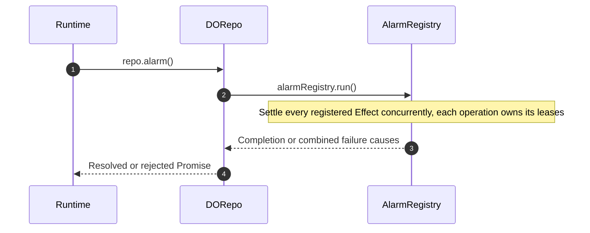
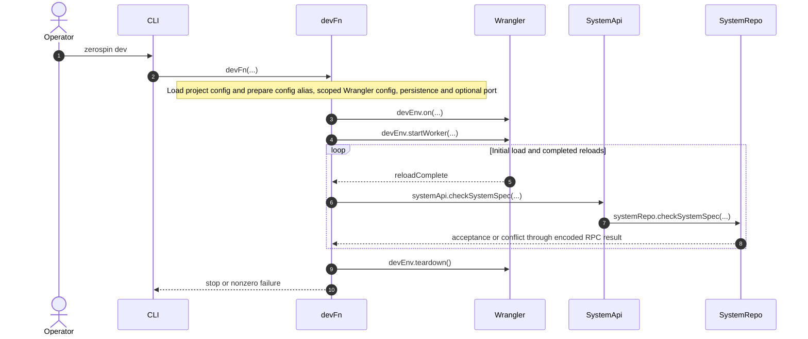

# Authored System and Static Worker

The root `zerospin.config.ts` imports an authored System and default-exports
`makeSystemConfig(system, { systemId })`. Configuration retains the live System capability
and its explicit deployment identity. Seed modules
are selected separately by the seed CLI's file-path argument.

- [`makeSystemConfig.ts`](../../packages/core/src/system/make/makeSystemConfig.ts) — synchronously validates configuration and retains the original authored System.
- [`types.ts`](../../packages/core/src/system/types.ts) — preserves the concrete System in the configuration type.
- [`zerospin.config.ts`](../../examples/shopping/zerospin.config.ts) — Shopping exports its configuration without importing seed commands.

The CLI imports the exact root module without invoking a typechecker. Worker
builds alias `config` directly to that root module and consume its default export;
the authored System is available as `config.system`.
Configuration imports belong to both Node and Worker module graphs. The seed CLI
imports its selected command module separately.

- [`makeWranglerConfig.ts`](../../packages/dev-worker/src/makeWranglerConfig.ts) — binds the direct `config` alias.
- [`loadZerospinConfigFn.ts`](../../packages/cli/src/deploy/loadZerospinConfigFn.ts) — loads TypeScript with project aliases and validates live capabilities.

Worker tsconfigs map `config` to the System Worker declaration for the injected application module. Worker builds resolve that module to the selected application configuration through Wrangler. There is no `config` workspace package.

## Generated backend configuration

`zerospin-${system.name}`, validates the resulting Worker name, and owns the
entrypoint, config alias, compatibility settings, static DO bindings, SQLite
exports, observability defaults, environment, and production version metadata.
Project configuration exposes `systemId`; it has no Wrangler overrides.

- [`makeWranglerConfig.ts`](../../packages/dev-worker/src/makeWranglerConfig.ts) — produces the common backend configuration.
- [`ZerospinConfigSchema.ts`](../../packages/core/src/system/ZerospinConfigSchema.ts) — validates the explicit system ID and live System.

Generated Wrangler configs live in unique directories under
`.wrangler/zerospin/`. CLI scopes and the test plugin dispose generated files;
local dev persistence remains in `dev-worker/<systemId>` under that same root.
loader. Deployment continues to load project keys separately and writes a
scoped mode-0600 secrets file.

- [`devFn.ts`](../../packages/cli/src/dev/devFn.ts) — preserves the selected system's persistence path and binds project-root local variables.
- [`deployWranglerFn.ts`](../../packages/cli/src/deploy/deployWranglerFn.ts) — generates production configuration and separate secrets with scoped cleanup.

Shopping owns its session hosting configuration, but has no backend Worker,
backend Wrangler files, or generated backend type declarations.

- [`vite.config.ts`](../../examples/shopping/vite.config.ts) — retains the app-owned session Wrangler configuration.
- [`tsconfig.json`](../../examples/shopping/tsconfig.json) — checks application sources without generated backend declarations.

`makeSystem` collects authored definitions in name-keyed, then version-keyed records without a root version. Each version key must equal its definition’s `version`. Aggregate,
service, contract, and model versions remain attached
to their definitions. Inspection serializes the executing bundle on demand.

- [`makeSystem.ts`](../../packages/core/src/system/make/makeSystem/makeSystem.ts) — Constructs the authored System without a root version.
- [`makeSystemSpec.ts`](../../packages/core/src/system/make/makeSystemSpec.ts) — Serializes the authored definitions and their individual versions.
- [`getSystemSpec.ts`](../../packages/system-worker/src/getSystemSpec/getSystemSpec.ts) — Generates and validates the inspection spec from the executing bundle.

## Persistence invariant

Command chains retain history under their `systemId`.
An aggregate definition owns one exact version and its AVR schema; an upgrade
creates an independent definition. Changing an existing Repo's physical schema
requires empty storage, without a schema-upgrade or compatibility path.

Each production Repo, including SystemRepo, provisions its current Drizzle schema
on first activation. The retained `_isBootstrapped` marker makes later cold
activations reopen that database without provisioning. SystemRepo has one explicit
exception: before common-base initialization it transactionally renames
`aggregateSpecLocks` / `serviceSpecLocks` to `lockedAggregateVersions` /
`lockedServiceVersions`, retaining rows and unique `(name, version)` indexes.
Repeated activation is a no-op after the rename. If both names for either kind
exist, activation fails and rolls back the entire migration.

- [`AggregateVersionRepo.ts`](../../packages/system-worker/src/AggregateVersionRepo/AggregateVersionRepo.ts) — Resolves the physical schema from the aggregateVersion carried in its name and declares its Repo type for common-base inspection registration.
- [`makeFixedDORepo.ts`](../../packages/system-worker/src/makeFixedDORepo/makeFixedDORepo.ts) — Skips provisioning for a marked database and supplies this policy to the common Repo base.
- [`SystemRepo.ts`](../../packages/system-worker/src/SystemRepo/SystemRepo.ts) — Uses the shared fixed-schema base while validating the exact configured singleton name.

SystemRepo retains immutable definitions in `lockedAggregateVersions` and
`lockedServiceVersions`, each with `name`, `version`, and `spec`. Their
logical identity is `{ systemId, kind, name, version }`: the configured/authenticated
system selects the singleton SystemRepo; the executing Worker's serialized
candidate supplies kind, name, and version. Acceptance compares all candidates
in one transaction and inserts new versions only if every existing lock matches.
Removed definitions retain their locks. Structural equality ignores object-key
order and preserves array order. Executable bodies and framework-owned physical schemas are outside this comparison.
Actor identities, identity descriptors, and selections are part of both aggregate and service specifications. `lockedAggregateActorVersions` and `lockedServiceActorVersions` retain actor definitions independently across owner versions and removal. Stored specs
are decoded with the JSON-column codecs. `assertAcceptedSpec` compares
JSON-compatible definitions with `JsonPatch.get(accepted, incoming)`; mismatches
retain their error code and include formatted patch JSON in the message and the
patch array in `extra.changes`.

- [`checkSystemSpec.ts`](../../packages/system-worker/src/SystemRepo/checkSystemSpec/checkSystemSpec.ts) — validates the candidate and atomically compares or inserts its definitions.
- [`systemRepoDbConfig.ts`](../../packages/system-worker/src/SystemRepo/systemRepoDbConfig.ts) — stores aggregate and service versions independently of registration.
- [`assertAcceptedSpec.ts`](../../packages/system-worker/src/SystemRepo/assertAcceptedSpec/assertAcceptedSpec.ts) — produces descriptive patch failures shared by acceptance and registration.
- [`ProcedureStepError.tsx`](../../packages/cli/src/ProcedureStep/ProcedureStepError.tsx) — renders the mismatch message and structured error details inline in the terminal.
- [`makeSystemSpec.ts`](../../packages/core/src/system/make/makeSystemSpec.ts) — defines the serialized aggregate/service fields.

Every fixed system Repo activation serializes its executing bundle and requests
`registerRepo({ registration, spec })` before accessing storage, provisioning,
bootstrap, or subscriptions. Registration requires existing matching locks;
it never accepts new definitions. A recorded instance remains known if later
initialization fails. SystemRepo is exempt from self-registration. Cold restarts
and alarms pass through the same guard. AVR initializes its execution head after
this guard and no longer stores an original spec in `head`.

AggregateChain supplies its aggregate name and validated ID from the parsed
physical key, whose `systemId` must match the configured system. Registration
atomically upserts its `repos` metadata and inserts one `aggregates` row per
name/ID pair in SystemRepo. Other Repo kinds do not create aggregate identities.
The owning SystemRepo provides system scope; aggregate version and actor identity
are not part of the aggregate row. Listing IDs and checking exact membership
query this table directly, independently of admission audit history.

- [`makeDORepo.ts`](../../packages/system-worker/src/makeDORepo/makeDORepo.ts) — guards the concurrency block before SQLite setup or marker reads.
- [`registerRepo.ts`](../../packages/system-worker/src/SystemRepo/registerRepo/registerRepo.ts) — checks accepted definitions before committing Repo metadata and aggregate identity together.
- [`getAggregateIds.ts`](../../packages/system-worker/src/SystemRepo/getAggregateIds/getAggregateIds.ts) — queries registered IDs by aggregate name in stable ID order.
- [`hasAggregate.ts`](../../packages/system-worker/src/SystemRepo/hasAggregate/hasAggregate.ts) — checks exact aggregate name/ID membership in the owning system.
- [`onDOActivation.ts`](../../packages/system-worker/src/AggregateVersionRepo/onDOActivation/onDOActivation.ts) — initializes the genesis execution head.

This is a hard cutover requiring fresh SystemRepo and affected AVR storage.
There is no adoption, fallback decoder, or translation migration for existing
physical databases. Shared or production state must be reset through a separate
explicitly approved operation.

- [`systemRepoDbConfig.ts`](../../packages/system-worker/src/SystemRepo/systemRepoDbConfig.ts) — adds required lock tables to the fixed physical schema.
- [`aggregateVersionRepoDbConfig.ts`](../../packages/system-worker/src/AggregateVersionRepo/aggregateVersionRepoDbConfig.ts) — removes the obsolete spec column from the fixed AVR schema.

## Repo lookup

Each Repo supplies a namespace binding name to its fixed or versioned factory and
inherits `getRepo({ key })` from the common base. The lookup is an Effect: it
formats the route key and resolves the namespace stub when run. Passing the
static directly to a queue preserves its captured binding and name contract.

- [`makeDORepo.ts`](../../packages/system-worker/src/makeDORepo/makeDORepo.ts) — Declares the namespace type map and implements the captured static lookup.

SystemRepo uses the configured system ID as its unprefixed name. Its constructor
validates singleton identity before common Repo initialization; obtaining a stub
alone does not validate that identity.

- [`SystemRepo.ts`](../../packages/system-worker/src/SystemRepo/SystemRepo.ts) — Checks the configured name and system-ID schema before calling the common constructor.

## Shared alarm dispatch

Each Repo inherits one alarm registry and alarm entrypoint from the common base.
Queue factories register lazy drain Effects during construction; registration
reads no storage and starts no work. Subscriptions are awaited during activation.
Cold construction rebuilds these registrations before the activation gate opens.



## Annotated workflow steps

1. Cloudflare delivers the inherited alarm after activation completes. A registered custom superclass alarm preserves its own initialization and hook.
   - [`makeDORepo.ts`](../../packages/system-worker/src/makeDORepo/makeDORepo.ts) — Creates the registry before derived fields and registers a bound custom superclass alarm when present.
2. The base dispatches every registered operation, even when no in-memory leases survived a cold activation. Drains read durable progress; subscriptions have already completed during activation.
   - [`makeFanoutQueue.ts`](../../packages/system-worker/src/makeFanoutQueue/makeFanoutQueue.ts) — Registers the internal serialized fanout drain without changing the public Promise-based drain.
   - [`makeOutboxQueue.ts`](../../packages/system-worker/src/makeOutboxQueue/makeOutboxQueue.ts) — Registers unbounded outbox recovery while retaining bounded explicit drains.
3. Dispatch captures each operation's full outcome without cancelling sibling operations, then combines failures. Hold and release continue to coordinate the shared scheduled wakeup.
   - [`makeAlarmRegistry.ts`](../../packages/system-worker/src/makeAlarmRegistry/makeAlarmRegistry.ts) — Maintains separate registrations and leases and combines failure causes after concurrent dispatch settles.
4. The inherited alarm resolves only after dispatch completes and rejects on failure without an RPC result envelope.
   - [`makeDORepo.ts`](../../packages/system-worker/src/makeDORepo/makeDORepo.ts) — Runs registry dispatch through the configured runtime with AsyncLive and propagates rejection.

## Deployed aggregate membership

AC binds `{ systemId, aggregateId, aggregateName }` from its physical name.
Activation reads the versions under `system.aggregates[aggregateName]` in the
executing bundle and reconciles its command destinations locally. Existing
cursors and failures survive reactivation; definitions absent from the bundle
become inactive. No System spec publication or subscription is involved.

- [`onDOActivation.ts`](../../packages/system-worker/src/AggregateChain/onDOActivation/onDOActivation.ts) — Retains the fanout alarm before atomically reconciling active destinations without resetting their progress.

## Recovery and inspection

AVR initializes its local execution head and recovers pending publication. AC reconciles the deployed aggregate versions as admitted-command destinations. Direct execution catches up through the requested admitted index.

- [`onDOActivation.ts`](../../packages/system-worker/src/AggregateVersionRepo/onDOActivation/onDOActivation.ts) — initializes retained execution state and recovers pending external work.
- [`execute.ts`](../../packages/system-worker/src/AggregateVersionRepo/execute/execute.ts) — catches up and returns retained terminal results.

Inspection reads explicit Repo registrations, including their retained table
names. Definition locks are retained separately from these registrations; inspection does not infer unactivated instances from locks.

- [`getRepoRegistrations.ts`](../../packages/system-worker/src/SystemRepo/getRepoRegistrations/getRepoRegistrations.ts) — Filters registered Repos by kind and decodes their table names.

## Authoring integrity

The authored definition graph is validated during construction. Each factory
strictly decodes its own input and snapshots the arrays and plain records it owns.
Definitions and their snapshots are not frozen at runtime; callers are responsible
for mutations after construction.
Functions, Effect Schemas, Drizzle objects, and canonical definitions remain
foreign keyentity-bearing leaves. Caller-owned containers stay mutable but are
detached from the returned definition.

`makeTable` constructs nominal `Table` instances, copies the shape descriptors and
index containers, resolves self references, and retains the owned data on the instance.
External tables, schema objects, and opaque defaults retain their identity;
`primitives.ref` rejects structural table objects.

- [`makeTable.ts`](../../packages/shapes/src/makeTable.ts) — constructs the table-owned graph after self-reference resolution.
- [`primitives.ts`](../../packages/shapes/src/primitives.ts) — checks the target is a Table instance before inspecting its primary key.
- [`IdentitySchema.ts`](../../packages/core/src/identity/make/makeActorIdentity/IdentitySchema/IdentitySchema.ts) — validates aggregate and service identity declarations and reversible selection patterns.
- [`makeModelVersion.ts`](../../packages/core/src/models/make/makeModelVersion.ts) — resolves the Model-owned table, then attaches owned descriptors, shapes, indexes, and the table object.
- [`makeModelVersion.ts`](../../packages/core/src/models/make/makeModelVersion.ts) — builds the serializable model spec.

The authoring factories produce canonical instances of
`Model`, `Contract`, `Service`, and `Aggregate`.
`makeSession` constructs a live session from direct configuration. Its internal
definition builders validate models and contracts and construct lock inputs. The `Service` and `Aggregate` constructors stay private to their factory modules.

- [`makeModelVersion.ts`](../../packages/core/src/models/make/makeModelVersion.ts) — constructs the canonical owned `Model`.
- [`makeSessionDefinition.ts`](../../packages/core/src/sessionDefinition/makeSessionDefinition.ts) — internally constructs and validates aggregate session definitions from plain constructor fields.
- [`makeServiceSessionDefinition.ts`](../../packages/core/src/serviceSession/make/makeServiceSessionDefinition.ts) — authors the service session definition without `systemName`.
- [`makeService.ts`](../../packages/core/src/service/make/makeService.ts) — keeps `Service` private while exposing its internal canonical-instance schema.
- [`makeAggregateVersion.ts`](../../packages/core/src/aggregate/make/makeAggregateVersion.ts) — keeps `Aggregate` private while exposing its internal canonical-instance schema.

`makeSession` accepts the aggregate or service identity, `sessionName`, selected models,
flat aggregate contracts, and identity schema together. Its internal definition retains
those selections and the bound system identity. Session specs serialize `sessionName`
and the selected `aggregateVersion` or `serviceVersion`. Specs and locks do not copy
`systemName`; that identity lives on the owning system spec, the session bind,
commands, and gateway request context. Model specs describe the exact selected
version without historical-definition arrays.

- [`types.ts`](../../packages/core/src/aggregateSession/types.ts) — defines the aggregate session definition.
- [`types.ts`](../../packages/core/src/serviceSession/types.ts) — defines the service session definition.
- [`makeSessionDefinition.ts`](../../packages/core/src/sessionDefinition/makeSessionDefinition.ts) — requires a nonempty aggregate version, a required string `aggregateId` claim, and flat contracts keyed by their command names.
- [`makeServiceSessionDefinition.ts`](../../packages/core/src/serviceSession/make/makeServiceSessionDefinition.ts) — requires a nonempty service version and authoritative models.
- [`makeAggregateSessionSpec.ts`](../../packages/core/src/aggregateSession/make/makeAggregateSessionSpec.ts) — serializes aggregate definition identity and builds aggregate lock fields from the definition alone.
- [`makeServiceSessionSpec.ts`](../../packages/core/src/serviceSession/make/makeServiceSessionSpec.ts) — serializes service definition identity and builds service lock fields from the definition alone.

`makeService` owns service actors, authoritative models, contracts, queries,
and its shared capability layer. `makeAggregateVersion` owns aggregate-local model, selection, guard,
service-pin, and command-construction checks. Each service actor’s optional `authorize` callback
receives `{ claims, sessionName, db }`, with `db` limited to model queries.
Omitting it allows access without an authored authorization check. Aggregate
definitions do not configure session bindings or adapters. Each constructs its decoded registries and
the query, selection, and capability containers it owns.
Neither factory takes `systemName` as an owner-level prop.

- [`makeService.ts`](../../packages/core/src/service/make/makeService.ts) — constructs the decoded service registries it owns.
- [`makeService.ts`](../../packages/core/src/service/make/makeService.ts) — constructs the canonical `Service`.
- [`makeAggregateVersion.ts`](../../packages/core/src/aggregate/make/makeAggregateVersion.ts) — constructs the decoded aggregate registries it owns.
- [`makeAggregateVersion.ts`](../../packages/core/src/aggregate/make/makeAggregateVersion.ts) — constructs the canonical `Aggregate`.
- [`authorizeAggregateSession.ts`](../../packages/system-worker/src/AggregateVersionRepo/authorizeAggregateSession/authorizeAggregateSession.ts) — skips omitted checks and runs supplied authorization against owner-local model queries.

Aggregate actor versions select callable contracts from their host's canonical declarations. Aggregate versions combine optional named `modules` with flat `models` and `contracts`, rejecting duplicate names. Contract model aliases are compared by their underlying model identities: mutation models must appear in the actor's database, and registered models must match the aggregate's canonical versions. Service and session registrations retain `{ contract }` bindings.

`updateAggregateActorVersion(previous, changes)` inherits omitted declaration fields and merges supplied `contracts`, `selections`, and `guards` by key. Supplied entries replace matching keys; an empty map preserves existing entries. Database, identity, and authorization overrides replace inherited values, and the complete merged declaration receives the same constructor validation.

Authored `selections` are native `actorDb.query.model.findMany(...)` queries. `makeActorDbVersion({ models })` pins the database graph without opening storage. `makeActorIdentity({ claims, actorPath })` derives identity codecs from the path and exposes typed `sql.placeholder(name)` inputs. The actor captures SQL, serializable bindings, and row mapping once at construction as `actor.capturedSelections`.

Contracts may declare a reusable claims schema and a shared synchronous `guard({ payload, claims, db })`. `prepareContractInput` applies payload defaults, projects decoded contract claims, and validates a recorded external response once per execution. Guards and programs require that prepared input and receive the same payload and claims, plus `response` for external contracts. Local staging and pending replay run the guard before the program; authoritative execution also rechecks the guard against the transaction database before applying operations. That recheck reuses the prepared input. Guard business failures use the executing contract's failure codec and explicit historical adapters.

`makeExternalContract` declares `external.request({ payload })` and its `external.response` codec. The producer records the request's returned value as immutable `response` before the synchronous continuation receives `{ payload, response }`. The contract's top-level `result` remains the continuation's return value. Recorded responses stay in full server history; browser sessions neither supply nor receive them.

Contract programs emit operations and return their separate typed result. Database queries observe the invocation state before those operations are applied. Session validation calculates without applying writes; staging and replay use local state, with replay using its active transaction. Aggregate and service materializers recalculate from their own state and commit each command before preparing the next. The client allocation is not retained as command intent.

Changing an actor's database requires rebuilding its selections against that definition. Selections have no independent identity or version; the actor version locks their compiled SQL and bindings along with model bindings.

`defineGuard({ name })` and `makeGuardVersion(identity, { version, payload, failure })` declare a typed capability. `.guard(payload)` requires that exact name/version; `.make(implementation)` supplies a layer and preserves its dependencies. Aggregate implementations override actor defaults, with actor fallback for other capabilities. Actor layers are scoped to an invocation; database and identity services bind to that invocation. Browser sessions supply their own layers.

`updateGuardVersion(previous, changes)` preserves the name and inherits omitted payload and failure codecs. Supplied codecs replace their predecessors. The new version requires its own guard implementation layer. Guard update helpers are available from the server and browser SDKs; actor factories are server-only.

- [`makeAggregateActorVersion.ts`](../../packages/core/src/aggregateActor/make/makeAggregateActorVersion/makeAggregateActorVersion.ts) — validates actor contract, selection, and identity composition.
- [`makeActorDbVersion.ts`](../../packages/core/src/models/make/makeActorDbVersion.ts) — constructs native relational queries and captures transaction-local execution.
- [`makeGuardVersion.ts`](../../packages/core/src/guards/makeGuardVersion.ts) — validates named guard inputs and failures and retains implementation dependencies.
- [`makeExternalContract.ts`](../../packages/core/src/contracts/make/makeExternalContract.ts) — declares the external request, response codec, and synchronous continuation.
- [`prepareContractInput.ts`](../../packages/core/src/contracts/prepareContractInput.ts) — prepares payload defaults, contract claims, and recorded response before guard or program execution.
- [`makeOperations.ts`](../../packages/core/src/contracts/make/makeOperations.ts) — consumes prepared input, runs the guard and program, and collects ordered operations with the typed result.

Declare a shared identity with `defineAggregate({ name: 'user' })`, which
returns `{ name }`. Construct each version with
`makeAggregateVersion(user, props)`; the version props do not repeat the name.

- [`defineAggregate.ts`](../../packages/core/src/aggregate/defineAggregate.ts) — validates and constructs the shared name identity.
- [`index.ts`](../../packages/sdk/src/index.ts) — explicitly exports server authoring functions.

Each aggregate owns one exact SemVer version. Its flat declarations and optional
`modules` contribute one effective inventory; duplicate declaration names are
errors, including duplicates that reference the same object.
`upgradeAggregateVersion(previous, props)` retains the aggregate name and builds
an independent version from complete declarations through the same composition
and validation path. Omitted collections are empty, not inherited; earlier
aggregate instances remain unchanged.
Services also own one exact version. Register older service definitions explicitly in `makeSystem`; service definitions and specs contain no `historicalDefinitions`.

- [`makeAggregateVersion.ts`](../../packages/core/src/aggregate/make/makeAggregateVersion.ts) — composes and validates independent aggregate versions.
- [`makeCommand.ts`](../../packages/core/src/makeCommand.ts) — exposes `makeCommand(service, { contractName, payload })` with the selected contract’s payload type and service metadata.
- [`makeSystemSpec.ts`](../../packages/core/src/system/make/makeSystemSpec.ts) — serializes each registered service definition without history arrays.
- [`makeCommand.ts`](../../packages/core/src/makeCommand.ts) — constructs typed commands from the selected contract binding and aggregate metadata.
- [`makeSystemSpec.ts`](../../packages/core/src/system/make/makeSystemSpec.ts) — serializes each aggregate's exact version without aggregate history.

Parent factories decode canonical owner instances. System assembly checks owner registry names and exclusive service-model ownership; aggregates have no inferred service pins. RPC, persistence, and session inputs retain their boundary validation.

- [`resolveSystemService.ts`](../../packages/core/src/system/make/makeSystem/resolveSystemService/resolveSystemService.ts) — checks service registry identity and model ownership.
- [`resolveSystemAggregate.ts`](../../packages/core/src/system/make/makeSystem/resolveSystemAggregate/resolveSystemAggregate.ts) — checks aggregate registry identity.

Contract programs receive `{ payload, models, claims }`. Guards receive
`db`. Browser execution uses the session's full claims; aggregate
execution preserves the admitted command's full claims, including actor
claims for trusted sessionless commands. Service programs receive `null`. The
claims are an invocation argument and does not belong in command payloads.

Aggregate contracts resolve only through the recorded actor name/version and that actor’s contract lineage. Explicit payload and failure adaptation remains supported within that lineage; another actor cannot supply a missing contract. Service and session registries contain `{ contract }`; guard callbacks belong to contracts.

`makeSystem({ layer })` supplies server capabilities through one managed `system.runtime`; aggregates, services, and actors do not own layers. `makeSession` supplies a separate browser session layer. The executing contract version supplies the shared state guard; historical payload adapters remain on contracts. These executable values are excluded from specs and locks.

Guards and programs read the invocation database through the query-only `db` interface, typed from declared models. Programs receive decoded
claims as an argument. Aggregate sessionless execution retains validated
actor claims. Service commands pass `null` claims. There is no execution tag map.

`system.runtime` lazily acquires capabilities once and reuses them across server calls. Its author layer must acquire synchronously because Durable Object construction uses `runSync`.
Admission validates payloads and claims without running state guards.

- [`makeSystem.ts`](../../packages/core/src/system/make/makeSystem/makeSystem.ts) — constructs the shared runtime with default and authored capabilities.

`makeSession({ layer, ... })` composes application services and framework defaults
into its own lazy `session.runtime`. It accepts models, contracts, owner and actor
versions, `sessionName`, claims schema, optional credentials schema, and `systemName` directly. The definition and
lock retain the system binding for gateway validation. Claims types come
from `claimsSchema` and optional `credentialsSchema`; `session.definition` exposes the validated configuration.
Local commands omit `systemName`; the worker stamps it on admitted commands.

Each live, standalone, or mock session owns its application-layer acquisitions.
Construction creates the runtime and stable store synchronously without acquiring
resources. Initialization composes the collector, logger, and tracer after application services, preserving authored loggers. It binds staging, guards, validation, and ID generation before publishing readiness. Decoded authenticated claims and their encoded identity are captured once per activation; each command receives its own encoded claims copy. Commands, guards, validation, and replay reuse the runtime services; command execution remains synchronous. Callers may run Effects through `session.runtime` directly.

`dispose()` immediately revokes command bindings, then stops session work, closes its resources, and disposes the runtime. It also releases services acquired directly before
initialization. A later initialization waits for cleanup and replaces the runtime
while preserving the session/store object. The getter retains the disposed runtime
until that replacement; captured old runtime references stay disposed. React
unmount/remount follows this same lifecycle. Competing owners are rejected
synchronously, and failed or canceled startup cleans up its partial acquisition.

`BrowserBackup` privately shares one lazy worker connection and backup-key claim
registry across live and standalone session runtimes. Its memo map is separate
from application layers. Disposing one session preserves other owners; the last
runtime release closes the connection. Saved backups survive disposal. Mock
sessions acquire neither backup infrastructure nor live transport. Standalone
`reset()` reseeds its backup under a fresh runtime.

- [`makeSessionLifecycle.ts`](../../packages/browser/src/makeSessionLifecycle.ts) — owns admission, cancellation, runtime replacement, and ordered teardown.
- [`BrowserBackup.ts`](../../packages/browser/src/BrowserBackup/BrowserBackup.ts) — shares only backup infrastructure and scopes key claims to sessions.
- [`makeSession.ts`](../../packages/browser/src/makeSession/makeSession.ts) — composes live aggregate/service sessions from a single layer.
- [`bindAggregateSession.ts`](../../packages/core/src/aggregateSession/bindAggregateSession.ts) — captures identity and installs complete command behavior before publishing initialized state.
- [`stageCommand.ts`](../../packages/core/src/aggregateSession/stageCommand/stageCommand.ts) — retains the synchronous typed public entrypoint for bound staging.

Server command batches acquire `makeSystem` application services and then the
selected aggregate or service layer before entering a synchronous transaction.
Programs yield model operations synchronously into a fresh runner-owned collector and return a value matching their optional `result` codec. Emission order is application order. A program may emit no operations. Without a result codec it returns void, retained as null. Server guards validate current state before those mutations are applied. Scoped resources close on success,
failure, or interruption, and the next batch acquires fresh instances. Acquisition
failure prevents transaction execution and remains retryable. Existing framework
runtimes remain at RPC entrypoints; Durable Object constructors acquire no
application layers. Authored rejection, savepoint rollback, and command ordering
retain their existing behavior.

- [`executeCommands.ts`](../../packages/system-worker/src/AggregateVersionRepo/executeCommands/executeCommands.ts) — acquires application services and aggregate capabilities outside the transaction.
- [`executeCommands.ts`](../../packages/system-worker/src/ServiceVersionRepo/executeCommands/executeCommands.ts) — acquires application and service capabilities per batch before transaction execution.

`runProgram` executes the program and its dependencies to a synchronous exit. Domain failures retain the normal failed command outcome; suspended work is interrupted before it can resume. Session staging commits without an asynchronous gap. AVR and SVR prepare and commit one command before starting the next program. AVR atomically commits owned operations and terminal history. Programs observe state before their emitted operations apply.

- [`runProgram.ts`](../../packages/core/src/execution/runProgram.ts) — preserves domain failures and rejects suspension.
- [`stageSessionCommandTx.ts`](../../packages/core/src/aggregateSession/stageCommand/stageSessionCommandTx/stageSessionCommandTx.ts) — commits pending command occurrences, resource changes, inverse operations, and sequence progress together.
- [`executeLocalSessionCommandTx.ts`](../../packages/core/src/aggregateSession/stageCommand/executeLocalSessionCommandTx/executeLocalSessionCommandTx.ts) — commits a locally completed occurrence without retaining pending optimism.
- [`checkAdmission.ts`](../../packages/system-worker/src/checkAdmission.ts) — validates the submitted payload and claims before materializer adaptation.

Aggregate staging returns the decoded command and typed local result after commit. The transaction constructs the encoded occurrence used by persistence and delivery. Staging failures are encoded and recognized once after rollback; unexpected precommit exceptions notify and rethrow. Delivery owns forking, receipts, uncertainty, and transport failure reporting, so a handoff failure preserves the successful local staging result.

The React application factory accepts authored sessions directly.
Configured name and system checks live in
[main-thread session bootstrap](./browser/bootstrapBrowserSession.md).

Factory-owned records are snapshots, while canonical Model,
Contract, definition, Service, and service-query leaves keep reference
identity. System assembly validates graph relationships and preserves the canonical `Service` and `Aggregate` definitions. Named
queries remain on their owning Service. Mutation after construction can invalidate validated decisions or diverge from
generated locks; owner factories do not generally enforce runtime immutability. Captured selection query definitions are normalized, cloned, and recursively frozen.

Models bind exact owner schemas. Contract operations use registered model identity; actor projections replay owned outputs from their version chain. Session locks serialize the selected model shapes without external-source metadata.

Downstream lookup-and-trust starts from the completed `ISystem`. Development
and deployment bind the root configuration module as the `config` module alias. The
Worker entrypoints export the direct Repo topology, while server query paths
look up the named service, aggregate, and query from that authored graph.

- [`devFn.ts`](../../packages/cli/src/dev/devFn.ts) — binds the root configuration module to the development Worker's `config` alias.
- [`deployWranglerFn.ts`](../../packages/cli/src/deploy/deployWranglerFn.ts) — binds the root configuration module to the production Worker's `config` alias.
- [`DevWorker.ts`](../../packages/dev-worker/src/DevWorker.ts) — exports the direct Repo topology and routes development requests.
- [`ProductionWorker.ts`](../../packages/production-worker/src/ProductionWorker.ts) — exports the production topology and applies production request checks.
- [`executeServiceQuery.ts`](../../packages/system-worker/src/ServiceVersionRepo/executeServiceQuery/executeServiceQuery.ts) — resolves the named service and query from `system.services` before execution.
- [`executeServiceQuery.ts`](../../packages/system-worker/src/executeServiceQuery/executeServiceQuery.ts) — resolves the requested service using the aggregate version's service pin for session calls and dispatches the named service query.

## Trigger: `zerospin dev`

1. The `dev` command parses `--clean` and `--port` and mounts the development step.
   - [`dev.tsx`](../../packages/cli/src/commands/dev.tsx) — passes both options to `DevStep`.
2. The development step runs `devFn(...)` under Node services; the Effect loads and validates the project configuration before starting Wrangler.
   - [`Dev.tsx`](../../packages/cli/src/dev/Dev.tsx) — supplies filesystem, path, and terminal services.
   - [`devFn.ts`](../../packages/cli/src/dev/devFn.ts) — obtains `systemId` from the loaded configuration.



## Annotated workflow steps

1. The operator supplies optional `--clean` and `--port`.
   - [`dev.tsx`](../../packages/cli/src/commands/dev.tsx) — starts the development step with these options.
2. The CLI runs `devFn` under Node filesystem, path, and terminal services.
   - [`Dev.tsx`](../../packages/cli/src/dev/Dev.tsx) — starts the scoped Effect and presents failures.
3. The programmatic environment comes from the consumer's resolved Wrangler package; reload, error, and teardown listeners are attached before startup.
   - [`devFn.ts`](../../packages/cli/src/dev/devFn.ts) — resolves `unstable_DevEnv` and queues events.
4. Startup binds the direct config alias, loopback address, port and system-scoped persistence path. Explicit `--clean` deletes only that local path.
   - [`devFn.ts`](../../packages/cli/src/dev/devFn.ts) — owns configuration generation, scoped deletion, and `startWorker` options.
5. Initial load and every completed reload queue a check after the proxy's update completes.
   - [`devFn.ts`](../../packages/cli/src/dev/devFn.ts) — consumes `reloadComplete` and waits for the proxy update mutex.
6. The CLI sends the existing empty argument tuple through Cap'n Web; it does not supply a candidate spec.
   - [`devFn.ts`](../../packages/cli/src/dev/devFn.ts) — opens the local authenticated SystemApi session and decodes acceptance.
7. The executing bundle generates the candidate and sends it to SystemRepo.
   - [`checkSystemSpec.ts`](../../packages/system-worker/src/SystemApi/checkSystemSpec/checkSystemSpec.ts) — uses the executing Worker's spec-generation path.
8. Only successful acceptance produces the accepted-ready message; conflicts retain their domain failure.
   - [`devFn.ts`](../../packages/cli/src/dev/devFn.ts) — displays readiness after decoding the check result.
9. Scope cleanup tears down Wrangler and removes generated configuration on success, failure, or interruption.
   - [`devFn.ts`](../../packages/cli/src/dev/devFn.ts) — registers environment, signal-handler, and generated-config finalizers.
10. An incompatible definition ends the CLI with status 1.
    - [`Dev.tsx`](../../packages/cli/src/dev/Dev.tsx) — reports terminal failure through the command step.

## Trigger: `zerospin deploy`

1. `deploy` directly mounts the Wrangler-backed deployment step.
   - [`deploy.tsx`](../../packages/cli/src/commands/deploy.tsx) — declares the default command path.
2. The step runs `deployWranglerFn()` under the required Node services.
   - [`DeployWrangler.tsx`](../../packages/cli/src/deploy/DeployWrangler.tsx) — invokes the production deployment Effect.

```mermaid
sequenceDiagram
  actor Operator
  participant deployWranglerFn
  participant Wrangler
  participant Forwarder as Local forwarding Worker
  participant SystemApi as SystemApi in B
  participant SystemRepo as SystemRepo in A
  autonumber 1
  Operator->>deployWranglerFn: zerospin deploy
  autonumber 2
  deployWranglerFn->>Wrangler: runWrangler(...)
  Note over Wrangler: Read current deployment and upload candidate B
  Note over Wrangler: Require incumbent A alone at 100%, then stage A100/B0
  autonumber 3
  deployWranglerFn->>Wrangler: runWrangler(...)
  autonumber 4
  deployWranglerFn->>Forwarder: devEnv.startWorker(...)
  autonumber 5
  deployWranglerFn->>SystemApi: systemApi.checkSystemSpec(...)
  Note over Forwarder,SystemApi: Remote service binding forwards normal HTTP with B override; verify executing-version response header
  autonumber 6
  SystemApi->>SystemRepo: systemRepo.checkSystemSpec(...)
  autonumber 7
  SystemRepo-->>deployWranglerFn: accepted or rejected through encoded RPC response
  alt accepted and staged deployment unchanged
    autonumber 8
    deployWranglerFn->>Wrangler: runWrangler(...)
    Note over Wrangler: Promote the same B version ID to 100%
    autonumber 9
    deployWranglerFn->>SystemApi: systemApi.initialize(...)
  else rejected or interrupted while this command still owns staging
    autonumber 10
    deployWranglerFn->>Wrangler: runWrangler(...)
    Note over Wrangler: Restore A alone at 100%; preserve any intervening deployment
  end
  autonumber 11
  deployWranglerFn->>Forwarder: devEnv.teardown()
  autonumber 12
  deployWranglerFn-->>Operator: Worker name and version ID, or failure and recovery details
```

## Annotated workflow steps

1. The production command loads project keys and config. Missing keys produce a key-generation result before deployment begins.
   - [`deployWranglerFn.ts`](../../packages/cli/src/deploy/deployWranglerFn.ts) — validates project input and prepares scoped mode-0600 config and secrets.
2. Wrangler JSON identifies the current deployment; only a successful empty result or the explicit missing-script error indicates a new Worker. Upload records supply B's version ID.
   - [`deployWranglerFn.ts`](../../packages/cli/src/deploy/deployWranglerFn.ts) — reads deployment JSON and structured upload output; rejects an incumbent split rollout.
3. After rechecking the active deployment, the CLI stages A at 100% and B at 0%, retaining deployment identity and a command-specific marker for recovery.
   - [`deployWranglerFn.ts`](../../packages/cli/src/deploy/deployWranglerFn.ts) — sends the stage command and records `version-deploy` output. With no incumbent, `wrangler deploy` creates guarded B at 100% first; its returned version and actual deployment are verified before acceptance.
4. A scoped local Worker binds the configured production Worker through a remote service binding. Wrangler handles account identity; no additional application Worker is deployed.
   - [`deployWranglerFn.ts`](../../packages/cli/src/deploy/deployWranglerFn.ts) — creates the distinct forwarding config and starts the project-resolved development environment.
5. The existing Cap'n Web client sends `args: []` and the project secret. The forwarder attaches B's override and rejects a missing or different version header after bounded propagation retries.
   - [`deployWranglerFn.ts`](../../packages/cli/src/deploy/deployWranglerFn.ts) — forwards cloned HTTP requests and validates the response before exposing RPC results.
   - [`ProductionWorker.ts`](../../packages/production-worker/src/ProductionWorker.ts) — adds `X-Zerospin-Worker-Version` from the version-metadata binding to HTTP RPC responses.
6. B serializes its own definitions; SystemRepo compares that supplied candidate even when its assigned Worker is A.
   - [`checkSystemSpec.ts`](../../packages/system-worker/src/SystemApi/checkSystemSpec/checkSystemSpec.ts) — generates B's spec at the public boundary and delegates atomic acceptance.
7. Spec acceptance is permanent. Newly accepted locks remain when promotion later fails; identical retries succeed.
   - [`checkSystemSpec.ts`](../../packages/system-worker/src/SystemRepo/checkSystemSpec/checkSystemSpec.ts) — commits additions without a deletion or rollback path.
8. Only verified acceptance and an unchanged staged deployment permit promotion of that same version ID.
   - [`deployWranglerFn.ts`](../../packages/cli/src/deploy/deployWranglerFn.ts) — rechecks deployment identity before `versions deploy B@100%`.
9. After promotion, the CLI waits until a checked response reports that SystemRepo itself executes B, then runs the existing health and initialization RPCs through the remote binding.
   - [`deployWranglerFn.ts`](../../packages/cli/src/deploy/deployWranglerFn.ts) — retries SystemRepo assignment within a bounded deadline, then awaits health and initialization before reporting success.
   - [`initialize.ts`](../../packages/system-worker/src/SystemRepo/initialize/initialize.ts) — awaits authored service-chain readiness; child activation still requires accepted definitions.
10. Failure cleanup restores A only while deployment identity/marker and A100/B0 still match this command. An intervening deployment is preserved; rollback failures report an explicit recovery command separately.
    - [`deployWranglerFn.ts`](../../packages/cli/src/deploy/deployWranglerFn.ts) — conditionally restores the incumbent in its scope finalizer.
11. Cleanup closes RPC sessions, tears down the local environment, and removes temporary config, secrets and adapter files.
    - [`deployWranglerFn.ts`](../../packages/cli/src/deploy/deployWranglerFn.ts) — registers finalizers on every acquired resource.
12. Deployment output contains the Worker name and deployed version ID, with no inferred production or preview URL.
    - [`DeployWrangler.tsx`](../../packages/cli/src/deploy/DeployWrangler.tsx) — presents the deployment result.

A candidate must belong to the active deployment for an HTTP override to select
it. Durable Object assignment is separate from HTTP request version selection;
the combined A100/B0 path was verified by the disposable live smoke test recorded in
[Plan 078](../dev/archived/078-plan-system-repo-spec-locks-and-production-preflight.md#implementation-and-verification-record). The smoke also observed that SystemRepo can temporarily remain on A
after B reaches 100%, which is why initialization waits for its reported version. Ordinary releases preserve DO class exports; class lifecycle changes
require a separate Cloudflare deployment procedure.

- [Cloudflare version overrides](https://developers.cloudflare.com/workers/versions-and-deployments/version-overrides/) — requires target-version membership in the active deployment.
- [Cloudflare deployments with Durable Objects](https://developers.cloudflare.com/workers/versions-and-deployments/gradual-deployments/with-durable-objects/) — defines per-object version assignment and restrictions on class lifecycle changes.

## Static Worker entrypoints

DevWorker and ProductionWorker export SystemRepo, SystemLogRepo,
SystemLogAgent, five command chains, and four Repos from one
static bundle. Both route session-command and system-log WebSockets through
SystemRepo and all other requests to GatewayApi.

- [`DevWorker.ts`](../../packages/dev-worker/src/DevWorker.ts) — exports and routes the development bundle.
- [`ProductionWorker.ts`](../../packages/production-worker/src/ProductionWorker.ts) — validates production keys and session socket tickets before applying the same topology.
- [`index.ts`](../../packages/system-worker/src/index.ts) — exports the complete System Worker Repo topology.
- [`makeWranglerConfig.ts`](../../packages/dev-worker/src/makeWranglerConfig.ts) — generates the static Durable Object bindings and SQLite exports for CLI and workerd tests.

## Seeds

After loading `.env.local` and `.env`, the seed CLI selects its endpoint from
`ZEROSPIN_API_URL`, then `VITE_ZEROSPIN_API_URL`, then
`NEXT_PUBLIC_ZEROSPIN_API_URL`, falling back to `https://api.zerospin.dev`.

- [`seedFn.ts`](../../packages/cli/src/seed/seedFn.ts) — applies seed endpoint precedence after configuration loading.
- [`loadConfigFn.ts`](../../packages/cli/src/deploy/loadConfigFn.ts) — loads environment files and supplies the hosted default.

`zerospin seed <file>` loads the specified TypeScript or JavaScript module using
project aliases. Relative paths resolve from the working directory. The named `seeds`
export is an array of resolved commands; other exports are ignored. Seed modules
construct that array with `Effect.runSync(Effect.gen(...))`, providing their own
ID factory before execution. Import-time Effect failures are module-load failures.
All command envelopes, targets, and payloads are validated and encoded before any
submission. Missing files, import failures, empty modules, invalid commands, and
submission failures produce errors.

- [`seedFn.ts`](../../packages/cli/src/seed/seedFn.ts) — loads the module and its named array, validates its commands, and submits the complete encoded commands through `executeAggregateCommand` or `executeServiceCommand`.
- [`seeds.ts`](../../examples/shopping/src/zerospin/seeds.ts) — provides the ID factory and synchronously constructs the command array.

Commands constructed by an aggregate or service definition retain that definition's
`aggregateVersion` or `serviceVersion`, independently of `contractVersion`. The CLI
uses the owner version to select the definition and populate the existing execution
request. Commands are submitted concurrently; the exported list is not a transaction
or a dependency ordering mechanism, and submission failure can leave partial work.

- [`makeAggregateCommand.ts`](../../packages/core/src/aggregate/make/makeAggregateCommand.ts) — retains the aggregate version with direct command provenance.
- [`makeCommand.ts`](../../packages/core/src/makeCommand.ts) — retains the service version with the constructed command.
- [`seedFn.ts`](../../packages/cli/src/seed/seedFn.ts) — validates all commands before concurrent RPC submission and reports the submitted count.
- [`seeds.ts`](../../examples/shopping/src/zerospin/seeds.ts) — Shopping resolves twelve `makeCommand(marketplaceServiceV1, ...)` Effects into its `seeds` array using `NanoIdFactory`.

`makeId(model)` returns a lazy Effect that generates a model-prefixed ID
through `CuidFactory`. `prefixId(model, suffix)` synchronously prefixes an
explicit suffix without services. It throws an `Error` if the suffix already
starts with the model's abbreviation followed by `_`; empty suffixes and other
models' prefixes are accepted.

- [`makeId.ts`](../../packages/core/src/models/make/makeId.ts) — generates suffixes through the ID factory.
- [`prefixId.ts`](../../packages/core/src/models/prefixId.ts) — prefixes explicit suffixes and rejects an existing matching prefix.

## Callers

- [System API](./SystemApi.md)
- [Command chains and materialization](./server/admitCommands.md)
- [Architecture overview](../overview.md)

## Model mutation versions

`defineModel({ name, abbreviation })` declares an identity with literal
name and abbreviation types. `makeModelVersion(model, props)` supplies its
attributes, indexes, and version separately.
`primitives.foreignKey({ abbreviation: model.abbreviation })` declares a caller-supplied
contract payload ID. Non-nullable IDs are required; decoding never generates them.
`primitives.primaryKey` remains the table identity descriptor. Foreign-key primitives
validate prefixed IDs without creating SQL relations; `primitives.ref` owns concrete
table relations.

- [`primitiveMaps.ts`](../../packages/shapes/src/primitiveMaps.ts) — decodes required prefixed IDs and maps foreign-key primitives to text columns.
- [`makeContractVersion.ts`](../../packages/core/src/contracts/make/makeContractVersion.ts) — admits foreign-key payload descriptors and rejects raw table primary keys.
- [`index.ts`](../../packages/sdk/src/browser/index.ts) — explicitly exports shared model authoring functions.
- [`defineModel.ts`](../../packages/core/src/models/defineModel.ts) — validates and snapshots the model identity.
- [`makeModelVersion.ts`](../../packages/core/src/models/make/makeModelVersion.ts) — constructs each model version.

Model definitions carry identity, attributes, indexes, tables, schemas, and their
spec; library operations are exposed through the `models` namespace.
`requireVersion(model, version)` returns an Effect that requires an exact
version match and preserves the selected definition's identity.
`encodeResource(model, resource)` validates the resource's model name,
version, and attributes before encoding it. Independently requested versions are
checked with `requireVersion` before encoding; no version adaptation occurs.

- [`types.ts`](../../packages/core/src/models/types.ts) — defines model data without instance operations.
- [`requireVersion.ts`](../../packages/core/src/models/requireVersion.ts) — checks an explicit version against the selected definition.
- [`encodeResource.ts`](../../packages/core/src/models/encodeResource.ts) — validates identity and current resource attributes, then encodes with the model's resource schema.

Models have no historical definitions or resource adapters. `upgradeModelVersion(previous, props)`
authors a separate model version: omitted attributes are inherited,
descriptors add or replace attributes, and `null` removes an existing attribute.
Model name and abbreviation remain unchanged. Indexes are inherited unless
explicitly replaced; indexes referencing removed attributes are rejected. This
declaration does not migrate stored resources or retain historical adapters.
Contract versions declare `models: { cart: cartV1 }`. Their authored programs receive
`models.cart.create({ resourceId, attributes })` and the other mutation factories,
bound to that exact model definition. Model definitions themselves expose no mutation
constructors. `makeContractVersion` infers operation types from the program’s Effect requirements independently of its returned result;
it has no `mutations` schema property. Every mutation retains its bound model and version.

- [`makeModelOperations.ts`](../../packages/core/src/contracts/make/makeModelOperations.ts) — binds mutation construction, and validation to one model.
- [`types.ts`](../../packages/core/src/contracts/types.ts) — defines model-specific mutation utility arguments and results.

Contract upgrades inherit model bindings by key. A model value adds or replaces a
binding; `null` removes an existing binding, and unknown removals are rejected.
Each program receives its resolved bindings. Earlier versions retain their original
bindings. Contract specs include the resolved model specs under `models`, including
models that a particular execution does not mutate. System inspection specs carry
those same model specs.

- [`makeContractVersion.ts`](../../packages/core/src/contracts/make/makeContractVersion.ts) — snapshots model maps, binds programs, resolves upgrade patches, and emits model specs.
- [`makeSystemSpec.ts`](../../packages/core/src/system/make/makeSystemSpec.ts) — includes contract model specs for aggregates and services.

Session model locks must match the controller's model version exactly. Resource
encoding validates that exact version and does not adapt historical resources.

- [`makeAggregateSessionSpec.ts`](../../packages/core/src/aggregateSession/make/makeAggregateSessionSpec.ts) — builds aggregate model locks from the exact session definitions.
- [`makeServiceSessionSpec.ts`](../../packages/core/src/serviceSession/make/makeServiceSessionSpec.ts) — builds service model locks from the exact session definitions.

- [`makeContractVersion.ts`](../../packages/core/src/contracts/make/makeContractVersion.ts) — Infers the program result and rejects obsolete declaration properties.
- [`makeOperations.ts`](../../packages/core/src/contracts/make/makeOperations.ts) — Collects emitted operations, checks ownership, and validates/encodes the independent result before application.
- [`prepareReplayAppliedMutation.ts`](../../packages/core/src/contracts/prepareReplayAppliedMutation.ts) — Uses operation codecs and model constructors during replay.

## Contract upgrades

`defineContract(name)` declares a nominal Effect-branded command name,
retaining its string literal type and its unchanged runtime string value.
`makeContractVersion(command, props)` authors one contract version using that
identity; payload, guard, and program inference remain specific to the version.

- [`defineContract.ts`](../../packages/core/src/contracts/defineContract.ts) — preserves the literal name using Effect's nominal brand constructor.
- [`index.ts`](../../packages/sdk/src/browser/index.ts) — exposes branded command declaration and contract authoring; payload operations remain internal.
- [`makeContractVersion.ts`](../../packages/core/src/contracts/make/makeContractVersion.ts) — requires the branded name separately from the version definition.

`upgradeContractVersion(previous, props)` inherits omitted
payload fields, adds or replaces descriptors, and removes fields marked `null`.
Each edge requires an `up` adapter and a replacement program; `down` is optional.
Adapters receive decoded payloads and return Effects. Each result is validated
against its destination's decoded schema without generating new identities.
Contract objects are not frozen at runtime. Readonly `up` and `down` getters expose
the authored adapters on each child definition; both are undefined on a root.
Readonly `previous` and `next` getters expose
adjacent definitions, with `undefined` at either end. An upgrade links its parent
only after construction succeeds; a second child from the same parent is rejected.
The links are not included in the serializable contract spec.

`contracts.getVersion(contract, version)` returns an Effect resolving an actual ancestor. Validation and encoding use the requested
ancestor's codec. `contracts.decodePayload(contract, { command })` finds the exact source through `previous` / `next`,
decodes with that source's codec, and adapts to the receiving contract through only
the required edges. Discovery follows object links rather than SemVer order. `contracts.adaptPayload(contract, { fromVersion, toVersion, payload })` supports either
direction within that chain; downward traversal fails if an edge has no `down`.
Unknown versions, invalid output, and adapter failures are rejected.

Session contract locks use each bound contract's own version and payload schema.
Sessions validate and execute that same version, preserving its payload and version
in the encoded command; React has no separate contract-version selection. Contract specs describe their own
version, with no historical-definition arrays.

- [`makeContractVersion.ts`](../../packages/core/src/contracts/make/makeContractVersion.ts) — infers upgrade payloads and mutations and exposes authored adapters and adjacent definitions.
- [`types.ts`](../../packages/core/src/contracts/types.ts) — describes authored contract content, payload histories, and historical guard requirements.
- [`getVersion.ts`](../../packages/core/src/contracts/getVersion.ts) — walks `previous` links and requires an exact ancestor version.
- [`validatePayload.ts`](../../packages/core/src/contracts/validatePayload.ts) — validates authored input and decoded JSON fields using the requested ancestor's payload schema.
- [`encodePayload.ts`](../../packages/core/src/contracts/encodePayload.ts) — encodes a validated payload using its exact version schema.
- [`decodePayload.ts`](../../packages/core/src/contracts/decodePayload/decodePayload.ts) — checks the command identity, decodes its source version, and adapts toward the selected definition.
- [`adaptPayload.ts`](../../packages/core/src/contracts/decodePayload/adaptPayload/adaptPayload.ts) — traverses authored `up` and `down` adapters and validates every output.
- [`makeAggregateSession.ts`](../../packages/core/src/aggregateSession/make/makeAggregateSession.ts) — uses the bound contract version for validation, guards, and optimistic execution.
- [`makeAggregateSessionSpec.ts`](../../packages/core/src/aggregateSession/make/makeAggregateSessionSpec.ts) — derives contract locks directly from aggregate session bindings.
- [`validateAggregateSessionLock.ts`](../../packages/system-worker/src/AggregateAccessApi/authorize/authorizeAggregateSession/validateAggregateSessionLock/validateAggregateSessionLock.ts) — checks the submitted aggregate session lock once during admission.

## Actor-owned aggregate identity

`defineAggregateActor({ name })` and `makeAggregateActorVersion(identity, props)` author one
named view. An actor version receives a database definition and actor identity,
which owns its identity schema, derived selection schema, and path; its separate `authentication` policy selects direct identity admission or credential verification. It also owns optional session-admission `authorize`, capability
`layer`, identity-service registration, and `selections` containing existing
model queries. Services use the separate `defineServiceActor` and
`makeServiceActorVersion` APIs for the same ownership boundary.

Shopping’s user aggregate registers `{ user: userActorV1, admin: adminActorV1 }`; its shopper actor belongs to marketplace. The system-only admin actor selects every domain row for transient Studio sessions, while each session binds its ordinary contracts.
Aggregate versions expose their named definitions through `actors`. Each actor
version exposes its authored selection map through `selections` and captured model/selection map through `capturedSelections`; aggregate `models` remain
the registered model definitions.

Registry keys equal actor names, and filter models must be the aggregate's
exact registered model objects. Omitted filters expose no rows. Aggregate upgrades
inherit omitted registrations, replace supplied registrations, and remove entries
marked `null`. Actor update helpers inherit omitted fields and merge authored selections by key. Aggregates retain canonical models,
database registration, and shared capability layers; actor versions own contracts.

Sessions receive a browser-safe `claimsSchema`; verified sessions also receive
`credentialsSchema`. Direct sessions initialize with `{ identity }`, while verified
sessions initialize with `{ getCredentials }`. An actor explicitly declares
`authentication: 'none'` to accept supplied identity, or
`authentication: { credentialsSchema, authenticate }` to verify credentials and
return identity. Missing policy never enables direct admission.

`makeActorIdentity` derives the selection schema and SQL placeholders from the
identity schema and parsed path. Every path parameter must name a required field
that decodes and encodes as a string. Other identity fields remain available to
commands without changing the selection path. Every field that changes the selected
view must distinguish its path.

```ts
const identity = sdk.makeActorIdentity({
  schema: claimsSchema,
  actorPath: RoutePattern.parse('/:userId'),
});
const db = sdk.makeActorDbVersion({ models: { user: User, list: List } });
const selections = {
  list: db.query.list.findMany({
    where: { user: { id: { eq: identity.sql.placeholder('userId') } } },
  }),
};
```

Selections must return complete root rows. Partial columns, nested materialization,
computed additions, and `findFirst` are rejected; relationship predicates remain native
Drizzle predicates. Registering models alone selects no rows. Construction rejects
foreign database queries and every placeholder outside the derived identity, including
ordinary Drizzle placeholders. Native Drizzle execution does not infer identity
requirements; Zerospin supplies decoded identity values at its execution boundary.

Construction captures compiled SQL, bindings, and Drizzle's row mapper. Each execution
prepares that captured query on the current resource transaction and returns mapped
rows synchronously. It never executes on the authoring database or recompiles mutable
query configuration. Dates, booleans, and JSON retain Drizzle's mappings and encoders.

System specs store SQL and deterministic literal/identity binding descriptors, plus
model name/version bindings. Runtime encoders and row mappers are not serialized.
SystemRepo locks each complete actor spec by owner name, actor name, and actor version,
atomically with aggregate and service locks. SQL, literal, binding, or model-binding
changes require a new actor version, including generated SQL changes after a Drizzle
upgrade. Execution-time identity values do not change the declaration. Removal does
not erase accepted locks. Changed persisted schemas require empty storage; no migration
or compatibility decoder is provided.

- [`makeAggregateActorVersion.ts`](../../packages/core/src/aggregateActor/make/makeAggregateActorVersion/makeAggregateActorVersion.ts) — validates the view and retains its capability dependencies.
- [`makeAggregateVersion.ts`](../../packages/core/src/aggregate/make/makeAggregateVersion.ts) — validates named registrations and exact models.
- [`makeSystemSpec.ts`](../../packages/core/src/system/make/makeSystemSpec.ts) — serializes actor identity, identity descriptors, and captured queries in the aggregate spec.

Contracts consume domain capability interfaces supplied by `system.runtime` on
servers and the session runtime in browsers. Decoded claims and the
invocation database are explicit callback arguments. Shared contract guards run
locally and during replay, and inside the server mutation transaction. Programs
and guards complete synchronously. Declared business failures retain their normal
refusal path; missing service wiring remains a defect.
Session-admission `authorize` retains its aggregate query surface.

Authenticated commands retain actor name/version and encoded claims. Admission
and authoritative execution resolve that exact definition across supported aggregate
versions. Conflicting definitions of one identity are rejected; replay never chooses
a newer actor. Internal/provisioning commands retain explicit actor identity and
validated claims with null browser-session metadata. The provisioner and operator currently use browser-capable actor identity.
Autonomous actor APIs and their identity rules are deferred.

- [`getAggregateActorVersion.ts`](../../packages/core/src/aggregateActor/getAggregateActorVersion.ts) — exact supported-version lookup and conflict rejection.
- [`makeSystem.ts`](../../packages/core/src/system/make/makeSystem/makeSystem.ts) — shared server capability runtime.
- [`admitAggregate.ts`](../../packages/system-worker/src/AggregateApi/admit/admitAggregate/admitAggregate.ts) — actor identity and trusted user provisioning.
- [`executeCommands.ts`](../../packages/system-worker/src/AggregateVersionRepo/executeCommands/executeCommands.ts) — invocation binding and retained command provenance.

Aggregate sessions bind `actorName` and `actorVersion`, and declare the
matching claims schema. Browser sessions compose optional named `modules` with flat declarations before constructing their effective model and contract bindings. Duplicate names are rejected. Service sessions expose authoritative models only and reject contracts. Browser session layers supply browser adapters;
server actor modules never enter the browser import graph. Session model
schemas can include aggregate models needed by contract mutations, while only
selection filters determine visible server rows. Locks validate exact aggregate
model definitions and the selected identity declaration. Actor projection keys,
snapshots, sessions, locks, and tickets include the actor identity, so equal
path parameters do not join different actors.

- [`makeAggregateSessionLock.ts`](../../packages/core/src/aggregateSession/make/makeAggregateSessionLock.ts) — locks actor name/version and claims schema.
- [`makeSessionLifecycle.ts`](../../packages/browser/src/makeSessionLifecycle.ts) — acquires browser adapters once per session runtime lifetime.
- [Identity workflow](./browser/Identity.md) — admission, selection partitions, and offline lookup.

This cutover changes fixed command, session metadata, ticket, and authored-spec
schemas. Affected server storage and browser journals/backups require empty storage;
there is no compatibility decoder or translation migration. Nothing automatically
deletes existing state. Drizzle selection verification is recorded in the
[implementation spec](../archive/specs/004-spec-drizzle-actor-selections.md#implementation-verification).

Mutation replay requires the exact registered model name and version. Aggregate and service definitions do not accept mutation adapter registries.

- [`prepareReplayAppliedMutation.ts`](../../packages/core/src/contracts/prepareReplayAppliedMutation.ts) — rejects unavailable model versions and validates replay against the exact model.

## Flat SDK authoring surface

Applications use namespace imports from `@zerospin/sdk` for server authoring and
`@zerospin/sdk/browser` for shared browser authoring. Both entrypoints explicitly
export their public functions and types. Component utility namespaces are absent;
version lookup, payload codecs, guard acquisition, sessions, provisioning, locks,
and canonical implementation classes remain internal.

- [`index.ts`](../../packages/sdk/src/index.ts) — defines the complete root allowlist, including `makeCommand` and `makeSystemConfig`.
- [`index.ts`](../../packages/sdk/src/browser/index.ts) — defines the shared allowlist without server factories.

`makeCommand(service, props)` selects a service contract and derives service name
and version from the definition. `makeCommand(aggregate, props)` selects a bound
contract and derives aggregate name and version; callers supply `aggregateId` and
`systemName`. Both validate payloads and generate command IDs through `CuidFactory`.
Aggregate commands retain null session and provenance fields.

- [`makeCommand.ts`](../../packages/core/src/makeCommand.ts) — preserves owner-specific overload inference and complete command shapes.

Session controllers expose data and execution registration. Session runtimes build
the supplied browser layer once before readiness, retaining its services for
preflight, staging, and pending replay. Constructor types require the services
used by both contract programs and guards. Database and claims remain
bound to each invocation; validation retains its temporary ID factories.

- [`types.ts`](../../packages/core/src/aggregateSession/types.ts) — derives required services from the selected contracts.
- [`validateSessionCommand.ts`](../../packages/core/src/aggregateSession/validateSessionCommand.ts) — provides the runtime context underneath validation-specific ID bindings.

## Versioned business failures

Contracts declare inline camelCase `failures` records of scoped error schemas. Guards and programs receive the record's constructors; omitted or empty records declare no business failures. The derived codec validates producer errors and recognizes received failures against the bound contract, without version adapters. Unfamiliar failures preserve their public code, scope, and encoded extra; the general runtime extra type is `unknown`. `matchZerospinErrorCode({ failure, onMatch, onUnknown })` dispatches validated known failures by wire code and sends unfamiliar or unhandled failures to the required fallback. Persistence codecs remain synchronous and context-free. The System spec locks historical failure schemas; session locks select one version's schema.

- [`makeContractVersion.ts`](../../packages/core/src/contracts/make/makeContractVersion.ts) — authoring validation, inference, and version edges.
- [`failureCodec.ts`](../../packages/core/src/contracts/failureCodec.ts) — synchronous persistence, provenance, and adaptation.
- [`makeSystemSpec.ts`](../../packages/core/src/system/make/makeSystemSpec.ts) — serializes historical failure schemas for immutable-definition checks.

## Aggregate and service actors

Use `defineAggregateActor` / `makeAggregateActorVersion` for aggregates and
`defineServiceActor` / `makeServiceActorVersion` for services. Register exact actor
versions in the owner's `actors` registry. The two actor kinds are distinct;
service actors do not require `aggregateId` or receive aggregate provisioning capabilities.

`updateServiceActorVersion(previous, changes)` creates a new declaration with the same name and a required `version`. Omitted identity fields, authorization, selections, layer, and execution inherit from the previous actor. Supplied `selections` merge by key: omitted entries inherit, supplied entries replace matching keys, and an empty map preserves existing entries. Other supplied fields replace wholesale. The complete declaration is validated by `makeServiceActorVersion`. This helper is server-only and does not migrate storage.

Actors own identity, optional authorization, authored resource `selections`, and `capturedSelections`.
Sessions import claims and optional credentials schemas directly.
`makeActorIdentity` derives the selection schema from `actorPath` parameters;
there is no separately authored partition schema. Only this subset parameterizes selection queries.

Both session kinds pin `actorName` and `actorVersion` in their locks. Service
actor projections and chains use `{ systemId, serviceName, serviceVersion, actorName,
actorVersion, actorPath }`. Sessions sharing this identity share projection and
history; `sessionName` remains connection/admission metadata. Each connection's
lock still limits the models delivered to that session.

Service projection replays retained owned operations, evaluates actor selections, and commits
selected changes with its actor checkpoint atomically. Every service position emits an
output, including empty selected deltas. Snapshot reads evaluate the same actor view.
Changing any actor identity field cannot reuse another view's actor projection or browser
lock key. This is an empty-storage cutover, with no aliases or conversion migration.

- [`makeServiceActorVersion.ts`](../../packages/core/src/serviceActor/make/makeServiceActorVersion.ts) — service actor declarations and actor schema constraints.
- [`resolveServiceActorView.ts`](../../packages/system-worker/src/ServiceActorVersionRepo/resolveServiceActorView.ts) — canonical actor-path decoding for service actor projections.
- [`executeTx.ts`](../../packages/system-worker/src/ServiceActorVersionRepo/execute/executeTx.ts) — atomic selected projection and progress.

## Contract result codecs

Each contract version may declare a `result` Effect codec; each upgrade declares its own codec rather than inheriting one. Contract specs expose `resultJsonSchema`, propagated into system specs and session locks. The codec defines `InferContractResult`; emitted operation requirements define `InferContractOperations`. The runner supplies the internal collector while ordinary program services remain caller requirements.

The codec must encode JSON and complete synchronously without caller services. Existing JSON command envelopes retain `staging.result` for the original local invocation and successful `execution.result` for authoritative execution. Pending replay preserves the original staging value. Success includes the actual executing `contractVersion`, which can differ from the submitted command’s version. History remains encoded; `resolveContractResult` checks command identity and version before decoding with the supplied contract. Completion delivery remains private to its originating caller.

The collector is append-only within a run: caught failures and internal retries preserve earlier successful emissions. Whole-program failure discards the output buffer. Collection does not apply operations, so queries observe pre-application state.

## Studio agent declarations

The project's browser-safe `agents.ts` exports cold `makeAgentSession` values,
one session per file. Its System imports the same values and retains their
definitions. Composition checks exact registered aggregate/admin actor versions,
canonical full-view models, ordinary contracts against mapped originals, claims,
captured actor-style selections and row contract bindings. The admin actor uses aggregate-only claims/path
and `authentication: 'system'`; ordinary application authentication rejects it.

The System manifest carries descriptors while Studio loads executable sessions
through Vite. Its secret-key broker resolves a declared session and registered
aggregate ID, captures the existing actor snapshot and the requesting node's
completed command outcomes at that cursor, and issues a single-use bounded socket
ticket. The lock includes the session's ordinary contracts and excludes private
async continuations. The browser receives no system secret.

The initialized session reuses ordinary local staging, optimistic inverses,
pending replay and authoritative reconciliation. SQLite and its journal exist
only while the view is open. Reconnect retains resources and observation history,
resumes committed execution and contiguous originating outcome cursors, and
imports direct missing commands while resubmitting uncertain input unchanged. The actor projection remains AggregateActorVersionRepo/Chain.

The agent's `db` supplies its canonical models. Its `selections` use the same
connection-free `findMany` declarations as actors and determine the displayed
tables and rows. Studio executes the captured selections against session SQLite
and reruns them after relevant committed model changes. Agent contract wrappers
attach ordinary contracts to selected models and bind fixed payload values from
their decoded rows. Unbound payload inputs use the shared `ShapeForm`; ordinary
staging remains responsible for payload validation and business eligibility.

- [`agentSession.ts`](../../packages/system-worker/src/SystemApi/agentSession.ts) — bounds administrative session access and snapshot outcome recovery.
- [`makeAgentSession.ts`](../../packages/browser/src/makeAgentSession.ts) — keeps an initialized memory projection during reconnect and imports missing direct commands transactionally.
- [`AgentPreview.tsx`](../../packages/studio/src/AgentPreview.tsx) — observes the retained commands table through live queries and keys journal occurrences independently of command ID.
- [`Studio README`](../../packages/studio/README.md) — documents the implemented selections, row commands and lifecycle behavior.
