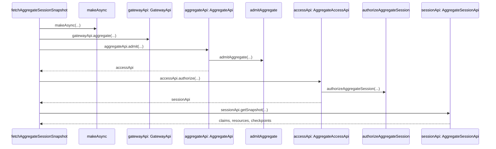

# Session claims and admission

**Claims** are the full admitted object. **Actor identity** is the subset selected by `actorPath`; it identifies the actor partition within its existing owner scope. Extra claims can leave that partition unchanged while changing the browser session identity. `makeActorIdentity({ claims, actorPath })` exposes the full `claimsSchema` and derives the partition's `identitySchema`. Neither term introduces a public/private visibility split.

An actor separately declares its admission policy. `authentication: 'none'` accepts browser-supplied claims; a credentials policy validates credentials and invokes `authenticate` to obtain claims. Aggregate verifiers can provision through their `executeCommand` capability. The selected policy determines the valid request form, and the server validates the returned full claims before deriving the canonical actor path.

A direct browser session initializes with `{ claims }`; a verified session initializes with `{ getCredentials, expectedClaims? }`. Direct claims and optional expected claims are copied at initialization. Expected claims must exactly match verified claims. The provider supplies fresh credentials for each new admission; credentials are absent from session snapshots, tickets, commands, discovery, and durable Node databases.

```ts
await directSession.initialize({ claims: { aggregateId, instanceId } });
await verifiedSession.initialize({
  getCredentials: () => Effect.succeed({ token }),
});
```

## Trigger

1. Session initialization captures claims or expected claims and constructs `makeAdmissionProvider`.
2. `resolveAggregateNode` or `resolveServiceNode` requests an authenticated snapshot before worker selection.
3. Worker attachment independently requests server proof for the complete name-bound identity; reconnect uses fresh attached admission providers.

The sequence shows aggregate capability ownership. Service selection uses the parallel concrete capabilities cited in each step.



## Annotated workflow steps

1. Acquire the admission request through the async boundary.
   - [`fetchAggregateSessionSnapshot.ts:46-48`](../../../packages/browser/src/fetchAggregateSessionSnapshot.ts#L46-L48) — makeAsync invokes the provider and decodeRpcOutcome resolves its result envelope. (`packages/browser/src/fetchAggregateSessionSnapshot.ts:46-48`)
   - [`fetchServiceSessionSnapshot.ts:45-47`](../../../packages/browser/src/fetchServiceSessionSnapshot.ts#L45-L47) — The service admission provider crosses the same async/result boundary. (`packages/browser/src/fetchServiceSessionSnapshot.ts:45-47`)

2. Select the versioned owner and actor capability through the gateway.
   - [`fetchAggregateSessionSnapshot.ts:51-59`](../../../packages/browser/src/fetchAggregateSessionSnapshot.ts#L51-L59) — The gateway selection binds system, aggregate name/version, and actor name/version. (`packages/browser/src/fetchAggregateSessionSnapshot.ts:51-59`)
   - [`fetchServiceSessionSnapshot.ts:50-58`](../../../packages/browser/src/fetchServiceSessionSnapshot.ts#L50-L58) — The gateway selection binds system and service name/version; admission selects the actor. (`packages/browser/src/fetchServiceSessionSnapshot.ts:50-58`)

3. Admit the supplied claims or fresh credentials through the selected capability.
   - [`fetchAggregateSessionSnapshot.ts:59-59`](../../../packages/browser/src/fetchAggregateSessionSnapshot.ts#L59-L59) — The selected aggregate capability admits the provider request. (`packages/browser/src/fetchAggregateSessionSnapshot.ts:59-59`)
   - [`fetchServiceSessionSnapshot.ts:56-60`](../../../packages/browser/src/fetchServiceSessionSnapshot.ts#L56-L60) — Service admission adds the selected actor name/version to the provider request. (`packages/browser/src/fetchServiceSessionSnapshot.ts:56-60`)

4. Validate the selected actor policy, authenticate when required, and derive the actor partition from validated claims.
   - [`admit.ts:33-40`](../../../packages/system-worker/src/AggregateApi/admit/admit.ts#L33-L40) — The selected binding is delegated to concrete admission before constructing access. (`packages/system-worker/src/AggregateApi/admit/admit.ts:33-40`)
   - [`admit.ts:40-47`](../../../packages/system-worker/src/ServiceApi/admit/admit.ts#L40-L47) — The selected binding is delegated to concrete admission before constructing access. (`packages/system-worker/src/ServiceApi/admit/admit.ts:40-47`)
   - [`admitAggregate.ts:83-119`](../../../packages/system-worker/src/AggregateApi/admit/admitAggregate/admitAggregate.ts#L83-L119) — Direct policy requires claims; verified policy validates credentials before invoking authenticate. (`packages/system-worker/src/AggregateApi/admit/admitAggregate/admitAggregate.ts:83-119`)
   - [`admitService.ts:74-110`](../../../packages/system-worker/src/ServiceApi/admit/admitService/admitService.ts#L74-L110) — Direct policy requires claims; verified policy validates credentials before invoking authenticate. (`packages/system-worker/src/ServiceApi/admit/admitService/admitService.ts:74-110`)
   - [`admitAggregate.ts:226-267`](../../../packages/system-worker/src/AggregateApi/admit/admitAggregate/admitAggregate.ts#L226-L267) — Only actorPath fields are encoded to derive the canonical actor partition. (`packages/system-worker/src/AggregateApi/admit/admitAggregate/admitAggregate.ts:226-267`)
   - [`admitService.ts:123-165`](../../../packages/system-worker/src/ServiceApi/admit/admitService/admitService.ts#L123-L165) — Service partition selection likewise uses only the declared identity fields. (`packages/system-worker/src/ServiceApi/admit/admitService/admitService.ts:123-165`)

5. Return the claims-bound access capability.
   - [`admit.ts:37-44`](../../../packages/system-worker/src/AggregateApi/admit/admit.ts#L37-L44) — The access capability retains the selected owner binding and admitted claims. (`packages/system-worker/src/AggregateApi/admit/admit.ts:37-44`)
   - [`admit.ts:49-56`](../../../packages/system-worker/src/ServiceApi/admit/admit.ts#L49-L56) — The access capability retains the selected owner binding and admitted claims. (`packages/system-worker/src/ServiceApi/admit/admit.ts:49-56`)

6. Authorize the selected session definition through that returned capability.
   - [`fetchAggregateSessionSnapshot.ts:60-63`](../../../packages/browser/src/fetchAggregateSessionSnapshot.ts#L60-L63) — The access capability receives sessionName and the concrete definition lock. (`packages/browser/src/fetchAggregateSessionSnapshot.ts:60-63`)
   - [`fetchServiceSessionSnapshot.ts:61-64`](../../../packages/browser/src/fetchServiceSessionSnapshot.ts#L61-L64) — The access capability receives sessionName and the concrete definition lock. (`packages/browser/src/fetchServiceSessionSnapshot.ts:61-64`)

7. Validate the admitted actor, lock, claims, and current owner authorization.
   - [`authorize.ts:80-100`](../../../packages/system-worker/src/AggregateAccessApi/authorize/authorize.ts#L80-L100) — Definition authorization is followed by the current authorization check. (`packages/system-worker/src/AggregateAccessApi/authorize/authorize.ts:80-100`)
   - [`authorize.ts:67-87`](../../../packages/system-worker/src/ServiceAccessApi/authorize/authorize.ts#L67-L87) — Definition authorization is followed by the current authorization check. (`packages/system-worker/src/ServiceAccessApi/authorize/authorize.ts:67-87`)

8. Return the authorized session capability.
   - [`authorize.ts:98-111`](../../../packages/system-worker/src/AggregateAccessApi/authorize/authorize.ts#L98-L111) — The returned session capability captures full claims, owner identity, actor identity, and definition lock. (`packages/system-worker/src/AggregateAccessApi/authorize/authorize.ts:98-111`)
   - [`authorize.ts:83-96`](../../../packages/system-worker/src/ServiceAccessApi/authorize/authorize.ts#L83-L96) — The returned session capability captures full claims, owner identity, actor identity, and definition lock. (`packages/system-worker/src/ServiceAccessApi/authorize/authorize.ts:83-96`)

9. Request the authenticated snapshot through the session capability.
   - [`fetchAggregateSessionSnapshot.ts:65-65`](../../../packages/browser/src/fetchAggregateSessionSnapshot.ts#L65-L65) — Snapshot requests pass the retained Node ID when validating an existing attachment. (`packages/browser/src/fetchAggregateSessionSnapshot.ts:65-65`)
   - [`fetchServiceSessionSnapshot.ts:66-66`](../../../packages/browser/src/fetchServiceSessionSnapshot.ts#L66-L66) — Snapshot requests pass the retained Node ID when validating an existing attachment. (`packages/browser/src/fetchServiceSessionSnapshot.ts:66-66`)

10. Return selected resources and progress with the full admitted claims.
    - [`getSnapshot.ts:124-143`](../../../packages/system-worker/src/AggregateSessionApi/getSnapshot/getSnapshot.ts#L124-L143) — The aggregate snapshot includes owner identity, execution/domain progress, claims, and selected resources. (`packages/system-worker/src/AggregateSessionApi/getSnapshot/getSnapshot.ts:124-143`)
    - [`getSnapshot.ts:230-249`](../../../packages/system-worker/src/ServiceSessionApi/getSnapshot/getSnapshot.ts#L230-L249) — The service snapshot retains service progress and full authorized claims. (`packages/system-worker/src/ServiceSessionApi/getSnapshot/getSnapshot.ts:230-249`)

## Browser identity and worker selection

`sessionKey` hashes the bound session definition, backend/system scope, owner identity, actor identity, session name, and complete admitted claims. Aggregate owner identity includes aggregate name/version/ID; service owner identity includes service name/version. The complete lock contributes its definition hash. Domain and compiled worker version appear separately in the worker name. Attachment must reproduce the bound key and independently authenticate the same full identity.

The following sources distinguish partition selection from full browser identity:

- [`makeActorIdentity.ts:57-71`](../../../packages/core/src/identity/make/makeActorIdentity/makeActorIdentity.ts#L57-L71) — The identity schema contains only fields named by actorPath. (`packages/core/src/identity/make/makeActorIdentity/makeActorIdentity.ts:57-71`)
- [`makeAggregateNodeDefinition.ts:16-26`](../../../packages/browser/src/AggregateNode/makeAggregateNodeDefinition.ts#L16-L26) — The aggregate definition includes configuration, aggregate ID, full claims, and lock hash. (`packages/browser/src/AggregateNode/makeAggregateNodeDefinition.ts:16-26`)
- [`makeServiceNodeDefinition.ts:15-24`](../../../packages/browser/src/ServiceNode/makeServiceNodeDefinition.ts#L15-L24) — The service definition includes configuration, full claims, and lock hash. (`packages/browser/src/ServiceNode/makeServiceNodeDefinition.ts:15-24`)
- [`sessionKey.ts:17-29`](../../../packages/core/src/Node/sessionKey.ts#L17-L29) — Canonical JSON hashing covers the entire provided identity. (`packages/core/src/Node/sessionKey.ts:17-29`)
- [`makeAdmissionProvider.ts:21-62`](../../../packages/browser/src/makeSession/makeAdmissionProvider.ts#L21-L62) — Initialization clones claims; verified providers suspend the credential callback for each admission. (`packages/browser/src/makeSession/makeAdmissionProvider.ts:21-62`)

## Durable Nodes and recovery

Each concrete Node has its own SQLite schema and journal. Its runtime-scoped discovery index stores verified identity metadata and eligibility. Offline resolution requires explicit expected claims, an exact definition match, exactly one eligible identity, and classified network unavailability. Discovery supplies local recovery metadata; online attachment still establishes server proof. Missing or ambiguous matches fail.

Attached tab admission providers run concurrently with bounded waits. A Node only resumes when the returned server identity matches its complete bound `sessionKey`. Fresh storage receives the authenticated baseline once. Subsequent server snapshots verify identity while retained resources, journal, and committed cursors remain authoritative for local recovery.

Logout increments the worker authentication generation, detaches old capabilities, stops synchronization, transactionally invalidates discovery eligibility, and clears authentication while preserving command storage. Stale in-flight attempts cannot undo logout. A later login must authenticate the original bound identity.

- [`resolveAggregateNode.ts:59-71`](../../../packages/browser/src/AggregateNode/resolveAggregateNode.ts#L59-L71) — Offline fallback requires classified network unavailability, explicit expected claims, and discovery lookup. (`packages/browser/src/AggregateNode/resolveAggregateNode.ts:59-71`)
- [`resolveServiceNode.ts:57-69`](../../../packages/browser/src/ServiceNode/resolveServiceNode.ts#L57-L69) — Offline fallback requires classified network unavailability, explicit expected claims, and discovery lookup. (`packages/browser/src/ServiceNode/resolveServiceNode.ts:57-69`)
- [`AggregateNodeAuthentication.ts:141-157`](../../../packages/browser/src/AggregateNode/AggregateNodeAuthentication.ts#L141-L157) — A successful provider result must match the complete identity hash and remain in the current authentication generation. (`packages/browser/src/AggregateNode/AggregateNodeAuthentication.ts:141-157`)
- [`ServiceNodeAuthentication.ts:141-157`](../../../packages/browser/src/ServiceNode/ServiceNodeAuthentication.ts#L141-L157) — A successful provider result must match the complete identity hash and remain in the current authentication generation. (`packages/browser/src/ServiceNode/ServiceNodeAuthentication.ts:141-157`)
- [`makeAggregateSharedWorker.ts:225-239`](../../../packages/browser/src/AggregateNode/makeAggregateSharedWorker.ts#L225-L239) — Logout revokes attachments, stops synchronization, invalidates discovery, and clears Node authentication. (`packages/browser/src/AggregateNode/makeAggregateSharedWorker.ts:225-239`)
- [`makeServiceSharedWorker.ts:218-232`](../../../packages/browser/src/ServiceNode/makeServiceSharedWorker.ts#L218-L232) — Logout revokes attachments, stops synchronization, invalidates discovery, and clears Node authentication. (`packages/browser/src/ServiceNode/makeServiceSharedWorker.ts:218-232`)

Cold server activation reconstructs actor selection fields from the canonical partition path; it does not recover credentials or invoke browser admission. Commands, snapshots, tickets, and replay retain accepted full claims. Different claims may select the same actor partition, so authorization and command provenance continue to bind the complete value.

Changed fixed schemas require empty server and browser storage before matching builds run. There is no compatibility decoder, translation migration, or automatic deletion. See [bootstrap](./bootstrapBrowserSession.md) and [session WebSocket](./SessionWebSocket.md).
