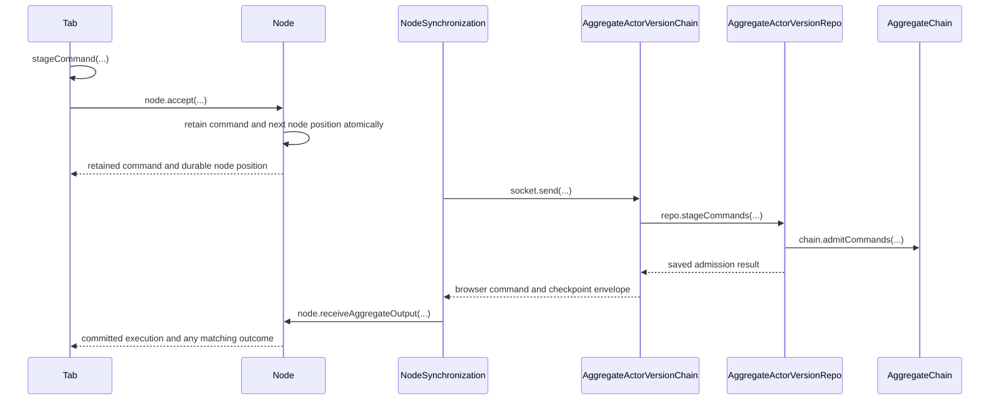

# Durable node command admission

`stageCommand` synchronously commits tab optimism and retains its local input, result, and timing. Durable node acceptance is asynchronous; `nodeState.nodeIndex` and `nodeState.uncertainHandoffs` expose that distinction.

## Trigger

1. The tab stages a command and hands its successful staging result to its durable Node.
2. NodeSynchronization sends committed journal rows over the authenticated actor connection in node order. Persisted pause and manual push control delivery.

## Annotated workflow steps

1. The tab commits its optimistic staging result.
   - [`stageCommand.ts:179-201`](../../../packages/core/src/aggregateSession/stageCommand/stageCommand.ts#L179-L201) — executes the local program and commits its staging transaction. (`packages/core/src/aggregateSession/stageCommand/stageCommand.ts:179-201`)

2. Successful staging is handed to the durable node.
   - [`bootstrapAggregateSession.ts:90-96`](../../../packages/browser/src/bootstrapAggregateSession.ts#L90-L96) — awaits node acceptance before removing the uncertain handoff. (`packages/browser/src/bootstrapAggregateSession.ts:90-96`)

3. Node deduplicates the original ID and retains one flat command row with the next node index.
   - [`Node.ts:317-371`](../../../packages/core/src/Node/Node.ts#L317-L371) — checks an existing ID and inserts the command with node progress in a transaction. (`packages/core/src/Node/Node.ts:317-371`)

4. Acceptance returns the retained row to the tab.
   - [`Node.ts:372-375`](../../../packages/core/src/Node/Node.ts#L372-L375) — publishes acceptance and returns the committed row. (`packages/core/src/Node/Node.ts:372-375`)

5. Only committed rows are pushed in durable node order.
   - [`NodeSynchronization.ts:349-366`](../../../packages/browser/src/Node/NodeSynchronization.ts#L349-L366) — sends stable input and node provenance over the live socket. (`packages/browser/src/Node/NodeSynchronization.ts:349-366`)

6. The actor stages complete input and prepared operations against derived optimism.
   - [`onMessage.ts:228-237`](../../../packages/system-worker/src/AggregateActorVersionChain/onMessage/onMessage.ts#L228-L237) — calls the bound actor repo and rejects unsuccessful staging. (`packages/system-worker/src/AggregateActorVersionChain/onMessage/onMessage.ts:228-237`)

7. The actor outbox submits saved input to authoritative AC admission.
   - [`makeStagedAggregateCommandOutbox.ts:103-109`](../../../packages/system-worker/src/AggregateActorVersionRepo/optimistic/makeStagedAggregateCommandOutbox.ts#L103-L109) — submits the already retained command at its recorded aggregate version. (`packages/system-worker/src/AggregateActorVersionRepo/optimistic/makeStagedAggregateCommandOutbox.ts:103-109`)

8. The actor chain waits for the saved outbox admission result.
   - [`onMessage.ts:239-243`](../../../packages/system-worker/src/AggregateActorVersionChain/onMessage/onMessage.ts#L239-L243) — recovers admission by original command ID after successful server staging. (`packages/system-worker/src/AggregateActorVersionChain/onMessage/onMessage.ts:239-243`)

9. Actor delivery exposes a browser command with a receiving checkpoint.
   - [`getActorOutputs.ts:172-181`](../../../packages/system-worker/src/AggregateActorVersionChain/getActorOutputs/getActorOutputs.ts#L172-L181) — constructs the selected delta and privately filtered terminal failure. (`packages/system-worker/src/AggregateActorVersionChain/getActorOutputs/getActorOutputs.ts:172-181`)

10. NodeSynchronization validates the wire shape and hands it to Node.

- [`NodeSynchronization.ts:159-165`](../../../packages/browser/src/Node/NodeSynchronization.ts#L159-L165) — decodes AggregateActorOutputSchema and invokes ID correlation. (`packages/browser/src/Node/NodeSynchronization.ts:159-165`)

11. Node commits selected resources, any matching outcome, and projection progress before publication.

- [`Node.ts:775-776`](../../../packages/core/src/Node/Node.ts#L775-L776) — publishes the execution only after the resource/outcome transaction completes. (`packages/core/src/Node/Node.ts:775-776`)

## Owned command results and terminal outcomes

Every retained occurrence keeps its original command ID. AC orders admitted owned commands; actor delivery retains each executed position. Actor delivery preserves every position, including empty selections and divergent applications.

`IBrowserCommand` contains only `id`, `commandName`, `delta`, and nullable `failure`. Its envelope carries receiving position, owner progress, and checkpoint hash. The authenticated model lock filters the delta. Failure is visible only to the submitting node/session/claims; original input, ownership, authoritative return values, and server timing stay server-side.

The node matches the incoming ID against its submitted journal. A new position applies the delta, advances the checkpoint, and records any matching unresolved outcome atomically. A covered historical position can fill a missing outcome without reapplying the delta or moving projection progress backward. Later occurrences preserve the first outcome's position, hash, selected delta, and failure. A terminal outcome position with `failure: null` means success.

Valid, addressed inputs that fail payload or contract admission retain a terminal admission rejection at their original owner position. Their materializer records skipped execution, and ordered actor delivery resolves the journal with that failure. Admission acknowledgement itself does not resolve the browser journal or advance projection progress. Boundary target, identity, and transport errors remain RPC failures.

Failed local staging returns a structured error without a durable command. A new definition has a new node and lock; retained older work is never translated to another identity. See [session replay and snapshot recovery](./SessionWebSocket.md) for the independent projection and outcome cursors.

Server actor staging is a separate durable preparation step. It uses the original browser contract rather than its server mapping, saves prepared model operations and submission work atomically, and keeps confirmed resources separate from derived optimism. Its outbox submits the saved input without running programs again. A recognized admission refusal removes the server's pending contribution without moving confirmed checkpoints. Successful admission delivery still leaves unresolved staging in place until terminal projection. The socket returns the saved AC admission result, not the local staging outcome.

[Actor staging verification](../../../packages/system-worker/scripts/checkActorStaging.mjs) covers the server preparation/replay/snapshot seams and cold SQLite restart. [Node outcome verification](../../../packages/core/src/Node/fixtures/commandOutcomes.ts) covers ID correlation, terminal failures, atomic rollback, retained SQLite reopening, historical outcome recovery, and snapshot outcome gating. These checks do not exercise a live browser socket or OPFS.
