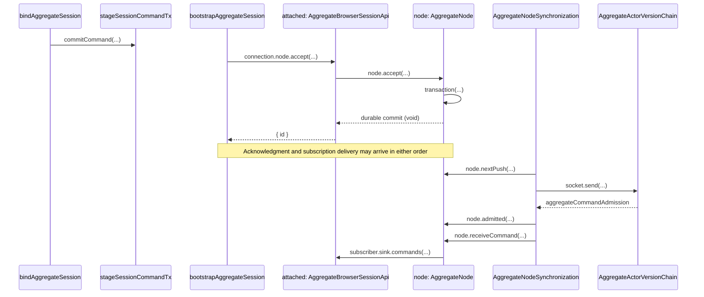

# Concrete Node command admission

Local staging, durable Node acceptance, server admission, and terminal execution are separate boundaries. Aggregate staging returns its synchronous program result after the tab transaction and starts the Node handoff. Service staging awaits durable Node acceptance. Acceptance replies acknowledge durable retention with `{ id }`; received command data arrives through the ordered Node subscription. A matching acknowledgment or committed subscription delivery clears an uncertain local handoff. Admission records `admissionIndex`; terminal delivery settles execution.

## Trigger

1. The standalone `stageCommand({ session, contractName, payload })` delegates to the bound aggregate operation; it or `stageServiceCommand` prepares an ordinary concrete contract against the current tab projection.
2. The bound operation commits optimism before the delivery owner submits the encoded command to the attached Node.
3. Concrete synchronization pushes retained unresolved input in Node order, respecting shared pause or manual push state.

## Annotated workflow steps

1. Stage the local contract and commit its optimistic resource operations and inverse bookkeeping.
   - [`bindAggregateSession.ts:200-214`](../../../packages/core/src/aggregateSession/bindAggregateSession.ts#L200-L214) — The bound aggregate operation prepares operations synchronously and invokes its concrete command transaction. (`packages/core/src/aggregateSession/bindAggregateSession.ts:200-214`)
   - [`stageSessionCommandTx.ts:21-50`](../../../packages/core/src/aggregateSession/stageCommand/stageSessionCommandTx/stageSessionCommandTx.ts#L21-L50) — Pending staging applies resource operations and inserts the encoded command and inverse bookkeeping in one transaction. (`packages/core/src/aggregateSession/stageCommand/stageSessionCommandTx/stageSessionCommandTx.ts:21-50`)
   - [`bootstrapServiceSession.ts:370-407`](../../../packages/browser/src/bootstrapServiceSession.ts#L370-L407) — The synchronous service staging handler commits the prepared local command and retains its uncertain handoff before returning success. (`packages/browser/src/bootstrapServiceSession.ts:370-407`)

2. Hand the unchanged staged command to the attached browser capability.
   - [`bindAggregateSession.ts:219-227`](../../../packages/core/src/aggregateSession/bindAggregateSession.ts#L219-L227) — Delivery begins only after the synchronous transaction succeeds; the caller retains its local result if handoff throws. (`packages/core/src/aggregateSession/bindAggregateSession.ts:219-227`)
   - [`bootstrapAggregateSession.ts:212-249`](../../../packages/browser/src/bootstrapAggregateSession.ts#L212-L249) — The delivery owner retains handoff uncertainty and forks acceptance through its runtime. (`packages/browser/src/bootstrapAggregateSession.ts:212-249`)
   - [`bootstrapAggregateSession.ts:190-200`](../../../packages/browser/src/bootstrapAggregateSession.ts#L190-L200) — The aggregate bootstrap awaits acceptance and verifies the receipt's command ID. (`packages/browser/src/bootstrapAggregateSession.ts:190-200`)
   - [`bootstrapServiceSession.ts:271-281`](../../../packages/browser/src/bootstrapServiceSession.ts#L271-L281) — The service bootstrap awaits acceptance and verifies the receipt's command ID. (`packages/browser/src/bootstrapServiceSession.ts:271-281`)

3. Validate the public input and delegate to the concrete Node.
   - [`AggregateBrowserSessionApi.ts:37-48`](../../../packages/browser/src/AggregateNode/AggregateBrowserSessionApi.ts#L37-L48) — The aggregate capability validates the encoded input before awaiting the core Node. (`packages/browser/src/AggregateNode/AggregateBrowserSessionApi.ts:37-48`)
   - [`ServiceBrowserSessionApi.ts:37-47`](../../../packages/browser/src/ServiceNode/ServiceBrowserSessionApi.ts#L37-L47) — The service capability validates the encoded input before awaiting the core Node. (`packages/browser/src/ServiceNode/ServiceBrowserSessionApi.ts:37-47`)

4. Commit a new submission or republish its existing journal row transactionally.
   - [`AggregateNode.ts:108-117`](../../../packages/core/src/AggregateNode/AggregateNode.ts#L108-L117) — The Node uses explicit SQLite BEGIN IMMEDIATE and rollback for atomic journal work. (`packages/core/src/AggregateNode/AggregateNode.ts:108-117`)
   - [`ServiceNode.ts:108-117`](../../../packages/core/src/ServiceNode/ServiceNode.ts#L108-L117) — The Node uses explicit SQLite BEGIN IMMEDIATE and rollback for atomic journal work. (`packages/core/src/ServiceNode/ServiceNode.ts:108-117`)
   - [`AggregateNode.ts:505-520`](../../../packages/core/src/AggregateNode/AggregateNode.ts#L505-L520) — Identical retries update only the originating journal row's and metadata's `changeIndex`; conflicts fail before mutation. (`packages/core/src/AggregateNode/AggregateNode.ts:505-520`)
   - [`ServiceNode.ts:503-516`](../../../packages/core/src/ServiceNode/ServiceNode.ts#L503-L516) — Identical retries update only the originating journal row's and metadata's `changeIndex`; conflicts fail before mutation. (`packages/core/src/ServiceNode/ServiceNode.ts:503-516`)
   - [`AggregateNode.ts:538-552`](../../../packages/core/src/AggregateNode/AggregateNode.ts#L538-L552) — A new aggregate submission inserts its input and advances `nextNodeIndex` and `changeIndex` in one transaction. (`packages/core/src/AggregateNode/AggregateNode.ts:538-552`)
   - [`ServiceNode.ts:533-547`](../../../packages/core/src/ServiceNode/ServiceNode.ts#L533-L547) — A new service submission inserts its input and advances `nextNodeIndex` and `changeIndex` in one transaction. (`packages/core/src/ServiceNode/ServiceNode.ts:533-547`)

5. Resolve core acceptance after durable commit, independently of subscriber callbacks.
   - [`AggregateNode.ts:552-555`](../../../packages/core/src/AggregateNode/AggregateNode.ts#L552-L555) — Acceptance schedules publication after its serialized transaction and returns no command data. (`packages/core/src/AggregateNode/AggregateNode.ts:552-555`)
   - [`ServiceNode.ts:547-550`](../../../packages/core/src/ServiceNode/ServiceNode.ts#L547-L550) — Acceptance schedules publication after its serialized transaction and returns no command data. (`packages/core/src/ServiceNode/ServiceNode.ts:547-550`)

6. Return only the command ID acknowledgment and clear handoff uncertainty.
   - [`AggregateBrowserSessionApi.ts:48-50`](../../../packages/browser/src/AggregateNode/AggregateBrowserSessionApi.ts#L48-L50) — Durable acceptance triggers synchronization and returns `{ id }`. (`packages/browser/src/AggregateNode/AggregateBrowserSessionApi.ts:48-50`)
   - [`ServiceBrowserSessionApi.ts:47-49`](../../../packages/browser/src/ServiceNode/ServiceBrowserSessionApi.ts#L47-L49) — Durable acceptance triggers synchronization and returns `{ id }`. (`packages/browser/src/ServiceNode/ServiceBrowserSessionApi.ts:47-49`)
   - [`bootstrapAggregateSession.ts:201-209`](../../../packages/browser/src/bootstrapAggregateSession.ts#L201-L209) — A current aggregate session clears only the uncertain handoff and publishes its count. (`packages/browser/src/bootstrapAggregateSession.ts:201-209`)
   - [`bootstrapServiceSession.ts:282-298`](../../../packages/browser/src/bootstrapServiceSession.ts#L282-L298) — A current service session clears only the uncertain handoff and publishes its count. (`packages/browser/src/bootstrapServiceSession.ts:282-298`)

7. Select the next retained unresolved submission in Node order.
   - [`AggregateNodeSynchronization.ts:270-276`](../../../packages/browser/src/AggregateNode/AggregateNodeSynchronization.ts#L270-L276) — The serialized loop selects retained input and requires an open socket. (`packages/browser/src/AggregateNode/AggregateNodeSynchronization.ts:270-276`)
   - [`ServiceNodeSynchronization.ts:269-275`](../../../packages/browser/src/ServiceNode/ServiceNodeSynchronization.ts#L269-L275) — The serialized loop selects retained input and requires an open socket. (`packages/browser/src/ServiceNode/ServiceNodeSynchronization.ts:269-275`)

8. Push submitted input with the bound Node provenance and owner identity.
   - [`AggregateNodeSynchronization.ts:306-325`](../../../packages/browser/src/AggregateNode/AggregateNodeSynchronization.ts#L306-L325) — The socket request forwards retained payload, contract version, claims, and aggregate identity. (`packages/browser/src/AggregateNode/AggregateNodeSynchronization.ts:306-325`)
   - [`ServiceNodeSynchronization.ts:305-325`](../../../packages/browser/src/ServiceNode/ServiceNodeSynchronization.ts#L305-L325) — The socket request forwards retained payload, contract version, claims, and bound service name/version. (`packages/browser/src/ServiceNode/ServiceNodeSynchronization.ts:305-325`)

9. Receive a domain admission receipt, distinct from terminal execution.
   - [`onMessage.ts:305-318`](../../../packages/system-worker/src/AggregateActorVersionChain/onMessage/onMessage.ts#L305-L318) — Aggregate success carries id, nodeIndex, admissionIndex, admission, and telemetry link; failure carries public failure. (`packages/system-worker/src/AggregateActorVersionChain/onMessage/onMessage.ts:305-318`)
   - [`pushServiceCommand.ts:50-68`](../../../packages/system-worker/src/ServiceActorVersionChain/onMessage/pushServiceCommand.ts#L50-L68) — Service success returns Node coordinates and admission separately from public admission failures. (`packages/system-worker/src/ServiceActorVersionChain/onMessage/pushServiceCommand.ts:50-68`)

10. Commit the admission marker before continuing the push loop.
    - [`AggregateNodeSynchronization.ts:213-225`](../../../packages/browser/src/AggregateNode/AggregateNodeSynchronization.ts#L213-L225) — The matching receipt updates the staged journal before the pending push resolves. (`packages/browser/src/AggregateNode/AggregateNodeSynchronization.ts:213-225`)
    - [`ServiceNodeSynchronization.ts:212-224`](../../../packages/browser/src/ServiceNode/ServiceNodeSynchronization.ts#L212-L224) — The matching receipt updates the staged journal before the pending push resolves. (`packages/browser/src/ServiceNode/ServiceNodeSynchronization.ts:212-224`)
    - [`AggregateNode.ts:684-699`](../../../packages/core/src/AggregateNode/AggregateNode.ts#L684-L699) — Admission mutates admissionIndex and changeIndex without advancing terminal domain progress. (`packages/core/src/AggregateNode/AggregateNode.ts:684-699`)
    - [`ServiceNode.ts:679-694`](../../../packages/core/src/ServiceNode/ServiceNode.ts#L679-L694) — Admission mutates admissionIndex and changeIndex without advancing terminal domain progress. (`packages/core/src/ServiceNode/ServiceNode.ts:679-694`)

11. Receive a flat terminal command through strict concrete decoding.
    - [`AggregateNodeSynchronization.ts:154-162`](../../../packages/browser/src/AggregateNode/AggregateNodeSynchronization.ts#L154-L162) — An unwrapped object is decoded as the concrete terminal command and passed to node.receiveCommand. (`packages/browser/src/AggregateNode/AggregateNodeSynchronization.ts:154-162`)
    - [`ServiceNodeSynchronization.ts:154-162`](../../../packages/browser/src/ServiceNode/ServiceNodeSynchronization.ts#L154-L162) — An unwrapped object is decoded as the concrete terminal command and passed to node.receiveCommand. (`packages/browser/src/ServiceNode/ServiceNodeSynchronization.ts:154-162`)

12. After commit, deliver staged input and terminal commands to each observing tab.
    - [`AggregateNode.ts:447-451`](../../../packages/core/src/AggregateNode/AggregateNode.ts#L447-L451) — The subscriber cursor advances only after the callback commits the command array. (`packages/core/src/AggregateNode/AggregateNode.ts:447-451`)
    - [`ServiceNode.ts:445-449`](../../../packages/core/src/ServiceNode/ServiceNode.ts#L445-L449) — The subscriber cursor advances only after the callback commits the command array. (`packages/core/src/ServiceNode/ServiceNode.ts:445-449`)
    - [`bootstrapAggregateSession.ts:328-353`](../../../packages/browser/src/bootstrapAggregateSession.ts#L328-L353) — The subscription page commits command imports before clearing uncertainty, publishing progress, and observing terminal notifications. (`packages/browser/src/bootstrapAggregateSession.ts:328-353`)
    - [`bootstrapServiceSession.ts:491-511`](../../../packages/browser/src/bootstrapServiceSession.ts#L491-L511) — The subscription page commits command imports before clearing uncertainty and publishing progress. (`packages/browser/src/bootstrapServiceSession.ts:491-511`)

## Journals and settlement

Each Node journal row has a stable `journalIndex` independent of command ID. A local submission receives one `nodeIndex`; foreign terminals and later repeated-ID executions allocate no new Node submission position. Each Node row mutation receives a durable `changeIndex`. Journal retention, selected resource changes, originating settlement, contiguous `outcomeIndex`, and numeric domain progress commit together. Publication follows commit.

Each tab command row has a non-null `sessionIndex` allocated from that database's sole `nextSessionIndex`. Local staging, received staged input, and terminal-only history consume the same retention sequence. Matching updates and redelivery retain the row's index; distinct repeated-ID executions allocate another row. New rows insert without an upsert fallback, so an occupied allocation fails and rolls back instead of overwriting history. Optimistic inverse operations use the same session key. Node-accepted pending work replays in `nodeIndex` order, followed by uncertain local work in session retention order. Restored standalone history retains its allocator even when the current live `sessionId` changes.

- [`applySessionCommandTx.ts:55-68`](../../../packages/core/src/aggregateSession/stageCommand/applySessionCommandTx/applySessionCommandTx.ts#L55-L68) — Local staging reads the sole allocator and rejects invalid or exhausted safe-integer allocation before applying operations. (`packages/core/src/aggregateSession/stageCommand/applySessionCommandTx/applySessionCommandTx.ts:55-68`)
- [`importAggregateNodeCommands.ts:302-316`](../../../packages/core/src/aggregateSession/importAggregateNodeCommands.ts#L302-L316) — New staged retention inserts a row; a match updates only its session key. Only new retention advances the allocator before replay. (`packages/core/src/aggregateSession/importAggregateNodeCommands.ts:302-316`)
- [`importServiceNodeCommands.ts:309-323`](../../../packages/core/src/serviceSession/importServiceNodeCommands.ts#L309-L323) — Service retention uses the same insert-or-selected-update boundary and advances its allocator only for a new row. (`packages/core/src/serviceSession/importServiceNodeCommands.ts:309-323`)
- [`replayPendingCommandsTx.ts:71-80`](../../../packages/core/src/aggregateSession/replayPendingCommandsTx.ts#L71-L80) — Aggregate replay places non-null Node submission positions first and uses session retention order for remaining rows. (`packages/core/src/aggregateSession/replayPendingCommandsTx.ts:71-80`)
- [`replayPendingServiceCommandsTx.ts:69-78`](../../../packages/core/src/serviceSession/replayPendingServiceCommandsTx.ts#L69-L78) — Service replay keeps Node submission order ahead of uncertain local retention order. (`packages/core/src/serviceSession/replayPendingServiceCommandsTx.ts:69-78`)
- [`makeStandaloneSession.ts:819-835`](../../../packages/browser/src/makeStandaloneSession/makeStandaloneSession.ts#L819-L835) — Restoration changes only the live metadata session ID and backs up the change without resetting the retained allocator. (`packages/browser/src/makeStandaloneSession/makeStandaloneSession.ts:819-835`)

Terminals are direct commands. Aggregate checkpoints are `executedIndex`/`executedHash`/`aggregateIndex`; service checkpoints are `executedIndex`/`serviceHash`/`serviceIndex`. Commands retain their existing `admission` and `execution` objects, including status, timing, failure, and result, for the submitting Node/session/claims. Both fields are null for other recipients. Delivery also carries ID, command name, and selected delta; private input and claims are excluded. A Node can send its own known staged input to attached tabs before that row's terminal command.

The receiver deduplicates by execution position, retains distinct repeated-ID occurrences, and preserves the originating submission's first terminal result. An identical local-ID acceptance retry assigns a fresh `changeIndex` to the originating retained row and Node metadata. The subscription redelivers its staged input and original first terminal result, including to a fresh tab whose baseline omitted resolved history, without allocating another journal row or submission position. Resources and execution checkpoints stay unchanged. A conflicting input fails without cursor mutation or publication. Covered historical commands settle pending work without reapplying stale deltas. Admission receipts update staged state without settling it or advancing terminal progress.

The tab keeps an uncertain handoff until a matching acknowledgment or committed subscription delivery proves durable retention. Acknowledgments update only handoff bookkeeping; the subscription callback is the sole incoming command writer and emits admission or execution failure notifications after commit for both aggregate and service sessions. A lost or failed acknowledgment cannot recreate uncertainty already cleared by delivery, and originating-command tracking remains available for later terminal failure notifications. Reconnection first commits missed journal changes through the subscription barrier, then retries remaining uncertain submissions unchanged. Identity, contract selection, and transport failures remain boundary failures; valid addressed commands rejected during payload or contract admission retain terminal failures.

Aggregate actor staging separately retains prepared operations and its submission outbox. Saved input is admitted without rerunning programs; admission delivery can complete while staging awaits terminal projection. Original encoded input and provenance survive forwarding unchanged.

See [session WebSocket](./SessionWebSocket.md) and [server admission](../server/admitCommands.md).
