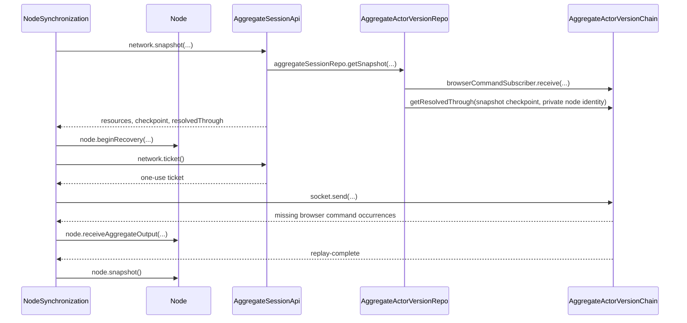

# Durable node session WebSocket

The authenticated actor socket carries admission responses and browser command occurrences. Tickets bind the exact target version, actor, identity, session, and model lock. Aggregate actor chains retain `connectionLocks` in SQLite; compact connection attachments survive hibernation without duplicating model schemas. Missing locks require a new snapshot.

## Trigger

1. NodeSynchronization authenticates the durable node and captures its current outcome cursor.
2. It requests a snapshot and ticket, then resumes the actor stream from the snapshot checkpoint and retained node-outcome cursor.
3. Live pushes start only after replay completes and snapshot installation finishes.

## Annotated workflow steps

1. Synchronization captures the durable node and requests its authenticated snapshot.
   - [`NodeSynchronization.ts:101-105`](../../../packages/browser/src/Node/NodeSynchronization.ts#L101-L105) — supplies the retained node ID when requesting a replacement snapshot. (`packages/browser/src/Node/NodeSynchronization.ts:101-105`)

2. The session capability captures a snapshot of the actor projection.
   - [`getSnapshot.ts:109-121`](../../../packages/system-worker/src/AggregateSessionApi/getSnapshot/getSnapshot.ts#L109-L121) — passes capability-bound identity and requesting node to the actor snapshot method. (`packages/system-worker/src/AggregateSessionApi/getSnapshot/getSnapshot.ts:109-121`)

3. The actor publishes through the captured projection checkpoint.
   - [`getSnapshot.ts:161-162`](../../../packages/system-worker/src/AggregateActorVersionRepo/getSnapshot/getSnapshot.ts#L161-L162) — awaits retained output publication after the capture transaction. (`packages/system-worker/src/AggregateActorVersionRepo/getSnapshot/getSnapshot.ts:161-162`)

4. The snapshot returns resources, checkpoint, and the required contiguous outcome prefix.
   - [`getSnapshot.ts:183-184`](../../../packages/system-worker/src/AggregateActorVersionRepo/getSnapshot/getSnapshot.ts#L183-L184) — returns the node watermark read from durable actor-chain history at the captured checkpoint. (`packages/system-worker/src/AggregateActorVersionRepo/getSnapshot/getSnapshot.ts:183-184`)

5. Node holds replacement resources until required outcomes arrive.
   - [`Node.ts:499-523`](../../../packages/core/src/Node/Node.ts#L499-L523) — validates independent cursors and begins private recovery. (`packages/core/src/Node/Node.ts:499-523`)

6. Synchronization requests a ticket for the same authenticated capability.
   - [`NodeSynchronization.ts:107-109`](../../../packages/browser/src/Node/NodeSynchronization.ts#L107-L109) — gets the ticket before opening the actor socket. (`packages/browser/src/Node/NodeSynchronization.ts:107-109`)

7. The API returns a single-use ticket.
   - [`createWebSocketTicket.ts:87-94`](../../../packages/system-worker/src/AggregateSessionApi/createWebSocketTicket/createWebSocketTicket.ts#L87-L94) — encodes the ticket through the capability-bound API response. (`packages/system-worker/src/AggregateSessionApi/createWebSocketTicket/createWebSocketTicket.ts:87-94`)

8. Resume includes independent projection and outcome cursors.
   - [`NodeSynchronization.ts:126-152`](../../../packages/browser/src/Node/NodeSynchronization.ts#L126-L152) — sends snapshot execution position/hash with the previously retained node-outcome index for aggregate or service. (`packages/browser/src/Node/NodeSynchronization.ts:126-152`)

9. Replay returns the missing contiguous projection suffix and private missing terminal occurrences.
   - [`onMessage.ts:384-423`](../../../packages/system-worker/src/AggregateActorVersionChain/onMessage/onMessage.ts#L384-L423) — pages both cursors, sends each retained occurrence, and checks contiguous execution progress. (`packages/system-worker/src/AggregateActorVersionChain/onMessage/onMessage.ts:384-423`)

10. Wire validation enters the corresponding domain-specific Node receiver.

- [`NodeSynchronization.ts:159-172`](../../../packages/browser/src/Node/NodeSynchronization.ts#L159-L172) — decodes aggregate or service wire schemas before Node applies ID correlation. (`packages/browser/src/Node/NodeSynchronization.ts:159-172`)

11. The actor chain sends replay completion with its delivered execution cursor.

- [`onMessage.ts:439-442`](../../../packages/system-worker/src/AggregateActorVersionChain/onMessage/onMessage.ts#L439-L442) — reports the executed position before entering live delivery. (`packages/system-worker/src/AggregateActorVersionChain/onMessage/onMessage.ts:439-442`)

12. Synchronization checks the committed node before becoming live.

- [`NodeSynchronization.ts:257-272`](../../../packages/browser/src/Node/NodeSynchronization.ts#L257-L272) — rejects incomplete recovery or a mismatched cursor before resolving the live connection. (`packages/browser/src/Node/NodeSynchronization.ts:257-272`)

## Recovery and privacy

The stream envelope carries occurrence position, owner progress, and checkpoint hash. Its command contains exactly `id`, `commandName`, selected `delta`, and nullable `failure`. Server-side ownership metadata filters failure to the submitting node/session/claims. Resource selection follows the retained authenticated model lock. [Command admission](./PushSequence.md#owned-command-results-and-terminal-outcomes) describes ID correlation and first-outcome retention.

A covered historical outcome fills missing journal history without reapplying its delta or moving projection progress backward. New positions commit selected resources, checkpoint, and matching outcome together. Snapshot installation waits for the required contiguous outcome prefix; interrupted recovery preserves the previous resources and durable cursors.

Service replay uses the same two cursors. Its `serviceHash` retains the own-command disposition meaning; its envelope `serviceIndex` is the actor's consumed own-command watermark. Aggregate hashes incorporate original command identity at every receiving position. Neither stream coalesces empty deltas or divergent applications.

A checkpoint conflict, projection gap, missing retained lock, or publication racing replay requests a fresh snapshot. Socket loss reconnects using durable cursors. Locally staged input, result, and timing remain in the journal; authoritative return values and server phase timing remain server-side. Changed fixed schemas require empty storage, without translation or automatic deletion.
