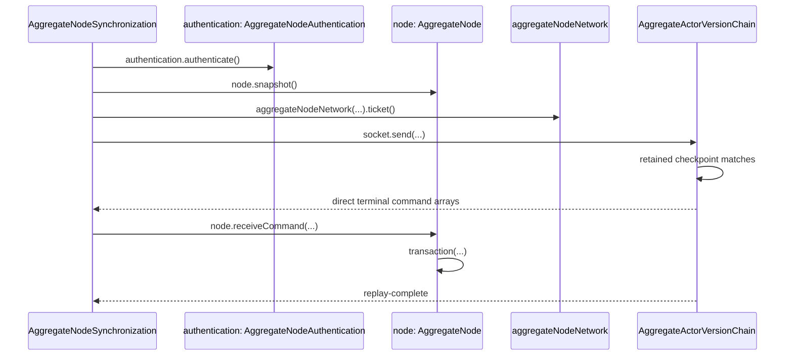

# Concrete Node session WebSocket

Each concrete synchronization runtime resumes its retained Node through the authenticated actor socket. The socket carries direct terminal commands, direct replay arrays, and explicit controls for admission, checkpoint rejection, and replay completion. The sequence shows the aggregate socket; paired citations describe the service socket.

## Trigger

1. Attachment enables the concrete synchronization runtime; reconnect retries authentication using the attached tab providers.
2. The runtime captures committed Node progress, obtains a bound ticket, and opens its domain socket.
3. Live pushing waits for server replay to reach the Node's committed execution position.

## Annotated workflow steps

1. Authenticate the retained Node identity using attached admission providers.
   - [`AggregateNodeSynchronization.ts:92-98`](../../../packages/browser/src/AggregateNode/AggregateNodeSynchronization.ts#L92-L98) — Authentication precedes node.authenticated and retained progress capture. (`packages/browser/src/AggregateNode/AggregateNodeSynchronization.ts:92-98`)
   - [`ServiceNodeSynchronization.ts:92-98`](../../../packages/browser/src/ServiceNode/ServiceNodeSynchronization.ts#L92-L98) — Authentication precedes node.authenticated and retained progress capture. (`packages/browser/src/ServiceNode/ServiceNodeSynchronization.ts:92-98`)

2. Capture the committed Node checkpoints.
   - [`AggregateNodeSynchronization.ts:98-98`](../../../packages/browser/src/AggregateNode/AggregateNodeSynchronization.ts#L98-L98) — The resume metadata comes from the retained Node snapshot. (`packages/browser/src/AggregateNode/AggregateNodeSynchronization.ts:98-98`)
   - [`ServiceNodeSynchronization.ts:98-98`](../../../packages/browser/src/ServiceNode/ServiceNodeSynchronization.ts#L98-L98) — The resume metadata comes from the retained Node snapshot. (`packages/browser/src/ServiceNode/ServiceNodeSynchronization.ts:98-98`)

3. Obtain the authenticated socket ticket.
   - [`AggregateNodeSynchronization.ts:99-103`](../../../packages/browser/src/AggregateNode/AggregateNodeSynchronization.ts#L99-L103) — The ticket request uses the verified admission and bound request. (`packages/browser/src/AggregateNode/AggregateNodeSynchronization.ts:99-103`)
   - [`ServiceNodeSynchronization.ts:99-103`](../../../packages/browser/src/ServiceNode/ServiceNodeSynchronization.ts#L99-L103) — The ticket request uses the verified admission and bound request. (`packages/browser/src/ServiceNode/ServiceNodeSynchronization.ts:99-103`)

4. Resume the actor socket with committed execution position/hash and contiguous local outcomes.
   - [`AggregateNodeSynchronization.ts:125-137`](../../../packages/browser/src/AggregateNode/AggregateNodeSynchronization.ts#L125-L137) — The payload sends nodeId, outcomeIndex as nodeIndex, executedIndex, and executedHash. (`packages/browser/src/AggregateNode/AggregateNodeSynchronization.ts:125-137`)
   - [`ServiceNodeSynchronization.ts:125-137`](../../../packages/browser/src/ServiceNode/ServiceNodeSynchronization.ts#L125-L137) — The payload sends nodeId, outcomeIndex as nodeIndex, executedIndex, and serviceHash. (`packages/browser/src/ServiceNode/ServiceNodeSynchronization.ts:125-137`)

5. The server validates the exact retained checkpoint before replay.
   - [`onMessage.ts:354-388`](../../../packages/system-worker/src/AggregateActorVersionChain/onMessage/onMessage.ts#L354-L388) — A missing checkpoint or mismatched executedHash sends state-required. (`packages/system-worker/src/AggregateActorVersionChain/onMessage/onMessage.ts:354-388`)
   - [`onMessage.ts:125-159`](../../../packages/system-worker/src/ServiceActorVersionChain/onMessage/onMessage.ts#L125-L159) — A missing checkpoint or mismatched serviceHash sends state-required. (`packages/system-worker/src/ServiceActorVersionChain/onMessage/onMessage.ts:125-159`)

6. Replay bounded arrays of disclosed terminal commands.
   - [`onMessage.ts:397-439`](../../../packages/system-worker/src/AggregateActorVersionChain/onMessage/onMessage.ts#L397-L439) — Aggregate replay sends the execution-ordered union of missing executions and unresolved own outcomes. (`packages/system-worker/src/AggregateActorVersionChain/onMessage/onMessage.ts:397-439`)
   - [`onMessage.ts:163-180`](../../../packages/system-worker/src/ServiceActorVersionChain/onMessage/onMessage.ts#L163-L180) — Covered service outcomes are replayed separately before advancing the execution cursor. (`packages/system-worker/src/ServiceActorVersionChain/onMessage/onMessage.ts:163-180`)
   - [`onMessage.ts:186-240`](../../../packages/system-worker/src/ServiceActorVersionChain/onMessage/onMessage.ts#L186-L240) — Service replay checks contiguous executions and filters each direct command before sending the array. (`packages/system-worker/src/ServiceActorVersionChain/onMessage/onMessage.ts:186-240`)

7. Decode concrete command schemas and import terminals in arrival order.
   - [`AggregateNodeSynchronization.ts:140-149`](../../../packages/browser/src/AggregateNode/AggregateNodeSynchronization.ts#L140-L149) — The serialized message queue validates the array and awaits each node.receiveCommand. (`packages/browser/src/AggregateNode/AggregateNodeSynchronization.ts:140-149`)
   - [`ServiceNodeSynchronization.ts:140-149`](../../../packages/browser/src/ServiceNode/ServiceNodeSynchronization.ts#L140-L149) — The serialized message queue validates the array and awaits each node.receiveCommand. (`packages/browser/src/ServiceNode/ServiceNodeSynchronization.ts:140-149`)

8. Commit retained history, selected resources, settlement, and checkpoints together.
   - [`AggregateNode.ts:108-117`](../../../packages/core/src/AggregateNode/AggregateNode.ts#L108-L117) — Concrete Node transactions use BEGIN IMMEDIATE, COMMIT, and rollback on error. (`packages/core/src/AggregateNode/AggregateNode.ts:108-117`)
   - [`ServiceNode.ts:108-117`](../../../packages/core/src/ServiceNode/ServiceNode.ts#L108-L117) — Concrete Node transactions use BEGIN IMMEDIATE, COMMIT, and rollback on error. (`packages/core/src/ServiceNode/ServiceNode.ts:108-117`)
   - [`AggregateNode.ts:751-866`](../../../packages/core/src/AggregateNode/AggregateNode.ts#L751-L866) — The terminal transaction retains the occurrence, applies uncovered selected resources, and advances contiguous local outcome progress. (`packages/core/src/AggregateNode/AggregateNode.ts:751-866`)
   - [`ServiceNode.ts:746-861`](../../../packages/core/src/ServiceNode/ServiceNode.ts#L746-L861) — The terminal transaction retains the occurrence, applies uncovered selected resources, and advances contiguous local outcome progress. (`packages/core/src/ServiceNode/ServiceNode.ts:746-861`)
   - [`AggregateNode.ts:866-872`](../../../packages/core/src/AggregateNode/AggregateNode.ts#L866-L872) — The completed terminal transaction publishes before errors can block further synchronization. (`packages/core/src/AggregateNode/AggregateNode.ts:866-872`)
   - [`ServiceNode.ts:861-867`](../../../packages/core/src/ServiceNode/ServiceNode.ts#L861-L867) — The completed terminal transaction publishes before errors can block further synchronization. (`packages/core/src/ServiceNode/ServiceNode.ts:861-867`)

9. Verify replay-complete before enabling live pushing.
   - [`AggregateNodeSynchronization.ts:226-239`](../../../packages/browser/src/AggregateNode/AggregateNodeSynchronization.ts#L226-L239) — The server completion position must equal the committed Node execution position before online state and push. (`packages/browser/src/AggregateNode/AggregateNodeSynchronization.ts:226-239`)
   - [`ServiceNodeSynchronization.ts:225-238`](../../../packages/browser/src/ServiceNode/ServiceNodeSynchronization.ts#L225-L238) — The server completion position must equal the committed Node execution position before online state and push. (`packages/browser/src/ServiceNode/ServiceNodeSynchronization.ts:225-238`)

## Durable recovery and disclosure

Fresh storage installs one independently authenticated baseline. Later authentication may obtain a snapshot to verify identity; initialized Nodes retain their resources and resume committed execution and outcome cursors. Socket loss retries from retained progress. A gap, hash conflict, unavailable retained server lock, or state-required response blocks synchronization and preserves storage. Recovery does not replace resources or delete history.

Terminals contain `id`, `commandName`, selected `delta`, and nullable `admission` and `execution` objects. Aggregate terminals add `executedIndex`, `executedHash`, and numeric `aggregateIndex`; service terminals add `executedIndex`, `serviceHash`, and numeric `serviceIndex`. The original submitting Node/session/claims receives its admission and execution status, timing, failures, and result; both objects are null for other recipients. Model filtering follows the authenticated session lock. Private input and claims are excluded. Aggregate and service hashes retain their existing domain semantics.

Every distinct execution position is retained, including failures, empty deltas, and repeated command IDs. Deduplication checks that position's contents. The originating submission keeps its first terminal result. Covered historical commands retain history and settle pending work without applying stale deltas or moving checkpoints backward. `outcomeIndex` advances across the contiguous terminal prefix of local submissions; `admissionIndex` records server acceptance independently.

Each observing tab assigns its own `sessionIndex` when it first retains a delivered occurrence. A matching staged/admission/terminal update preserves that row key; a later execution of the same command ID receives a new key. The tab's committed change cursor, sole row allocator, inverse operations, and resource changes advance together, so rollback consumes neither a session position nor subscription progress. Rebase order remains accepted Node submissions first, then uncertain local commands in session retention order.

- [`importAggregateNodeCommands.ts:238-246`](../../../packages/core/src/aggregateSession/importAggregateNodeCommands.ts#L238-L246) — A new terminal occurrence inserts independently, while a matched occurrence updates only its retained session key before uncovered resources apply. (`packages/core/src/aggregateSession/importAggregateNodeCommands.ts:238-246`)
- [`importServiceNodeCommands.ts:309-323`](../../../packages/core/src/serviceSession/importServiceNodeCommands.ts#L309-L323) — Service retention updates a matched session key or inserts a new row, then advances the allocator only for a new occurrence. (`packages/core/src/serviceSession/importServiceNodeCommands.ts:309-323`)
- [`importAggregateNodeCommands.ts:321-352`](../../../packages/core/src/aggregateSession/importAggregateNodeCommands.ts#L321-L352) — One synchronous page transaction imports each occurrence and advances the subscription change cursor after those imports succeed. (`packages/core/src/aggregateSession/importAggregateNodeCommands.ts:321-352`)
- [`importServiceNodeCommands.ts:328-360`](../../../packages/core/src/serviceSession/importServiceNodeCommands.ts#L328-L360) — The service page transaction keeps occurrence imports and change-cursor advancement in the same commit. (`packages/core/src/serviceSession/importServiceNodeCommands.ts:328-360`)
- [`replayPendingCommandsTx.ts:71-80`](../../../packages/core/src/aggregateSession/replayPendingCommandsTx.ts#L71-L80) — Aggregate rebase sorts accepted Node submissions before uncertain local rows, whose final order is sessionIndex. (`packages/core/src/aggregateSession/replayPendingCommandsTx.ts:71-80`)
- [`replayPendingServiceCommandsTx.ts:69-78`](../../../packages/core/src/serviceSession/replayPendingServiceCommandsTx.ts#L69-L78) — Service rebase uses Node submission order followed by session retention order. (`packages/core/src/serviceSession/replayPendingServiceCommandsTx.ts:69-78`)

## Incremental tab delivery

A session initializes from one snapshot, then receives command data exclusively through its ordered Node subscription. Subscription delivery commits received rows, projection changes, and checkpoints before emitting admission or execution failure notifications in the originating tab. Aggregate and service sessions use the same callbacks. Acceptance returns only `{ id }`; it clears handoff uncertainty without merging commands or moving projection progress. A committed subscription page also clears matching uncertain handoffs, so a lost acknowledgment cannot restore already settled uncertainty.

Each journal mutation assigns a durable `changeIndex`. Identical acceptance retries advance the existing originating row and Node metadata to a fresh change index, redelivering pending input or its original first terminal result through this same subscription. A tab subscribes using its last committed cursor. The Node pages changed journal rows in change order and sends known staged input before its terminal command. Each tab transaction undoes optimism, merges occurrences, applies uncovered authoritative changes, replays unresolved Node commands in Node order followed by uncertain local submissions, and advances progress. The connector advances its cursor after that callback commits; live queries are notified after commit.

Each subscriber reads its own bounded SQLite backlog, so a slow tab catches up independently without replacement snapshots or blocking durable acceptance. Subscription returns after initial projection or replay through the captured registration watermark, keeping uncertain acceptance retries behind retained outcomes.

- [`AggregateNode.ts:423-438`](../../../packages/core/src/AggregateNode/AggregateNode.ts#L423-L438) — Each subscriber orders its retained journal query by changeIndex and limits the row page. (`packages/core/src/AggregateNode/AggregateNode.ts:423-438`)
- [`ServiceNode.ts:421-436`](../../../packages/core/src/ServiceNode/ServiceNode.ts#L421-L436) — Each subscriber orders its retained journal query by changeIndex and limits the row page. (`packages/core/src/ServiceNode/ServiceNode.ts:421-436`)
- [`importAggregateNodeCommands.ts:383-396`](../../../packages/core/src/aggregateSession/importAggregateNodeCommands.ts#L383-L396) — The tab importer delegates the direct command array to its synchronous page transaction. (`packages/core/src/aggregateSession/importAggregateNodeCommands.ts:383-396`)
- [`importServiceNodeCommands.ts:391-404`](../../../packages/core/src/serviceSession/importServiceNodeCommands.ts#L391-L404) — The tab importer delegates the direct command array to its synchronous page transaction. (`packages/core/src/serviceSession/importServiceNodeCommands.ts:391-404`)
- [`bootstrapAggregateSession.ts:191-210`](../../../packages/browser/src/bootstrapAggregateSession.ts#L191-L210) — The matched acknowledgment clears only local handoff bookkeeping. (`packages/browser/src/bootstrapAggregateSession.ts:191-210`)
- [`bootstrapServiceSession.ts:271-298`](../../../packages/browser/src/bootstrapServiceSession.ts#L271-L298) — The matched acknowledgment clears only local handoff bookkeeping. (`packages/browser/src/bootstrapServiceSession.ts:271-298`)
- [`bootstrapAggregateSession.ts:329-354`](../../../packages/browser/src/bootstrapAggregateSession.ts#L329-L354) — Command delivery commits imports and clears uncertainty before emitting aggregate terminal notifications. (`packages/browser/src/bootstrapAggregateSession.ts:329-354`)
- [`bootstrapServiceSession.ts:491-515`](../../../packages/browser/src/bootstrapServiceSession.ts#L491-L515) — Command delivery commits imports and clears uncertainty before publishing service progress. (`packages/browser/src/bootstrapServiceSession.ts:491-515`)
- [`AggregateNode.ts:505-520`](../../../packages/core/src/AggregateNode/AggregateNode.ts#L505-L520) — An identical retry creates another durable change on the originating journal row, preserving its retained input and terminal fields. (`packages/core/src/AggregateNode/AggregateNode.ts:505-520`)
- [`ServiceNode.ts:503-516`](../../../packages/core/src/ServiceNode/ServiceNode.ts#L503-L516) — An identical retry creates another durable change on the originating journal row, preserving its retained input and terminal fields. (`packages/core/src/ServiceNode/ServiceNode.ts:503-516`)
- [`connectAggregateNode.ts:226-236`](../../../packages/browser/src/AggregateNode/connectAggregateNode.ts#L226-L236) — Reconnection awaits subscription readiness before retrying remaining uncertain handoffs. (`packages/browser/src/AggregateNode/connectAggregateNode.ts:226-236`)
- [`connectServiceNode.ts:222-230`](../../../packages/browser/src/ServiceNode/connectServiceNode.ts#L222-L230) — Reconnection awaits subscription readiness before retrying remaining uncertain handoffs. (`packages/browser/src/ServiceNode/connectServiceNode.ts:222-230`)

See [bootstrap](./bootstrapBrowserSession.md) and [command admission](./PushSequence.md).
