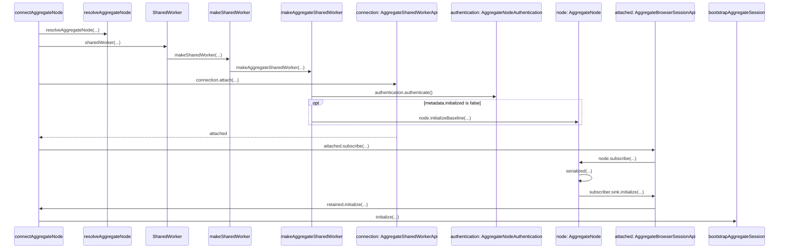

# Concrete browser Node bootstrap

An application keeps one entry calling `makeSharedWorker({ sqliteWasmUrl })`. The application factory constructs a module `SharedWorker` using the supplied name. Construction and parsing share these RoutePattern declarations:

```text
/zerospin/aggregate/:sharedWorkerVersion/:sessionKey
/zerospin/service/:sharedWorkerVersion/:sessionKey
```

`AggregateNode` and `ServiceNode` each own their schema, journal, authentication integration, synchronization, and recovery. Shared primitives provide SQLite, hashing, serialization, storage opening, and RPC. The sequence shows aggregate ownership; each service path is cited alongside its aggregate counterpart.

## Trigger

1. `bootstrapAggregateSession` or `bootstrapServiceSession` captures the bound definition and creates the tab SQLite projection.
2. Its concrete connector resolves admitted claims, computes `sessionKey`, and invokes the application worker factory.
3. The worker selects its concrete initializer from its name. Attachment returns a per-tab capability; subscription completes initial projection or catch-up before uncertain handoffs retry.



## Annotated workflow steps

1. Resolve the admitted definition before selecting a named worker.
   - [`resolveAggregateNode.ts:28-47`](../../../packages/browser/src/AggregateNode/resolveAggregateNode.ts#L28-L47) — The server snapshot supplies aggregate ID and claims before definition construction. (`packages/browser/src/AggregateNode/resolveAggregateNode.ts:28-47`)
   - [`resolveServiceNode.ts:28-47`](../../../packages/browser/src/ServiceNode/resolveServiceNode.ts#L28-L47) — The server snapshot supplies the service claims before definition construction. (`packages/browser/src/ServiceNode/resolveServiceNode.ts:28-47`)

2. Construct the domain name and invoke the application worker factory.
   - [`connectAggregateNode.ts:116-119`](../../../packages/browser/src/AggregateNode/connectAggregateNode.ts#L116-L119) — The connector passes the identity-derived aggregate worker name to sharedWorker. (`packages/browser/src/AggregateNode/connectAggregateNode.ts:116-119`)
   - [`connectServiceNode.ts:115-118`](../../../packages/browser/src/ServiceNode/connectServiceNode.ts#L115-L118) — The connector passes the identity-derived service worker name to sharedWorker. (`packages/browser/src/ServiceNode/connectServiceNode.ts:115-118`)
   - [`sharedWorkerNames.ts:7-18`](../../../packages/browser/src/sharedWorkerNames.ts#L7-L18) — Both names use shared RoutePattern declarations and the compiled worker version. (`packages/browser/src/sharedWorkerNames.ts:7-18`)

3. The application worker entry calls makeSharedWorker.
   - [`zerospin.worker.ts:4-4`](../../../examples/shopping/src/zerospin/zerospin.worker.ts#L4-L4) — The application entry supplies only the WASM URL to the shared dispatcher. (`examples/shopping/src/zerospin/zerospin.worker.ts:4-4`)

4. Parse and validate the name, then initialize its concrete runtime once.
   - [`sharedWorkerNames.ts:19-39`](../../../packages/browser/src/sharedWorkerNames.ts#L19-L39) — Name parsing validates domain, compiled version, canonical path, and a 64-character session key. (`packages/browser/src/sharedWorkerNames.ts:19-39`)
   - [`makeSharedWorker.ts:11-15`](../../../packages/browser/src/makeSharedWorker.ts#L11-L15) — Parsed aggregate names dispatch to makeAggregateSharedWorker; service names dispatch to makeServiceSharedWorker. (`packages/browser/src/makeSharedWorker.ts:11-15`)

5. Attach through the worker RPC capability and independently check the complete identity.
   - [`connectAggregateNode.ts:176-179`](../../../packages/browser/src/AggregateNode/connectAggregateNode.ts#L176-L179) — The connector sends the resolved attachment and admission callback. (`packages/browser/src/AggregateNode/connectAggregateNode.ts:176-179`)
   - [`connectServiceNode.ts:175-178`](../../../packages/browser/src/ServiceNode/connectServiceNode.ts#L175-L178) — The connector sends the resolved attachment and admission callback. (`packages/browser/src/ServiceNode/connectServiceNode.ts:175-178`)
   - [`makeAggregateSharedWorker.ts:81-85`](../../../packages/browser/src/AggregateNode/makeAggregateSharedWorker.ts#L81-L85) — The attachment definition must hash to the name-bound sessionKey. (`packages/browser/src/AggregateNode/makeAggregateSharedWorker.ts:81-85`)
   - [`makeServiceSharedWorker.ts:76-80`](../../../packages/browser/src/ServiceNode/makeServiceSharedWorker.ts#L76-L80) — The attachment definition must hash to the name-bound sessionKey. (`packages/browser/src/ServiceNode/makeServiceSharedWorker.ts:76-80`)

6. The concrete worker authenticates through the registered tab capability.
   - [`makeAggregateSharedWorker.ts:175-192`](../../../packages/browser/src/AggregateNode/makeAggregateSharedWorker.ts#L175-L192) — The attachment registers its admission provider before authenticate verifies a server-returned identity. (`packages/browser/src/AggregateNode/makeAggregateSharedWorker.ts:175-192`)
   - [`makeServiceSharedWorker.ts:169-186`](../../../packages/browser/src/ServiceNode/makeServiceSharedWorker.ts#L169-L186) — The attachment registers its admission provider before authenticate verifies a server-returned identity. (`packages/browser/src/ServiceNode/makeServiceSharedWorker.ts:169-186`)

7. Fresh storage installs the independently authenticated baseline.
   - [`makeAggregateSharedWorker.ts:192-197`](../../../packages/browser/src/AggregateNode/makeAggregateSharedWorker.ts#L192-L197) — Only uninitialized storage receives verified resources and progress; initialized storage retains its own state. (`packages/browser/src/AggregateNode/makeAggregateSharedWorker.ts:192-197`)
   - [`makeServiceSharedWorker.ts:186-191`](../../../packages/browser/src/ServiceNode/makeServiceSharedWorker.ts#L186-L191) — Only uninitialized storage receives verified resources and progress; initialized storage retains its own state. (`packages/browser/src/ServiceNode/makeServiceSharedWorker.ts:186-191`)

8. Return the per-tab session capability.
   - [`AggregateSharedWorkerApi.ts:52-52`](../../../packages/browser/src/AggregateNode/AggregateSharedWorkerApi.ts#L52-L52) — Each attachment returns a distinct session RPC stub with its own disposal lifetime. (`packages/browser/src/AggregateNode/AggregateSharedWorkerApi.ts:52-52`)
   - [`ServiceSharedWorkerApi.ts:52-52`](../../../packages/browser/src/ServiceNode/ServiceSharedWorkerApi.ts#L52-L52) — Each attachment returns a distinct session RPC stub with its own disposal lifetime. (`packages/browser/src/ServiceNode/ServiceSharedWorkerApi.ts:52-52`)

9. Subscribe the tab with its last committed cursor, or no cursor for a fresh observation window.
   - [`connectAggregateNode.ts:226-231`](../../../packages/browser/src/AggregateNode/connectAggregateNode.ts#L226-L231) — Reconnection supplies afterChangeIndex; fresh initialization omits it. (`packages/browser/src/AggregateNode/connectAggregateNode.ts:226-231`)
   - [`connectServiceNode.ts:222-227`](../../../packages/browser/src/ServiceNode/connectServiceNode.ts#L222-L227) — Reconnection supplies afterChangeIndex; fresh initialization omits it. (`packages/browser/src/ServiceNode/connectServiceNode.ts:222-227`)

10. The attached capability forwards the subscription to its concrete Node.
    - [`AggregateBrowserSessionApi.ts:68-72`](../../../packages/browser/src/AggregateNode/AggregateBrowserSessionApi.ts#L68-L72) — The per-tab API wraps callback lifetime and delegates Node subscription. (`packages/browser/src/AggregateNode/AggregateBrowserSessionApi.ts:68-72`)
    - [`ServiceBrowserSessionApi.ts:67-71`](../../../packages/browser/src/ServiceNode/ServiceBrowserSessionApi.ts#L67-L71) — The per-tab API wraps callback lifetime and delegates Node subscription. (`packages/browser/src/ServiceNode/ServiceBrowserSessionApi.ts:67-71`)

11. Capture fresh resources, unresolved commands, progress, and the change cursor in one serialization boundary.
    - [`AggregateNode.ts:376-381`](../../../packages/core/src/AggregateNode/AggregateNode.ts#L376-L381) — Snapshot capture, the registration watermark, and subscriber registration occur inside serialized work. (`packages/core/src/AggregateNode/AggregateNode.ts:376-381`)
    - [`ServiceNode.ts:374-379`](../../../packages/core/src/ServiceNode/ServiceNode.ts#L374-L379) — Snapshot capture, the registration watermark, and subscriber registration occur inside serialized work. (`packages/core/src/ServiceNode/ServiceNode.ts:374-379`)

12. Initialize the registered sink outside the SQLite boundary.
    - [`AggregateNode.ts:400-400`](../../../packages/core/src/AggregateNode/AggregateNode.ts#L400-L400) — The captured baseline callback is awaited before replay scheduling. (`packages/core/src/AggregateNode/AggregateNode.ts:400-400`)
    - [`ServiceNode.ts:398-398`](../../../packages/core/src/ServiceNode/ServiceNode.ts#L398-L398) — The captured baseline callback is awaited before replay scheduling. (`packages/core/src/ServiceNode/ServiceNode.ts:398-398`)

13. The per-tab capability forwards the captured baseline to the connector callback.
    - [`AggregateBrowserSessionApi.ts:71-71`](../../../packages/browser/src/AggregateNode/AggregateBrowserSessionApi.ts#L71-L71) — The duplicated callback capability receives the baseline only while the attachment remains current. (`packages/browser/src/AggregateNode/AggregateBrowserSessionApi.ts:71-71`)
    - [`ServiceBrowserSessionApi.ts:70-70`](../../../packages/browser/src/ServiceNode/ServiceBrowserSessionApi.ts#L70-L70) — The duplicated callback capability receives the baseline only while the attachment remains current. (`packages/browser/src/ServiceNode/ServiceBrowserSessionApi.ts:70-70`)

14. Commit the tab projection before advancing the connector cursor.
    - [`connectAggregateNode.ts:189-193`](../../../packages/browser/src/AggregateNode/connectAggregateNode.ts#L189-L193) — The change cursor is set only after initialization succeeds. (`packages/browser/src/AggregateNode/connectAggregateNode.ts:189-193`)
    - [`connectServiceNode.ts:188-192`](../../../packages/browser/src/ServiceNode/connectServiceNode.ts#L188-L192) — The change cursor is set only after initialization succeeds. (`packages/browser/src/ServiceNode/connectServiceNode.ts:188-192`)
    - [`bootstrapAggregateSession.ts:272-285`](../../../packages/browser/src/bootstrapAggregateSession.ts#L272-L285) — The bootstrap validates full claims and initializes the concrete SQLite projection. (`packages/browser/src/bootstrapAggregateSession.ts:272-285`)
    - [`bootstrapServiceSession.ts:445-458`](../../../packages/browser/src/bootstrapServiceSession.ts#L445-L458) — The bootstrap validates full claims and initializes the concrete SQLite projection. (`packages/browser/src/bootstrapServiceSession.ts:445-458`)

## Observation window and recovery

A fresh tab starts its observation window at one serialized Node capture. Its baseline includes resources, numeric domain progress, execution position/hash, unresolved staged commands, and `changeIndex`; it does not import older resolved history. Reconnection supplies `afterChangeIndex`, preserving the tab's resource tables and observed journal. Subscription readiness waits for the initialization callback or committed delivery through the registration watermark. Uncertain local submissions retry afterward, so retained outcomes settle them first.

Slow subscribers independently page retained SQLite changes. Known staged input precedes its terminal command; callbacks acknowledge only after the tab transaction commits. Navigation and DevTools toggling preserve the current session's observed history. Detaching one tab leaves other attachments running; the last detach stops synchronization, and later attachment reopens retained storage.

Every command first retained in either session database receives a local `sessionIndex`, including unresolved input captured at initialization and terminal-only history received afterward. Staging and imports advance the same `nextSessionIndex` within their resource and command transaction. Matching updates preserve row identity; new repeated-ID executions allocate distinct rows. These tab coordinates never replace Node `journalIndex`/`nodeIndex` or enter submitted Node input.

- [`initializeAggregateNodeProjection.ts:64-78`](../../../packages/core/src/aggregateSession/initializeAggregateNodeProjection.ts#L64-L78) — Fresh aggregate metadata starts its retention allocator at one, then imports the baseline unresolved rows in that transaction. (`packages/core/src/aggregateSession/initializeAggregateNodeProjection.ts:64-78`)
- [`initializeServiceNodeProjection.ts:65-79`](../../../packages/core/src/serviceSession/initializeServiceNodeProjection.ts#L65-L79) — Fresh service metadata starts its retention allocator at one, then imports the baseline unresolved rows in that transaction. (`packages/core/src/serviceSession/initializeServiceNodeProjection.ts:65-79`)
- [`importAggregateNodeCommands.ts:160-172`](../../../packages/core/src/aggregateSession/importAggregateNodeCommands.ts#L160-L172) — A matched aggregate occurrence reuses its key; new retention validates the next position and its safe successor. (`packages/core/src/aggregateSession/importAggregateNodeCommands.ts:160-172`)
- [`importServiceNodeCommands.ts:168-180`](../../../packages/core/src/serviceSession/importServiceNodeCommands.ts#L168-L180) — A matched service occurrence reuses its key; new retention validates the same positive safe-integer allocation boundary. (`packages/core/src/serviceSession/importServiceNodeCommands.ts:168-180`)

Nontelemetry worker RPC returns domain values directly and rejects with existing public error fields. Error codes survive serialization; stacks and causes do not cross that boundary. Identity or checkpoint conflicts preserve storage and block synchronization. Changed fixed schemas require empty storage, with no translation or automatic deletion.

- [`AggregateNode.ts:383-387`](../../../packages/core/src/AggregateNode/AggregateNode.ts#L383-L387) — Subscription readiness waits for initialization or committed replay through the registration watermark. (`packages/core/src/AggregateNode/AggregateNode.ts:383-387`)
- [`ServiceNode.ts:381-385`](../../../packages/core/src/ServiceNode/ServiceNode.ts#L381-L385) — Subscription readiness waits for initialization or committed replay through the registration watermark. (`packages/core/src/ServiceNode/ServiceNode.ts:381-385`)
- [`connectAggregateNode.ts:234-236`](../../../packages/browser/src/AggregateNode/connectAggregateNode.ts#L234-L236) — Uncertain handoff retry occurs after subscription readiness. (`packages/browser/src/AggregateNode/connectAggregateNode.ts:234-236`)
- [`connectServiceNode.ts:230-230`](../../../packages/browser/src/ServiceNode/connectServiceNode.ts#L230-L230) — Uncertain handoff retry occurs after subscription readiness. (`packages/browser/src/ServiceNode/connectServiceNode.ts:230-230`)
- [`publicRpcError.ts:9-25`](../../../packages/browser/src/Node/publicRpcError.ts#L9-L25) — Worker errors retain existing encoded public fields and discard stacks. (`packages/browser/src/Node/publicRpcError.ts:9-25`)

See [identity and admission](./Identity.md), [session WebSocket](./SessionWebSocket.md), and [command admission](./PushSequence.md).
