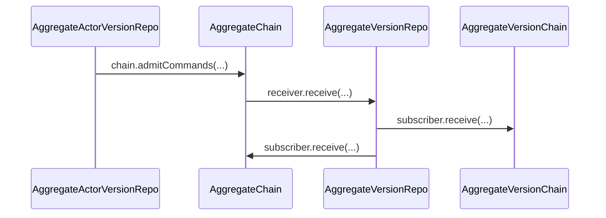
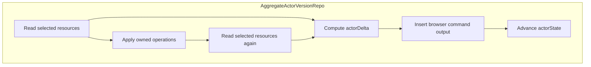
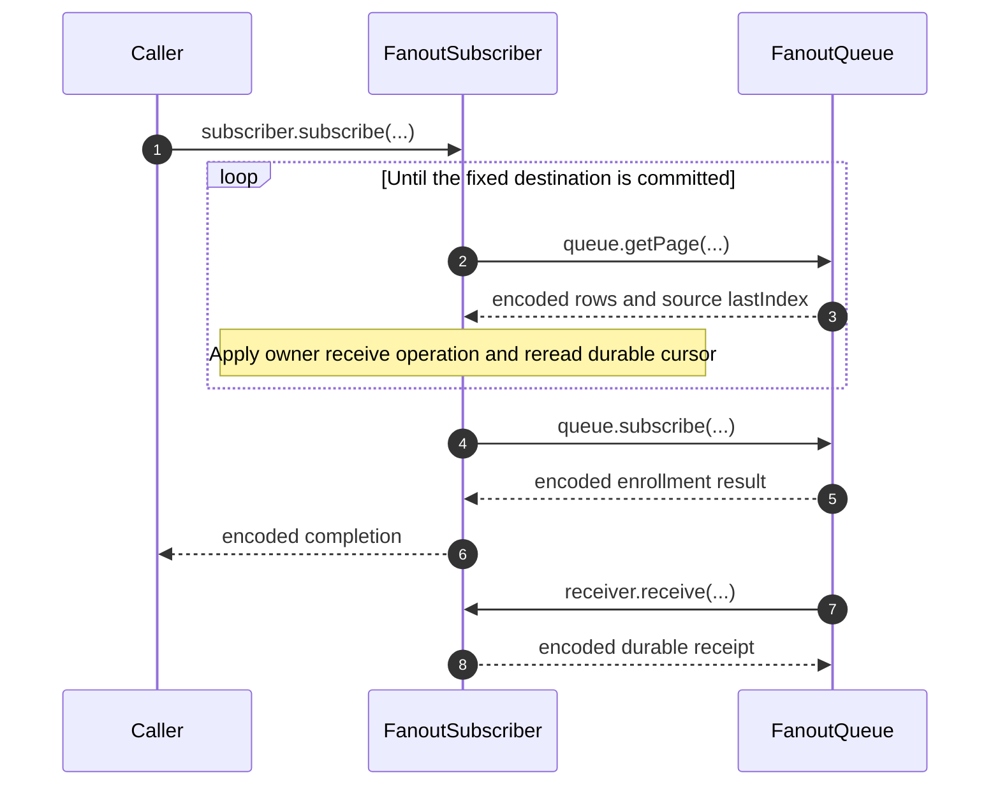

# Aggregate Command Admission and Result Delivery

AggregateChain owns the admitted aggregate command order. Admission is synchronous and local. Each VAR executes its own version's program against owned state and atomically commits a terminal result and ordered outputs. Original execution independently publishes to AVC and returns the original evidence to AC. Actors project committed outputs; sessions synchronize selected rows and replay unresolved optimistic operations.

## Trigger

1. A live aggregate session sends `pushAggregateCommand` through its admitted connection. The server checks the aggregate identity, actor, claims, session, node, and selected contract against that connection.
   - [`onMessage.ts`](../../../packages/system-worker/src/AggregateActorVersionChain/onMessage/onMessage.ts) — validates the message and its definition lock before staging.
2. The bound AggregateActorVersionRepo prepares the command against its optimistic view and retains pending work for its `stagedAggregateCommandOutbox`.
   - [`AggregateActorVersionRepo.ts`](../../../packages/system-worker/src/AggregateActorVersionRepo/AggregateActorVersionRepo.ts) — schedules durable staging and delivery.
3. The outbox submits the saved command to AggregateChain. Direct trusted execution uses `executeAggregateCommand` with an explicit aggregate version and recovers that version's terminal result.
   - [`makeStagedAggregateCommandOutbox.ts`](../../../packages/system-worker/src/AggregateActorVersionRepo/optimistic/makeStagedAggregateCommandOutbox.ts) — submits staged commands in `stageIndex` order.
   - [`executeAggregateCommand.ts`](../../../packages/system-worker/src/AggregateChain/executeAggregateCommand/executeAggregateCommand.ts) — admits once, then calls the explicitly selected materializer.

## Annotated workflow steps

1. The actor outbox submits its saved command and provenance for local admission.
   - [`makeStagedAggregateCommandOutbox.ts:103-109`](../../../packages/system-worker/src/AggregateActorVersionRepo/optimistic/makeStagedAggregateCommandOutbox.ts#L103-L109) — calls chain admission with the retained command and explicit aggregate version. (`packages/system-worker/src/AggregateActorVersionRepo/optimistic/makeStagedAggregateCommandOutbox.ts:103-109`)
2. AC sends admitted command inputs to each materializer according to original-result readiness.
   - [`AggregateChain.ts:70-87`](../../../packages/system-worker/src/AggregateChain/AggregateChain.ts#L70-L87) — binds command paging and materializer destinations. (`packages/system-worker/src/AggregateChain/AggregateChain.ts:70-87`)
3. VAR publishes complete terminal commands and owned outputs to AVC after commit.
   - [`AggregateVersionRepo.ts:346-355`](../../../packages/system-worker/src/AggregateVersionRepo/AggregateVersionRepo.ts#L346-L355) — acquires the version-chain subscriber and delivers the retained version result page. (`packages/system-worker/src/AggregateVersionRepo/AggregateVersionRepo.ts:346-355`)
4. Original execution also returns its terminal disposition and outputs to AC.
   - [`AggregateVersionRepo.ts:208-215`](../../../packages/system-worker/src/AggregateVersionRepo/AggregateVersionRepo.ts#L208-L215) — acquires the aggregate-chain subscriber and returns original execution evidence. (`packages/system-worker/src/AggregateVersionRepo/AggregateVersionRepo.ts:208-215`)

## Atomic batch admission

Admission preparation checks every input before retention: the command must match the bound aggregate, use a supported recorded actor, and carry structurally valid command fields. Payload/contract admission validation retains success or terminal failure; rejected commands materialize as skipped execution. `claims.aggregateId` must match the command's aggregate ID. State guards run during staging or execution, not in `checkAdmission`.

One synchronous transaction recovers retained commands, allocates shared input positions, validates node progress, and inserts the whole batch. An empty batch returns immediately. A conflicting node identity or node position rolls back every new row in that batch; previously committed history remains intact.

A repeated aggregate command ID returns the original retained command and admission, including its original executor pin and an occurrence inserted earlier in the same batch. The retry must retain its node, session, actor, and claims provenance; it cannot replace the stored command. For a new command with a node ID, `nodeIndex` must be exactly the next retained position, and the node's session, actor, and claims must remain the same.

- [`admitCommandsTx.ts`](../../../packages/system-worker/src/AggregateChain/admitCommands/admitCommandsTx.ts) — performs duplicate provenance checks, contiguous node validation, and aggregate-index allocation in one transaction.
- [`makeTx.ts`](../../../packages/core/src/drizzle/make/makeTx.ts) — runs the transaction Effect synchronously; failure or suspension rolls it back.

## Identity and ownership

| Owner                                                  | Bound identity                                                             | Durable responsibility                                                 |
| ------------------------------------------------------ | -------------------------------------------------------------------------- | ---------------------------------------------------------------------- |
| AggregateChain                                         | `systemId`, `aggregateId`, `aggregateName`                                 | Admitted commands, original results/outputs, and materializer progress |
| AggregateVersionRepo / AggregateVersionChain           | Aggregate identity plus `aggregateVersion`                                 | Version-owned resources, terminal commands and owned outputs           |
| AggregateActorVersionRepo / AggregateActorVersionChain | Versioned aggregate identity plus `actorName`, `actorVersion`, `actorPath` | Selected resources, actor outputs, and output delivery history         |

The actor path is the canonical encoded selection identity. Recorded commands retain the actor name/version and full claims separately. Materialization resolves that actor definition before decoding claims, and verifies that the selected materializer's contract belongs to the same supported contract lineage.

- [`aggregateActorVersionRepoFixedDORepoConfig.ts`](../../../packages/system-worker/src/AggregateActorVersionRepo/aggregateActorVersionRepoFixedDORepoConfig.ts) — defines the seven-field owner key and validates the canonical actor path.
- [`executeCommands.ts`](../../../packages/system-worker/src/AggregateVersionRepo/executeCommands/executeCommands.ts) — resolves recorded actor provenance, contract lineage, and claims before preparing operations.

AAVR resource tables contain confirmed state. Unresolved prepared operations replay into a disposable optimistic database for actor guards. A recognized chain admission refusal resolves the pending command without assigning an aggregate index or advancing the confirmed actor cursor. Snapshots and publications contain confirmed selected resources.

Staging checks candidates in retained order against that derived view. A declared rejection allocates neither a command row nor a staging position; earlier accepted candidates remain available to later guards. Accepted command rows, prepared operations, and submission work commit together only after confirming the preparation basis is still current. Same-command retries reuse retained work, while conflicting input or provenance fails. Reconstruction applies saved operations to the current confirmed graph, preserving captured IDs and timestamps without invoking programs or delivery. An unreplayable command remains pending but contributes no partial changes.

The staged-command outbox can delete after admission acknowledgement while the staging journal remains unresolved. Terminal projection resolves the journal together with confirmed resources, checkpoint, and browser publication. Snapshot capture reads that confirmed base and waits for publication through its captured checkpoint. AAVR no longer runs observation-triggered listeners or gates projection on their outputs; explicit async emissions belong to the authoritative command's VersionRepo.

- [`makeStagedAggregateCommandOutbox.ts`](../../../packages/system-worker/src/AggregateActorVersionRepo/optimistic/makeStagedAggregateCommandOutbox.ts) — retains recognized admission failures against the staged command.
- [`stageActorCommands.ts`](../../../packages/system-worker/src/AggregateActorVersionRepo/optimistic/stageActorCommands.ts) — commits accepted staging and delivery work after checking the prepared basis.
- [`makeOptimisticActorDb.ts`](../../../packages/system-worker/src/AggregateActorVersionRepo/optimistic/makeOptimisticActorDb.ts) — reconstructs optimism from the full confirmed resource graph and saved operations.
- [`checkActorStaging.mjs`](../../../packages/system-worker/scripts/checkActorStaging.mjs) — verifies these production seams with disposable Workerd SQLite, transaction-failure injection, and cold restart; snapshot and admission network receivers are fixture-owned.
- [`aggregateActorVersionRepoDbConfig.ts`](../../../packages/system-worker/src/AggregateActorVersionRepo/aggregateActorVersionRepoDbConfig.ts) — separates commands, pending prepared operations, actor outputs, and the projection checkpoint.

## Command outboxes and retained history

| Owner                                     | Pending command outbox           | Command type                                                                | Receiver                          |
| ----------------------------------------- | -------------------------------- | --------------------------------------------------------------------------- | --------------------------------- |
| AggregateActorVersionRepo                 | `stagedAggregateCommandOutbox`   | `IStagedAggregateCommand`                                                   | AggregateChain                    |
| AggregateVersionRepo / ServiceVersionRepo | `executedCommandOutbox`          | `IExecutedAggregateCommand` or `IExecutedServiceCommand`, by original owner | Corresponding version chain       |
| Original AggregateVersionRepo             | `executedAggregateCommandOutbox` | `IExecutedAggregateCommand`                                                 | AggregateChain                    |
| Both actor version repos                  | `browserCommandOutbox`           | `IBrowserCommand`                                                           | Corresponding actor version chain |
| Both version repos                        | `asyncCommandOutbox`             | `IAsyncCommand`                                                             | Corresponding admission chain     |

Each pending row stores flat command fields and required occurrence, recipient, and delivery metadata. Associated normalized operations remain available until every delivery requiring them acknowledges. Acknowledgement deletes exactly the delivered page after the receiver commits durable history. Lost acknowledgements retry identical commands; conflicting retries fail without advancing progress. Original aggregate execution enqueues both destinations in one synchronous transaction; replay do not enqueue another original return.

The actor’s `stagedCommands` journal preserves unresolved optimistic operations after admission delivery deletes. Actor-chain `browserCommands` retain outcomes independently of browser delivery. Aggregate snapshots publish through the captured resource checkpoint, then derive the private contiguous outcome prefix from actor-chain history at that checkpoint. Service flush recovers its checkpoint from pending delivery or acknowledged version-chain history.

- [`ExecutedCommandSchema.ts`](../../../packages/core/src/contracts/ExecutedCommandSchema.ts) — validates original-owner provenance and terminal result relationships.
- [`makeOutboxQueue.ts`](../../../packages/system-worker/src/makeOutboxQueue/makeOutboxQueue.ts) — deletes acknowledged delivery pages and retains pending failures for alarm recovery.
- [`deleteDeliveredAggregateMaterial.ts`](../../../packages/system-worker/src/AggregateVersionRepo/deleteDeliveredAggregateMaterial.ts) — protects material required by either pending aggregate delivery.
- [`getResolvedThrough.ts`](../../../packages/system-worker/src/AggregateActorVersionChain/getResolvedThrough.ts) — derives checkpoint-bounded private outcome progress from receiving history.

## Command occurrences and positions

| Storage                                        | Contents and order                                                 |
| ---------------------------------------------- | ------------------------------------------------------------------ |
| AggregateChain `commands`                      | Admitted aggregate commands by `aggregateIndex`                    |
| AVR / AVC `aggregateCommands` and `operations` | Terminal aggregate commands and their ordered owned operations     |
| AVR / AVC merged result feed                   | Complete command occurrences by aggregate-local `executedIndex`    |
| AAVR `outputs` / AAVC `outputs`                | Minimal browser command and checkpoint envelope by `executedIndex` |

- [`aggregateVersionRepoDbConfig.ts`](../../../packages/system-worker/src/AggregateVersionRepo/aggregateVersionRepoDbConfig.ts) — defines original command, operation, receiving head, storage.
- [`aggregateVersionChainDbConfig.ts`](../../../packages/system-worker/src/AggregateVersionChain/aggregateVersionChainDbConfig.ts) — defines durable published result history.
- [`aggregateActorVersionChainDbConfig.ts`](../../../packages/system-worker/src/AggregateActorVersionChain/aggregateActorVersionChainDbConfig.ts) — retains actor outputs separately from connection state.

An aggregate command advances `aggregateIndex`, `executedIndex`, and the aggregate `dispositionHash`. Its retained `execution` records success, declared failure, or skipped execution after failed admission. Owned operation rows replace a stored execution delta. Their order, identities, bodies, and timestamps are retained so consumers can apply them without rerunning the producing program.

- [`executeCommandsTx.ts`](../../../packages/system-worker/src/AggregateVersionRepo/executeCommands/executeCommandsTx.ts) — applies guarded operations under a savepoint and commits the terminal command with the owner head.

Actor staging evaluates contract and actor guards against the derived optimistic database. Authoritative aggregate access guards run before program preparation and again in the command transaction. Contract guards run before the program and are revalidated in that transaction. Portable programs and guards run through the synchronous program boundary; their runtime capabilities come from the configured system runtime. A declared execution rejection rolls back the command's owned mutations and outputs, then retains its failed terminal result . An infrastructure failure rolls back the unfinished command; the caller commits each command before preparing the next, so an earlier committed prefix remains durable.

Contract guards only validate: they fail or return void. Every admitted successful execution runs its program, which can emit zero operations and return its declared result. The command transaction revalidates access and guard before applying outputs. Same-command delivery retries reuse retained outcomes.

- [`stageActorCommands.ts`](../../../packages/system-worker/src/AggregateActorVersionRepo/optimistic/stageActorCommands.ts) — evaluates actor and contract guards before retaining prepared optimism.
- [`executeCommands.ts`](../../../packages/system-worker/src/AggregateVersionRepo/executeCommands/executeCommands.ts) — holds the execution permit across preparation and commits each command through `executeCommandsTx`.

## Projection state and actor outputs

Actors apply retained owned operations against their pinned model versions. The operation, selection delta, browser output, and checkpoint share one local transaction.

AAVR computes selection through the actor's captured Drizzle query and row mappings against its pinned models. Rows entering the selection produce upserts; rows leaving it produce deletions even if they still exist outside that selection. The previous selection remains in memory within the replay transaction.

Resource writes, `actorDelta`, the output row, and the checkpoint commit together. Each terminal command advances the actor's `executedIndex`, `executedHash`, and aggregate watermark. Service actors use the corresponding `executedIndex` and `serviceHash` checkpoint.

Submitted ownership metadata stays server-side. Delivery explicitly constructs `IBrowserCommand { id, commandName, delta, failure }`, applies the authenticated model lock, and exposes failure only to the submitting node/session/claims. Occurrence position, owner progress, and hash remain in the envelope. The browser resolves its own journal by ID and preserves the first outcome across later occurrences.

- [`deliverActorOutput.ts`](../../../packages/system-worker/src/deliverActorOutput/deliverActorOutput.ts) — constructs the selected browser aggregate command.
- [`filterServiceActorOutput.ts`](../../../packages/core/src/serviceSession/filterServiceActorOutput.ts) — filters service deltas and private terminal failure.

## Deployed destination enrollment and explicit versions

AggregateChain and ServiceChain activation reconcile supported versions from the executing bundle. Their local membership transactions preserve retained cursors and failures, mark supported destinations active, and mark missing versions inactive. Admission fanout selects active destinations.

- [`onDOActivation.ts`](../../../packages/system-worker/src/AggregateChain/onDOActivation/onDOActivation.ts) — reconciles materializers for this aggregate instance.
- [`onDOActivation.ts`](../../../packages/system-worker/src/ServiceChain/onDOActivation/onDOActivation.ts) — reconciles service materializer membership.

Direct aggregate admission pins the explicit `aggregateVersion`; retries use that retained original executor. Service execution similarly uses an explicit execution version. Neither path selects a mutable base version.

- [`executeAggregateCommand.ts`](../../../packages/system-worker/src/AggregateChain/executeAggregateCommand/executeAggregateCommand.ts) — validates the requested version and returns that materializer's result through the retained admission index.
- [Service command admission](./admitServiceCommand.md)

## Fanout scheduling and terminal failures

Fanout pages contain at most 64 rows, with an exclusive `afterIndex`, optional inclusive `maxIndex`, and the source's whole committed `lastIndex`. Admission feeds use `aggregateIndex` or `serviceIndex`. Aggregate actor result feeds and service result feeds use `executedIndex`.

`drainAfter` retains an alarm lease before the producer and starts delivery after it settles. Fanout producers run synchronously; outbox producers can perform asynchronous preparation before their local commit. Receivers acknowledge durable receipt, and the source records only the delivered row tail—not a newer envelope tip. There is no transaction spanning the receiver RPC and the source acknowledgement. Lost acknowledgements can therefore cause redelivery of complete committed results.

- [`makeFanoutQueue.ts`](../../../packages/system-worker/src/makeFanoutQueue/makeFanoutQueue.ts) — owns paging, source-bound receiver lookup, acknowledgement, and terminal failure persistence.
- [`makeOutboxQueue.ts`](../../../packages/system-worker/src/makeOutboxQueue/makeOutboxQueue.ts) — owns pending output delivery, exact-page acknowledgement, retry metadata, and alarm leases.

Each delivery resolves the persisted subscriber key and invokes its `${name}Subscriber(sourceKey)` capability. Lookup, delivery, decoding, or acknowledgement-write failure becomes a retained terminal subscriber `failure`. Failed subscribers remain stopped across activation and cannot clear that failure by enrolling again. Interrupted attempts without a retained terminal failure resume from durable progress. Outboxes use their own delivery retry policy.

## Subscription and snapshot recovery

A source-bound subscriber reads its owner's durable cursor. `catchup(index?)` fixes its destination to the supplied index or the first response's `lastIndex`. `subscribe(index?)` completes that catch-up before enrolling the resulting cursor. Pull and push use the same owner receive operation.

## Annotated workflow steps

1. Subscription first performs bounded catch-up.
   - [`makeFanoutSubscriber.ts:163-168`](../../../packages/system-worker/src/makeFanoutSubscriber/makeFanoutSubscriber.ts#L163-L168) — invokes `catchup` before rereading the enrollment cursor. (`packages/system-worker/src/makeFanoutSubscriber/makeFanoutSubscriber.ts:163-168`)
2. The subscriber requests pages after durable progress, with a fixed upper bound once known.
   - [`makeFanoutSubscriber.ts:89-101`](../../../packages/system-worker/src/makeFanoutSubscriber/makeFanoutSubscriber.ts#L89-L101) — resolves the bound source queue and passes `afterIndex` and optional `maxIndex`. (`packages/system-worker/src/makeFanoutSubscriber/makeFanoutSubscriber.ts:89-101`)
3. The first response fixes an omitted destination. The subscriber applies rows and rereads progress to account for overlapping push delivery.
   - [`makeFanoutSubscriber.ts:102-135`](../../../packages/system-worker/src/makeFanoutSubscriber/makeFanoutSubscriber.ts#L102-L135) — validates the tip, detects missing history or stalled progress, and stops when the fixed destination is committed. (`packages/system-worker/src/makeFanoutSubscriber/makeFanoutSubscriber.ts:102-135`)
4. Catch-up completes before remote enrollment, without a receiver execution permit spanning the request.
   - [`makeFanoutSubscriber.ts:168-176`](../../../packages/system-worker/src/makeFanoutSubscriber/makeFanoutSubscriber.ts#L168-L176) — submits the receiver key and current durable cursor to `queue.subscribe`. (`packages/system-worker/src/makeFanoutSubscriber/makeFanoutSubscriber.ts:168-176`)
5. The source returns after local enrollment and schedules delivery independently of the drain permit.
   - [`makeFanoutQueue.ts:680-695`](../../../packages/system-worker/src/makeFanoutQueue/makeFanoutQueue.ts#L680-L695) — holds recovery, commits enrollment, and starts `drain` on success. (`packages/system-worker/src/makeFanoutQueue/makeFanoutQueue.ts:680-695`)
6. Subscription succeeds only after decoding the enrollment response.
   - [`makeFanoutSubscriber.ts:171-178`](../../../packages/system-worker/src/makeFanoutSubscriber/makeFanoutSubscriber.ts#L171-L178) — decodes the source RPC envelope before encoding completion. (`packages/system-worker/src/makeFanoutSubscriber/makeFanoutSubscriber.ts:171-178`)
7. The source resolves the receiver from the retained subscriber identity and delivers the remaining rows.
   - [`makeFanoutQueue.ts:583-591`](../../../packages/system-worker/src/makeFanoutQueue/makeFanoutQueue.ts#L583-L591) — binds the queue owner key and calls `receiver.receive(delivery)`. (`packages/system-worker/src/makeFanoutQueue/makeFanoutQueue.ts:583-591`)
8. Successful receipt advances source acknowledgement to the delivered tail; delivery failure follows the durable failure path.
   - [`makeFanoutQueue.ts:589-629`](../../../packages/system-worker/src/makeFanoutQueue/makeFanoutQueue.ts#L589-L629) — decodes the receipt, writes the cursor, and retains terminal failure if delivery or acknowledgement fails. (`packages/system-worker/src/makeFanoutQueue/makeFanoutQueue.ts:589-629`)

VAR initializes its owned command head. AAVR subscribes to the finalized aggregate result feed and commits projection progress before acknowledging delivery.

- [`onDOActivation.ts`](../../../packages/system-worker/src/AggregateActorVersionRepo/onDOActivation/onDOActivation.ts) — subscribes the actor projection to result history.

An actor snapshot first catches the owner up and replays through its captured execution checkpoint. It then captures selected resources, actor indices/hash, and the requesting node's contiguous `resolvedThrough` completion watermark in one synchronous transaction. Publication is awaited through the captured `executedIndex` after that transaction. The snapshot exposes confirmed resources and the watermark, without returning private source command payloads.

- [`getSnapshot.ts`](../../../packages/system-worker/src/AggregateActorVersionRepo/getSnapshot/getSnapshot.ts) — captures selection and checkpoint together, derives the node watermark from receiving history, and drains `browserCommandOutbox` through the captured position.

## Verification

- [Implementation plan](../../archive/plans/030-plan-remove-replicas-and-service-subscriptions.md) — records the destructive removal and scoped verification.

Changed fixed schemas require empty storage. No compatibility decoder or automatic reset is provided.

## Contract return values

Programs yield model operations into a fresh execution-owned collector and return a value checked by their optional result codec. Successful command history retains the encoded result and actual executing contract version in the existing execution JSON column, atomically with owned resource writes. Omitted result codecs require void and store null. Failed application retains no successful result. Result codecs and programs complete synchronously.
