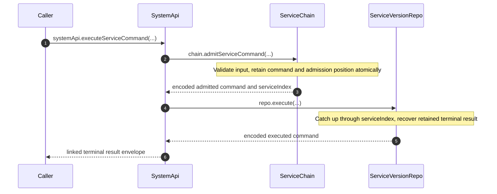

# Service Command Admission

`SystemApi.executeServiceCommand` admits one encoded service command and waits for its terminal result from the explicitly selected service version. The internal `ServiceChain.admitServiceCommand` call returns the retained command, `serviceIndex`, and completed `admission`; that return acknowledges admission only. The public SystemApi method continues through execution before responding.

## Trigger

1. An authorized SystemApi caller supplies `{ serviceVersion, command }`. The capability supplies `systemId`; it is not accepted from the command.
   - [`executeServiceCommand.ts`](../../../packages/system-worker/src/SystemApi/executeServiceCommand/executeServiceCommand.ts) — validates the request, selected execution version, and submitted contract version.
2. The handler admits the command through its ServiceChain, then executes through the assigned `serviceIndex` in the requested ServiceVersionRepo.
   - [`executeServiceCommand.ts`](../../../packages/system-worker/src/SystemApi/executeServiceCommand/executeServiceCommand.ts) — decodes both RPC responses with `readRpcEnvelope`.

## Annotated workflow steps

1. SystemApi validates the request against `EncodedServiceCommandSchema`, resolves the selected service version, and checks its contract lineage.
   - [`executeServiceCommand.ts:40-78`](../../../packages/system-worker/src/SystemApi/executeServiceCommand/executeServiceCommand.ts#L40-L78) — combines capability-bound `systemId` with the decoded service name and checks the authored contract version. (`packages/system-worker/src/SystemApi/executeServiceCommand/executeServiceCommand.ts:40-78`)
2. ServiceChain serializes admission preparation and retention. Its fanout queue holds recovery before the synchronous producer runs, then starts delivery after the producer settles.
   - [`ServiceChain.ts:138-164`](../../../packages/system-worker/src/ServiceChain/ServiceChain.ts#L138-L164) — serializes admission preparation and durable retention under the admission permit. (`packages/system-worker/src/ServiceChain/ServiceChain.ts:138-164`)
3. The local transaction returns the retained admission, including its original index on an identical retry. It does not wait for materialization.
   - [`retainServiceCommand.ts:20-53`](../../../packages/system-worker/src/ServiceChain/admitServiceCommand/retainServiceCommand.ts#L20-L53) — returns original admission and index on retry, then validates contiguous node provenance before insertion. (`packages/system-worker/src/ServiceChain/admitServiceCommand/retainServiceCommand.ts:20-53`)
4. SystemApi asks the explicitly selected ServiceVersionRepo to execute through that admission position.
   - [`executeServiceCommand.ts:80-97`](../../../packages/system-worker/src/SystemApi/executeServiceCommand/executeServiceCommand.ts#L80-L97) — decodes admission, constructs the version-specific Repo key, and calls `repo.execute`. (`packages/system-worker/src/SystemApi/executeServiceCommand/executeServiceCommand.ts:80-97`)
5. Execution catches up through the requested position and returns the retained terminal command. If publication has removed the local outbox row, it recovers the same result from ServiceVersionChain.
   - [`execute.ts:37-87`](../../../packages/system-worker/src/ServiceVersionRepo/execute/execute.ts#L37-L87) — reads the local command or calls `chain.getServiceResult`, then validates `ExecutedServiceCommandSchema`. (`packages/system-worker/src/ServiceVersionRepo/execute/execute.ts:37-87`)
6. SystemApi returns the terminal result through its existing linked RPC boundary.
   - [`makeApiHandler.ts:77-120`](../../../packages/system-worker/src/SystemApi/makeApiHandler/makeApiHandler.ts#L77-L120) — retains the settled handler result while separately recording telemetry and constructing the optional trace link. (`packages/system-worker/src/SystemApi/makeApiHandler/makeApiHandler.ts:77-120`)

## Admission validation and retries

The command's `serviceVersion` identifies its submitted service composition. The request's `serviceVersion` explicitly selects the execution composition. Admission validates the command against its addressed composition; execution resolves the program in the selected materializer. These are separate checks.

- [`admitServiceCommand.ts`](../../../packages/system-worker/src/ServiceChain/admitServiceCommand/admitServiceCommand.ts) — checks the bound service name, complete encoded command, addressed composition, submitted payload, and exact retained command identity.
- [`executeCommands.ts`](../../../packages/system-worker/src/ServiceVersionRepo/executeCommands/executeCommands.ts) — resolves the selected service's contract and prepares its operations.

- [`checkAdmission.ts`](../../../packages/system-worker/src/checkAdmission.ts) — validates the submitted contract payload and any supplied claims without running state guards.
- [`executeCommandsTx.ts`](../../../packages/system-worker/src/ServiceVersionRepo/executeCommands/executeCommandsTx.ts) — evaluates the service contract guard and applies the command under the synchronous transaction.

Contract guards only validate: they fail or return void. Every admitted successful execution runs its program, which can emit zero operations and return its declared result. The command transaction revalidates access and guard before applying outputs. Same-command delivery retries reuse retained outcomes.

A mismatched service, unsupported version, forbidden actor, or conflicting command ID fails at the boundary without allocating a new position. A valid addressed command with rejected payload/contract admission retains the rejection and proceeds through skipped execution. An identical retry returns the original admission and timestamps. Retrying public execution then recovers that selected version's terminal result rather than rerunning an already consumed command.

## Delivery, transactions, and recovery

ServiceChain stores admitted `commands` in `serviceIndex` order. Activation reconciles all bundled service versions into `serviceSubscribers`, preserving their existing cursors and failures while marking absent versions inactive. Its `admissionResultsFanout` sends complete admitted rows to each active, unfailed materializer's `admissionResultsFanoutSubscriber(sourceKey)`.

- [`onDOActivation.ts`](../../../packages/system-worker/src/ServiceChain/onDOActivation/onDOActivation.ts) — updates deployed membership in one local transaction.
- [`ServiceChain.ts`](../../../packages/system-worker/src/ServiceChain/ServiceChain.ts) — binds `commands`, `serviceIndex`, and the `active` predicate to the fanout queue.
- [`ServiceVersionRepo.ts`](../../../packages/system-worker/src/ServiceVersionRepo/ServiceVersionRepo.ts) — verifies the source key, reads `head.serviceIndex`, and executes received rows under the owner permit.

- [`makeTx.ts`](../../../packages/core/src/drizzle/make/makeTx.ts) — executes the transaction Effect synchronously and rolls back failures or suspension.
- [Service execution](./serviceExecution.md) — details owned execution and subsequent actor projection.

Service execution retains `serviceIndex` for admission and `executedIndex` for terminal history. ServiceVersionChain retains commands, owned operations and execution positions. Its remaining fanout supplies service actor projections and sessions.

- [`serviceVersionChainDbConfig.ts`](../../../packages/system-worker/src/ServiceVersionChain/serviceVersionChainDbConfig.ts) — defines the retained result storage and merged execution index.

Fanout acknowledges only the delivered page tail after successful durable receipt. A lost acknowledgement can redeliver already committed results, which receivers validate against retained original inputs and operation bodies before skipping. Terminal subscriber failures remain stopped across activation and enrollment; outboxes retain their separate delivery retry policy. See [fanout scheduling and terminal failures](./admitCommands.md#fanout-scheduling-and-terminal-failures).

## Callers

- [`seedFn.ts`](../../../packages/cli/src/seed/seedFn.ts) — executes service seed commands through `systemApi.executeServiceCommand`.
- [Aggregate command admission](./admitCommands.md)

## Contract return values

Programs yield model operations into a fresh execution-owned collector and return a value checked by their optional result codec. Successful command history retains the encoded result and actual executing contract version in the existing execution JSON column, atomically with owned resource writes. Omitted result codecs require void and store null. Failed application retains no successful result. Result codecs and programs complete synchronously.
