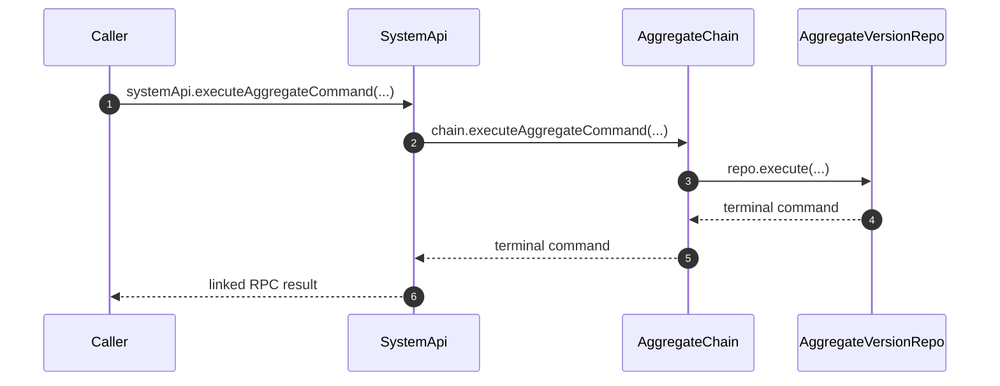

# Aggregate Command Execution

Secret-key and provisioning requests stage in the selected AAVR before direct AC execution. Direct requests admit with an explicit aggregate version and return its terminal result. Admission persists that original executor pin; retries preserve it. Session push requests return admission receipts instead. Publication proceeds through the durable topology described in [Command Chains](./admitCommands.md).

## Trigger

1. A secret-key caller submits one full aggregate command.
   - [`executeAggregateCommand.ts:34-44`](../../../packages/system-worker/src/SystemApi/executeAggregateCommand/executeAggregateCommand.ts#L34-L44) — Validates the command envelope and obtains the capability-bound systemId.

## Annotated workflow steps

1. SystemApi validates the complete request and uses its bound system capability.
   - [`executeAggregateCommand.ts:43-56`](../../../packages/system-worker/src/SystemApi/executeAggregateCommand/executeAggregateCommand.ts#L43-L56) — decodes the explicit version/command tuple and obtains authenticated system context. (`packages/system-worker/src/SystemApi/executeAggregateCommand/executeAggregateCommand.ts:43-56`)
2. SystemApi stages the command, then calls its aggregate chain.
   - [`executeAggregateCommand.ts:93-105`](../../../packages/system-worker/src/SystemApi/executeAggregateCommand/executeAggregateCommand.ts#L93-L105) — stages against the selected actor before decoding the direct chain result. (`packages/system-worker/src/SystemApi/executeAggregateCommand/executeAggregateCommand.ts:93-105`)
3. AC admits once and executes through the saved occurrence on its original executor.
   - [`executeAggregateCommand.ts:28-43`](../../../packages/system-worker/src/AggregateChain/executeAggregateCommand/executeAggregateCommand.ts#L28-L43) — uses the admission receipt's retained index and originalExecutionVersion. (`packages/system-worker/src/AggregateChain/executeAggregateCommand/executeAggregateCommand.ts:28-43`)
4. VAR returns the retained terminal occurrence after local commit or recovery from AVC.
   - [`execute.ts:87-100`](../../../packages/system-worker/src/AggregateVersionRepo/execute/execute.ts#L87-L100) — returns pending durable output or queries finalized result history when already acknowledged. (`packages/system-worker/src/AggregateVersionRepo/execute/execute.ts:87-100`)
5. AC encodes the version-owned result for its caller.
   - [`AggregateChain.ts:221-235`](../../../packages/system-worker/src/AggregateChain/AggregateChain.ts#L221-L235) — runs the bound direct operation through makeRpcEnvelope. (`packages/system-worker/src/AggregateChain/AggregateChain.ts:221-235`)
6. SystemApi returns the decoded linked RPC result.
   - [`executeAggregateCommand.ts:100-110`](../../../packages/system-worker/src/SystemApi/executeAggregateCommand/executeAggregateCommand.ts#L100-L110) — wraps the chain result with the system span and granted capability. (`packages/system-worker/src/SystemApi/executeAggregateCommand/executeAggregateCommand.ts:100-110`)

## Publication and recovery

VAR retains owned outputs, terminal disposition and local head atomically with resource state. The business savepoint rolls back owned writes on rejection; infrastructure failures abort the enclosing transaction. Independent original-result and version-history outboxes recover after interruption. Their acknowledgements delete pending delivery rows independently, retaining model publication material until neither destination needs it. Producer-owned async rows survive both acknowledgements. Post-commit retries recover the saved result. No SQL transaction spans delivery RPCs.

- [`executeCommandsTx.ts`](../../../packages/system-worker/src/AggregateVersionRepo/executeCommands/executeCommandsTx.ts) — commits owned state, disposition and pending delivery together.
- [`deleteDeliveredAggregateMaterial.ts`](../../../packages/system-worker/src/AggregateVersionRepo/deleteDeliveredAggregateMaterial.ts) — retains model material until both destinations acknowledge, preserving async lifecycle.
- [`flush.ts`](../../../packages/system-worker/src/AggregateVersionRepo/flush/flush.ts) — awaits execution and AVC publication through a fixed command checkpoint.

## Recorded selection provenance

- [`getAggregateActorVersion.ts`](../../../packages/core/src/aggregateActor/getAggregateActorVersion.ts) — rejects unsupported or conflicting actor versions.
- [`makeSystem.ts`](../../../packages/core/src/system/make/makeSystem/makeSystem.ts) — supplies shared runtime capabilities across invocations.
- [Implementation verification](../../archive/plans/030-plan-remove-replicas-and-service-subscriptions.md) — records scoped gates and outstanding runtime checks.

## Operation results

The returned command has completed `admission` and `execution` results. Admission
rejection retains its failure and skips execution with reason `admission-failed`.
A declared execution rejection lives in `execution.failure`. Infrastructure failures
abort the attempt and remain RPC failures. Resource timestamps use execution's
`startedAt`; `completedAt` records completion of that operation. Delivery retries
return the retained result without changing either timestamp.

## Contract return values

The runner collects typed operation emissions independently of the program return value. It validates and encodes the optional result codec before resource application. Successful terminal history retains the encoded result and actual executing contract version atomically with owned operations; failed application retains no successful result. Same-command retries reuse that retained outcome.

## Mapped output and async lifecycle

Server execution runs the ordinary program, validates its original result, then runs the mapper with immutable base output and declared read-only model access. Mapper emissions append in order and its required result codec owns authoritative output. Both programs see pre-application state. Browser staging and locks continue to use the original declaration.

Successful application commits model changes, complete output and eligible async lifecycle with terminal history. `modelOperations` and `asyncOperations` share `(commandId, operationIndex)` identity; readers merge immutable output by that index. Original execution alone allocates child IDs and retains actor authority. Replay runs the full mapped program but applies only model operations and retains async emissions with null lifecycle. Actor projections skip async entries without renumbering model operations.

Producer execution starts after commit. Observation recording, deadline clearing and minimal child-command delivery enqueue share one synchronous transaction. Retained async rows survive source publication cleanup. Child reconstruction uses frozen payload, observation, exact actor/contract pins and Repo identity; it does not require a source command row. Continuation rejection preserves recorded evidence. See [async operation lifecycle](../../../packages/system-worker/src/asyncOperations/README.md).

- [`makeOperations.ts`](../../../packages/core/src/contracts/make/makeOperations.ts) — base validation, immutable mapper input and authoritative result validation.
- [`readOperationOutput.ts`](../../../packages/system-worker/src/asyncOperations/readOperationOutput.ts) — ordered complete output across physical tables.
- [`makeAsyncOperations.ts`](../../../packages/system-worker/src/asyncOperations/makeAsyncOperations.ts) — concurrent production, atomic observation retention and recovery.
