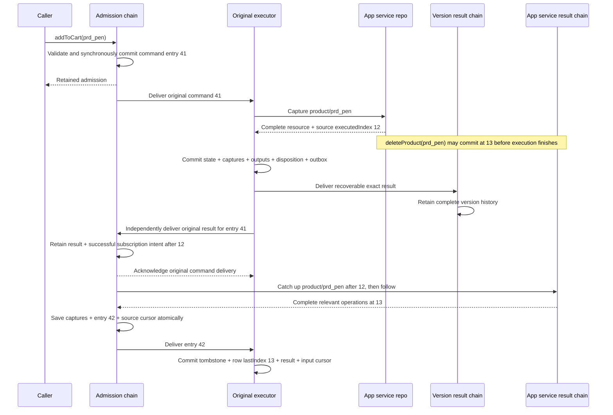

# Captured operations, resource subscriptions, and chain replay

**Date:** 2026-10-01

**Status:** Superseded on 2026-10-02 by [plan 030](../../archive/plans/030-plan-remove-replicas-and-service-subscriptions.md). Historical implementation/evidence below describes the removed machinery.

## Problem and scope

1. An aggregate must copy only the service resources it actually enrolls, such as products successfully added to a cart. Copying the catalog or independently subscribing every aggregate version wastes storage and lets versions observe different external inputs.
2. Admission must remain synchronous: validate the submitted command and commit its admission in a local transaction. Admission does not fetch resources, run the execution program, wait for materialization, or wait for downstream delivery. An asynchronous RPC return type does not change this local admission contract.
3. Execution performs asynchronous capture. The admission chain eventually retains the command's immutable external observations, original output operations, and terminal execution result. Resource subscriptions belong to that chain, and incoming subscription operations join commands in one durable input order.
4. This plan covers the service-to-aggregate replica lifecycle demonstrated by `addToCart`, operation typing/storage, result handoff, and new-version replay. Adapt shared service/actor consumers affected by these contracts. Preserve independently declared service observation behavior rather than replacing it incidentally.
5. Earlier agent decisions remain context for subsequent work: agents are declared on the system and pinned to service versions; one agent can use multiple aggregate/service actor sessions; Studio should expose their actual vantage point. This plan does not invent the agent runner, session registration, or Studio UI. Agent upgrades and runtime aggregate-source enrollment are deferred. Aggregate sources require a specific owning aggregate instance; do not infer that instance from a model name or copy all instances.
6. Apply the pre-release hard cutover. Replace in-scope obsolete paths, schemas, callers, and docs outright. Changed fixed schemas require empty storage; provide no compatibility decoder, alias, translation migration, or automatic deletion of user storage.

## Agreed terminology and behavior

1. **Captured operation:** an operation whose external observation is frozen for later execution/replay. Use `ICapturedOperation` for this meaning. `replicate(product)` is the first authored captured-operation kind. Future kinds are possible, but this delivery adds no speculative capture provider framework.
2. **`captured`:** the typed captured value. For a successful `replicate`, this column contains the complete authoritative resource snapshot, including its exact model version. Source identity and source position remain envelope fields. Do not hide the snapshot in a replica operation's `body.resource` while also copying it into `captured`.
3. **Owned output operation:** what execution actually committed to aggregate-owned state. Preserve output order and exact model/operation identity. Original outputs are evidence for inspection/comparison; a new executing version regenerates its own owned outputs.
4. **Disposition:** the terminal execution outcome represented by the existing execution-result contract, including structured business failure where applicable. Reuse that representation rather than adding a second outcome wrapper. Keep delivery diagnostics separate from business rejection.
5. **Original executor:** the aggregate version explicitly selected for the command's initial execution. Persist that version as provenance at admission, using the existing selected `aggregateVersion` input. Its retained result governs subscription enrollment. A replaying version cannot replace the original captures/result or activate additional subscriptions for the historical command. This is not an automatic upgrade policy.
6. **Chain input order:** one local sequence containing admitted commands and standalone incoming source-result batches. A command's captures and original result attach to its existing entry; receiving the result does not allocate another input position. Source positions do not determine local interleaving across services.
7. **Resource subscription:** the exact source owner/version, model, and resource ID, with a source cursor indicating how far that chain has durably captured the source history. Repeated successful references to the same resource share one subscription. A later command capture must not advance that subscription past source operations the chain has not retained.
8. **Replica row `lastIndex`:** how far that materialized resource covers its source history. It differs from the chain subscription's `lastIndex`, which may be ahead because the chain has saved operations the aggregate has not applied yet. Retain neither `sourceResultPosition` nor a second receiver-side subscription table.
9. Captures already observed survive a subsequent business rejection. Owned writes and successful output operations roll back. A rejected command creates no active resource subscription. A rejection before any capture retains an empty capture collection.
10. A source subscription delivers committed operations from the existing ServiceVersionChain (SVC), filtered to enrolled resources. Do not introduce a second product change log. Preserve all relevant operations from one source result together and retain their original order.

## Source declaration

Use the agreed flat declaration rather than the current `sourceModel` / `serviceName` / `serviceVersion` props:

```ts
const productReplica = makeReplica({
  model: productV1,
  kind: 'service',
  name: 'app',
  version: '1.0.0',
});
```

1. The declaration identifies the source model and pinned owner version. It does not create a catalog subscription or subscribe an aggregate instance merely because the model is registered.
2. The selected resource is identified by the authored `replicate(product)` operation. Execution obtains the authoritative snapshot; client-supplied resource fields cannot become the authoritative capture.
3. Retain the flat `kind`, `name`, and `version` source vocabulary for aggregate-source declarations discussed in the interview. Executing aggregate-source capture requires an explicit owning aggregate ID and is outside this delivery; do not silently accept an unresolved source at an execution boundary.

## Persistence and ownership

The following tables describe intended ownership. Implement them through the repository's `makeTable` / row-codec conventions, with structured fields rather than a serialized copy of the entire command or result.

| Owner                               | Table/state                                 | Required meaning                                                                                                                                                                                                                           |
| ----------------------------------- | ------------------------------------------- | ------------------------------------------------------------------------------------------------------------------------------------------------------------------------------------------------------------------------------------------ |
| AggregateChain (AC)                 | `entries`                                   | Shared input sequence and entry kind: command or incoming captured-operation batch. Use `aggregateIndex` as the aggregate's shared input position.                                                                                         |
| AC                                  | `commands`                                  | Complete admitted command fields, admission result, selected original execution version, and its entry association. `nodeIndex` remains the submitting node's own command order.                                                           |
| AC                                  | `capturedOperations`                        | Entry association, operation order, operation kind, exact source/model/resource identity, source index, and typed `captured` value. Command captures attach to a command entry; subscription captures attach to their source-result entry. |
| AC                                  | `operations`                                | Original committed owned output operations, associated with the command entry and original operation order. Keep these separate from replay inputs.                                                                                        |
| AC                                  | execution result                            | Original disposition, execution timestamps/provenance, and completion of the existing command entry. Reuse the existing execution-result shape.                                                                                            |
| AC                                  | `subscriptions`                             | Exact service/version/model/resource enrollment and `lastIndex` durably captured. The successful result and enrollment intent commit together.                                                                                             |
| AC                                  | existing materializer subscriber progress   | Contiguous input progress per version. Original execution and saved-input replay share input positions, but have different readiness rules.                                                                                                |
| Original AggregateVersionRepo (VAR) | resources + result outbox                   | Locally committed state and the recoverable exact result: captures, actual outputs, disposition, and entry identity. Delivery copies survive until acknowledged.                                                                           |
| Any VAR                             | replay head + replica rows                  | Last applied chain input, version-owned state, and each replica row's `lastIndex` / `deletedAt`. State, result, and replay progress commit together.                                                                                       |
| AggregateVersionChain (AVC)         | existing terminal output history            | Version-specific committed results for actor projection and existing downstream observers. This is derived output history, not a separately merged source of replay inputs.                                                                |
| Source ServiceVersionRepo (SVR)     | authoritative `product`                     | Service-owned product fields. No replica subscription cursor is added to the source product.                                                                                                                                               |
| Source SVC                          | existing committed result/operation history | Source of resource-filtered catch-up and live delivery. Use its merged `executedIndex` as the source position, not service command admission order.                                                                                        |

1. Require unique entry positions and command identities. Capture/output rows must refer to the correct entry, and operation order must be unique within its collection. Validate entry kinds and whole-result associations at the receiving boundary.
2. Source delivery deduplication is scoped to the exact subscription and source result. An identical redelivery does not append another entry or advance progress twice. Conflicting retained data fails without rewriting the original.
3. A filtered stream may skip unrelated source indices. Its delivery reports the source range covered so the receiver does not confuse a numeric jump with lost relevant operations. It advances only the subscriptions covered by that delivery.
4. If one source result affects several enrolled resources, retain its complete relevant batch as one local entry. Snapshot baselines may differ per resource; omit operations already covered by that resource's baseline without splitting the remaining batch into independent applications.
5. Group source transport by destination AC and exact source service/version. A page contains complete relevant source-result batches and per-resource coverage for that group's active enrollments. Do not schedule unrelated per-resource callbacks and expect the receiver to reconstruct batch completeness. Durable enrollment/cursors remain per resource; late enrollment uses targeted historical catch-up without rewinding previously covered resources.
6. Keep historical captures after a replica is tombstoned or no longer needed by a current cart. Those captures are replay evidence. Automatic subscription retirement, reference counting, pruning, and re-enrollment epochs are separate work; do not add another lifecycle now.

For the pen example, the source envelope identifies `service app@1.0.0`, model `product@1.0.0`, and resource `prd_pen`. The capture rows look like this; the snapshot cell is abbreviated for display only:

| `aggregateIndex` | Operation order | Operation   | Source index | `captured`                                                               |
| ---------------- | --------------- | ----------- | ------------ | ------------------------------------------------------------------------ |
| 41               | 0               | `replicate` | 12           | `{ id: 'prd_pen', name: 'Pen', price: 30, ... }`                         |
| 42               | 0               | `delete`    | 13           | `{}` — received deletion body; resource identity remains in the envelope |

## Concrete execution and replay

| Local chain position | Retained entry                                                                    | Original execution / new-version replay                                                                                                                          |
| -------------------- | --------------------------------------------------------------------------------- | ---------------------------------------------------------------------------------------------------------------------------------------------------------------- |
| 41                   | `addToCart(prd_pen)` plus its eventual result and product capture at SVC index 12 | Execute the version's contract using the saved pen snapshot and its current owned cart state. Initial successful enrollment installs the replica baseline at 12. |
| 42                   | Received `deleteProduct(prd_pen)` operation at SVC index 13                       | Apply the captured source deletion to the enrolled replica, retain a tombstone, and advance its `lastIndex` to 13.                                               |
| 43                   | Next admitted command and its captures/result                                     | Execute after 42 against this version's owned state, satisfying external requests from that command's saved captures.                                            |



1. VAR atomically enqueues `executedCommandOutbox` to AVC and `executedAggregateCommandOutbox` directly to AC for original execution. Either receiver may commit first. Independent acknowledgements delete only that destination’s pending command; shared operations/captures remain until both acknowledge. Replay and imported occurrences do not enqueue another original return. [Plan 029](029-plan-command-chains-without-receipts.md) replaces the earlier forwarding hop.
2. AC may acknowledge admission before capturing starts. Incoming source entries may append while an earlier command is executing, but no version applies a later entry before completing the earlier entry.
3. The original executor receives pending commands so it can supply their captures/results. Replaying versions receive commands only once the original result and capture collection are retained. A permanently blocked earlier entry blocks later replay; a business rejection is a completed entry and allows progress.
4. A command uses its saved external capture, even if a live replica now represents a newer source position. Reusing an older command capture must not overwrite or rewind that live row. Only first successful enrollment installs the initial snapshot baseline; subsequent source batches advance the live replica.
5. New-version replay reruns that version's program and guards against its own current owned state. Match saved captures by capture kind and exact source/model/resource identity rather than assuming the new program has the original operation ordinal. Keep original ordinals for output evidence.
6. A replay capture provider performs no source RPC. If new code requests an external dependency absent from the retained captures, stop with an explicit unsupported/missing-capture result. Do not turn that into a new business rejection or fetch today's resource. Validated external absence observed during original execution must also remain an observation when it affects the result.
7. Ordinary output operations and the original disposition are comparison evidence, not instructions for a new executing version. Actor projection and downstream source publication still consume the actual committed outputs of their pinned version. Subscription entries directly apply saved source operations to the replica; they do not rerun the source service's command.
8. A replaying version may reject a command that originally enrolled a resource. Later source entries must skip operations for resources absent from that version's local enrollment, while atomically recording the empty result and advancing its input cursor. Do not initialize a replica from an update/delete patch or turn expected output divergence into a missing-row infrastructure failure. Conversely, a new successful replay of an originally rejected command does not manufacture unrecorded source history or activate new canonical subscriptions; that divergence is comparison evidence, and its acceptance/promotion policy remains deferred.
9. Handoff idempotency compares the exact retained result, including captures and original provenance/timestamps. Automatic new-version comparison and its dedicated API are removed by [plan 026](026-plan-contract-operation-emission-and-results.md). Retained outputs and dispositions remain inspection evidence; comparison policy is deferred.

## Transaction and interruption rules

1. **Admission:** atomically allocate the shared input position and retain the validated complete command and original execution pin. Retry by command identity returns the retained occurrence. Admission does not enter a remote capture/execution transaction.
2. **Original execution:** perform source capture outside SQLite transactions. In a synchronous local transaction, apply guarded business work under a savepoint and retain terminal disposition, captures, actual committed outputs, input progress, and durable delivery work. A business rollback removes owned mutations/output rows but retains already-observed captures outside that savepoint. A failed storage commit publishes nothing.
3. **Retry before commit:** interruption before any execution result commits may capture again. Once state/result commit, recovery reads that exact result and never reruns the command or fetches different external data.
4. **Result publication:** AVC retains complete version history before acknowledging VAR. AC independently retains the direct original result, all capture/output rows, and successful resource enrollment intents atomically before acknowledging VAR. Lost acknowledgements resend identical records; they never create new input entries or subscriptions.
5. **Subscription activation:** persisted intent recovers if registration/catch-up is interrupted. Start after the successful enrollment capture's source index. Historical source results bridge the capture-to-execution and execution-to-registration gaps. Do not require a distributed transaction with the service.
6. **Incoming source result:** validate source and complete operation order, check per-resource coverage, and atomically append its captured-operation rows/entry and advance covered subscription cursors. No relevant operations means no artificial local input entry, while covered source progress can still advance.
7. **Materialization:** all applicable operations in one source entry, replica row frontiers, input progress, version result, and output delivery work commit together. Keep deletion tombstones while owned references require them. `prd_book` never appears in the shopper merely because it shares the app service.
8. Reuse existing outbox, fanout, alarm, and subscriber mechanisms. Do not hold a SQL transaction or admission gate across source RPCs, result delivery, catch-up, or subscriber registration. Preserve source operation order and local input order without timestamp sorting or a global sequencer.

## Initial source inspection (before implementation)

1. [AggregateChain admission](../../../packages/system-worker/src/AggregateChain/admitCommands/admitCommandsTx.ts) currently allocates command-only `aggregateIndex` positions. [AggregateChain](../../../packages/system-worker/src/AggregateChain/AggregateChain.ts) fans those rows to version repos. It does not yet retain original captures/results or resource subscriptions.
2. [Aggregate execution preparation](../../../packages/system-worker/src/AggregateVersionRepo/executeCommands/executeCommands.ts) already performs asynchronous source snapshot reads. [Its transaction](../../../packages/system-worker/src/AggregateVersionRepo/executeCommands/executeCommandsTx.ts) currently treats encoded output operations as captures and writes them inside the business savepoint. That does not satisfy external-observation retention through rejection.
3. [Worker capturedOperations](../../../packages/system-worker/src/capturedOperations.ts) currently names all encoded output operations `ICapturedOperation`. [Core operations](../../../packages/core/src/contracts/types.ts) and [replicate](../../../packages/core/src/contracts/replicate.ts) do not yet expose the agreed capture semantics. Replace these meanings rather than layering another similarly named type over them.
4. [makeReplica](../../../packages/core/src/models/make/makeReplica.ts) currently takes service-specific source props and adds `sourceResultPosition`. [Aggregate version construction](../../../packages/core/src/aggregate/make/makeAggregateVersion.ts) derives whole-service pins from those models. Change metadata, declarations, validation, manifest/spec encoding, and in-scope callers together.
5. `AggregateVersionRepo/receiveServiceResults.ts` (now deleted), [VAR activation](../../../packages/system-worker/src/AggregateVersionRepo/onDOActivation/onDOActivation.ts), and [VAR storage](../../../packages/system-worker/src/AggregateVersionRepo/aggregateVersionRepoDbConfig.ts) currently own source subscriptions/progress. [SVC](../../../packages/system-worker/src/ServiceVersionChain/ServiceVersionChain.ts) routes to aggregate version repos. Move this lifecycle to resource-scoped AC enrollment and delete the replaced direct route.
6. [SVR snapshot lookup](../../../packages/system-worker/src/ServiceVersionRepo/getReplicatedResources/getReplicatedResources.ts) is the existing source-local resource/frontier capture seam. [AVC](../../../packages/system-worker/src/AggregateVersionChain/AggregateVersionChain.ts) and [SVC storage](../../../packages/system-worker/src/ServiceVersionChain/serviceVersionChainDbConfig.ts) remain the version-specific committed output histories used by actors/observers.
7. The inspected checkout is clean. The earlier [replication research](../../research/aggregate-service-replication-indexes.md) describes an earlier source snapshot and historical deleted tests; recheck its cited paths rather than treating its runnable-status notes as current.
8. At the planning baseline, no governing ADR directory existed. [Spec 010](../specs/010-spec-command-lifecycle-results.md) and [plan 011](011-plan-actor-staging-and-gated-listener-execution.md) are now reconciled and archived historical lifecycle/staging records. Current surviving responsibilities are documented and verified in the plan 011 closure; its listener scope is retired. Archived [plan 012](012-plan-executed-mutation-retention.md) explains retained output evidence but does not govern this new input-capture ownership.

## Implementation sequence

1. **Establish scoped verification.** The inspected core/system-worker projects have no `test` target or remaining behavioral test files. Before implementation, create narrowly scoped behavioral fixtures through the admission, execution transaction, retained-result, and subscription interfaces below. Use existing TypeScript/runtime tooling and SQLite support for local method assertions, and the configured Shopping dev runtime for real Durable Object restart/delivery cases. Expose the scenarios through Nx; record actual commands once configured. Do not resurrect a broad deleted test suite or assume historical filenames exist.
2. **Cut over core source/capture declarations.** Update `models/make/makeReplica.ts`, `models/types.ts`, replica metadata in `models/defineModel.ts`, contract model-operation construction/inference, `contracts/replicate.ts`, and exact model/operation codecs. Separate authored capture requests, completed `ICapturedOperation` values, and ordinary encoded outputs. Update aggregate source validation, specs/manifests, Shopping programs, and affected actor/session/browser consumers. Replace `sourceResultPosition` with replica-row `lastIndex` in this path.
3. **Introduce the shared AC input journal.** Update AC storage, admission transaction, paging/fanout, and subscriber progress so `entries` owns `aggregateIndex` for both commands and incoming source batches. Persist the original selected execution version while admitting. Keep node command order distinct. Enforce original-executor versus replay readiness, deliver complete entry envelopes, and remove command-table-only assumptions from contiguous progress checks and bounded execution.
4. **Make captures execution-owned and durable.** Refactor existing VAR preparation and transaction code to collect authoritative external observations, reuse one observation for the same resource request within a command, and keep those observations through domain rejection. Preserve authored operation order and current owned-state guard checks. Commit resource changes, disposition, captures, actual outputs, and result delivery work together. Store/recover full results so post-commit retries cannot recapture.
5. **Retain the result at AC through the existing result path.** Extend the VAR → AVC delivery/retention contract with distinct capture and owned-output collections. Atomically enqueue direct VAR → AC delivery alongside VAR → AVC delivery. AC validates original version/command/entry association, durably retains the full result, and records enrollment only for successfully executed replication. Allow captures on failed results; reject committed owned mutations on failed results. Adapt actor and service-observer readers to the new types without deleting their distinct behavior.
6. **Move replica subscriptions to AC.** Replace VAR's `services` subscription/progress ownership, service-result subscriber capabilities/caches, direct catch-up loops, and `receiveServiceResults` path. Change SVC aggregate destinations to AC resource subscriptions. Implement filtered historical/live delivery from existing SVC results, grouped by destination AC and exact source/version, with complete relevant batches and per-resource coverage. Commit capture/entry/cursor progress atomically and recover enrollment from the saved initial source position. Do not retain per-version source subscriptions alongside this route.
7. **Implement saved-input replay.** Add the replay execution path that reuses captures without network access, reruns the selected version's program/guards, and regenerates owned outputs/disposition. Consume standalone source entries through the same input cursor and version result publication. Apply tombstones/frontiers transactionally; skip stale baseline reinstalls. Keep original retained outputs/disposition available through existing chain inspection. Do not add a dedicated comparison API or automated upgrade policy.
8. **Update delivery and inspection consumers.** Adapt AC/AVC/SVC table inspection APIs, SDK manifests/generated schemas where affected, and existing Studio table views so command captures, original outputs, disposition, subscription progress, and replica-row progress can be inspected by owner. Preserve actor/session privacy and command-completion ownership; a source-only entry cannot complete a submitted browser command. This is support for changed table contracts, not the deferred agent-vantage UI.
9. **Complete verification and hard cutover.** Run the behavioral matrix and scoped Nx gates, remove obsolete encoded-output capture names and old resource-subscription routes, and verify all changed schemas require empty storage. Preserve unrelated WIP and report blockers separately. No compatibility path or automatic storage reset is part of completion.
10. **Reconcile implemented documentation.** Perform the documentation work below only after code/verification establish the actual behavior. Keep this plan active until all required work is complete.

## Verification matrix

1. **Synchronous admission:** make the source capture endpoint unavailable and prove admission still commits/returns without contacting it. Admission rejection consumes no chain position. Identical command retry returns the retained identity/index/version pin; node ordering remains correct across interleaved subscription entries.
2. **Capture transaction:** source resource and source merged frontier are captured together. Ignore client-supplied authoritative fields. Verify complete snapshot decoding, exact source/model version binding, partial capture followed by rejection, and retained observed absence where relevant.
3. **Business rollback:** force a later owned write or guard to reject after capture. No cart item, replica enrollment, committed owned output, or active subscription remains; the failed disposition and already-observed captures remain recoverable.
4. **Crash/outbox recovery:** interrupt before result commit, after commit before VAR delivery, after either receiver retention before acknowledgement, after AC retention before acknowledgement, and after enrollment intent before source registration. Verify no lost result, no post-commit recapture/re-execution, no duplicate entries/enrollment, and no premature outbox cleanup.
5. **Delayed enrollment:** capture pen at 12, commit its deletion at 13 before `addToCart` finishes, then delay chain result retention/registration. Catch-up still saves and applies deletion 13. Book changes produce no shopper replica or captured resource entry.
6. **Source grouping:** two relevant operations for one resource, and operations for two subscribed resources in one source result, apply atomically in source order. Independent subscriber scheduling cannot split the result for already-active resources. Failure of the last write rolls back earlier writes and all row/cursor progress. Cover numeric jumps over unrelated results, empty covered ranges, duplicate delivery, conflicting delivery, and snapshots ahead of another resource's baseline.
7. **Shared replay order:** interleave pending command 41, source entry 42, and command 43. Original and replaying versions cannot advance past unfinished 41. Business rejection allows progress. Command-associated captures never execute independently. State/results/cursors agree after restart and differently sized delivery pages.
8. **New-version execution:** with the source unavailable or changed, replay uses saved captures, its own owned state, and its own contract/guards. Original mutations are not applied as its own contract outputs. Retain generated outputs/disposition and original evidence for inspection; comparison-only assertions are removed by plan 026. Missing new capture dependencies fail explicitly without source reads or new subscription enrollment.
9. **Live replica versus command capture:** an old command capture cannot rewind an existing live row or cursor. Initial enrollment installs the baseline once; source deletion advances the live tombstone while the command's saved capture remains unchanged. Multiple cart items for one product share enrollment.
10. **Enrollment divergence:** original success followed by replay rejection leaves no local replica in that replaying version. Later captured update/delete entries skip that absent resource, preserve the canonical captures, and advance replay/result progress atomically. Original rejection followed by replay success cannot fetch additional source history or create canonical enrollment; report the changed disposition/output.
11. **Actor/session consumers:** actual committed version outputs still project correctly, including empty results and source-only entries. Submitted command completion follows command identity; source entries do not manufacture completion. Existing service-observation declaration behavior survives the shared type cutover.
12. **Static gates:** resolved targets include `ts`, `lib`, `lint`, and `tsc:typecheck` for `@zerospin/core` and `system-worker`, and `ts` / `lint` for Shopping. Run one scoped Nx graph per gate, for example `pnpm nx run-many -t ts -p @zerospin/core,system-worker,shopping` and the equivalent `lint` graph; include additional consumers only when their source changed. Keep configured dependency execution/caching. The currently declared `system-worker:static-cutover:check` references a missing script and is not a usable gate for this plan.
13. **Runtime exercise — superseded by maintainer instruction on 2026-10-02:** do not test Shopping or Tic Tac Toe, including their static checks and runtime exercises. The originally planned Shopping runtime matrix remains unverified and is excluded from execution. Verify remaining generic worker recovery seams independently of those examples. Any fixed-schema runtime fixture must use fresh disposable storage without deleting retained databases.
14. **Plan verification:** run `git diff --check` and verify Markdown/source links. No implementation tests or runtime checks have been run while authoring this plan; target discovery is not behavioral validation.

## Alternatives and rationale

1. **Capture during admission:** rejected because external calls would put asynchronous resource availability on the admission path. Execution owns capture, while the chain retains the committed observation afterward.
2. **Subscribe when a replica model is declared, or on capture alone:** rejected because registration/failed commands would enroll resources never successfully added to the cart. The original successful result supplies the enrollment decision; source history closes the later activation gap.
3. **Independent per-version source subscriptions:** rejected because versions can observe different service histories and require separate subscription storage. AC saves one ordered external input history for all versions.
4. **Replay original owned mutations:** rejected for new-version execution because it would bypass that version's program and guards. Those mutations remain useful evidence and authoritative outputs for the original version's projections.
5. **Separate command and captured-operation orders:** rejected because replay would have to reconstruct their interleaving. A shared AC sequence records the decision once; source cursors retain their separate source-progress meaning.
6. **Ephemeral execution return:** rejected because a crash after state commit could lose its observations or cause recapture. Local exact-result retention and durable forwarding preserve the committed decision across each independent owner.

## Documentation and completion

1. Update affected Repo READMEs/JSDoc and existing workflows in `wiki/architecture/server/admitCommands.md`, `server/executeAggregateCommand.md`, `server/serviceExecution.md`, `browser/PushSequence.md`, and `browser/SessionWebSocket.md` as applicable. Explain synchronous admission, result forwarding, shared input order, and input replay versus terminal-output projection.
2. Replace superseded local pattern rules in `aggregate-chain-materialization.ts`, `command-chain-subscriber-anti-entropy.ts`, `models/authoritative-model-and-replica.ts`, and affected fanout guidance. In particular, remove the old prohibition against retaining execution results in AC; do not leave contradictory ownership rules governing the new implementation.
3. Reconcile existing `wiki/glossary.md` terminology after implementation: captured operation, replica, chain input order, disposition, subscription cursor, and materialized row frontier. Do not update the glossary merely to record this proposal.
4. Create an ADR only after implementation and only if the implemented trade-off is hard to reverse, surprising without context, and the result of a real choice. If warranted, record chain-owned external input history and execution-owned capture/result handoff, and link it here. No ADR is created during planning.
5. Complete when the synchronous admission contract, durable original result, chain-owned sparse subscriptions, ordered saved-input replay, and all required recovery cases are implemented and verified; changed consumers/docs agree; superseded in-scope paths are deleted; and required checks pass. Report unresolved blockers as remaining work, not completion.
6. Record implementation/verification results here and archive this plan under `wiki/archive/plans/` only when no required work remains. Agent execution/Studio vantage points, source-version upgrades, aggregate-source instance routing, and retention/pruning remain explicitly separate work.

## Implementation and verification evidence

- AC now retains shared `entries`, original executor pins/results, external captures, original owned outputs, and exact resource subscriptions. VAR's obsolete direct service subscription/progress path is deleted. SVC groups filtered source history by AC/source, with per-resource coverage. VAR reruns saved command inputs and applies source entries through one cursor; VAR returns original results directly to AC with independent durable intent. Studio's existing dynamic `registration.tableNames` view exposes the new owner tables without an additional UI schema.
- Core declarations/spec/session locks use flat source metadata and replica `lastIndex`. Aggregate-source execution rejects missing owner context. Owned outputs use their separate codec and `committedAt`; imported occurrence `sourceResultPosition` remains application provenance for independently declared observation routes.
- `pnpm nx run system-worker:captured-operations:check` passed on 2026-10-02. Scenarios cover local admission without a source capability, retained version pin/retry, node-gap rollback, business rollback with captures retained, no failed enrollment, exact VAR/AVC/AC command-occurrence retries and conflict rejection, authoritative saved data versus client fields, missing replay dependencies, grouped update/delete, last-operation rollback, sparse coverage/empty ranges, tombstones, divergent empty imported occurrence, and semantic comparison of domain outputs while ignoring framework timestamps/source frontiers.
- `pnpm nx run-many -t ts -p @zerospin/core,system-worker` passed, including required `lib` dependencies. `pnpm nx run-many -t lint -p @zerospin/core,system-worker,shopping` passed; core/worker warnings are resolved. Shopping retains three pre-existing unused-import warnings in `src/zerospin/system.ts`.
- `pnpm nx run-many -t tsc:typecheck -p @zerospin/core,system-worker --skipSync` passed. The ordinary invocation stopped on pre-existing TypeScript project-reference drift; `nx sync:check` identified unrelated root/CLI/backup/sync/tic-tac-toe references. `--skipSync` runs the scoped compiler gate without changing them. This is not a claim that workspace synchronization passes.
- The initial Shopping graph stopped at the stale CLI E2e command. On 2026-10-02, the user explicitly approved its removal; `packages/cli/src/commands/e2e.tsx` is deleted. CLI `lib`, `ts`, and `lint` now pass. The subsequent Shopping `ts` check reaches the consumer and exposes existing missing `@zerospin/purchase`, `@zerospin/fulfillment`, `checkoutOperatorV1`, and `paymentOperatorV1` imports, plus dependent model/guard inference failures. These source modules were removed by commit `90b6a9f52` and are absent at HEAD; this is not a workspace symlink problem.
- After the CLI repair, the actual `pnpm nx run shopping:zerospin:dev` reaches config loading but fails with `deploy-invalid-config` because `examples/shopping/src/zerospin/system.ts` imports the deleted fulfillment module. Workerd never reaches its ready signal. Nx reports task success despite the nested CLI process's config failure; the log and absent ready signal establish that runtime verification did not run. No storage was deleted, reused, or changed by a runtime session.
- `git diff --check` passed after the CLI repair. The command directory is discovered by the CLI framework, so removing the stale file removes that command without another registry path.
- Nx Cloud 401 diagnostics do not invalidate successful local gates. Changed fixed schemas require fresh disposable storage for runtime verification; no compatibility or automatic reset was added.
- Source-adjacent AC/VAR/AVC READMEs, the scoped workflows, glossary, and superseded local patterns now describe implemented ownership. Governing ADR creation and archival remain deferred until required verification establishes the complete behavior.

- On 2026-10-02, the user approved removal of stale Shopping purchase/fulfillment integrations and checkout/payment actors and prohibited testing Shopping or Tic Tac Toe. Removed purchase module wrappers, fulfillment service/actor/session/routes, checkout/payment registrations and provider integrations, actor/session purchase model bindings and selections, checkout-only guard/payload/write paths, and purchase UI. The remaining cart contracts retain ownership checks and product replication. No Shopping or Tic Tac Toe targets or runtime exercises were run after this instruction; cleanup is unverified by request.

## Supersession and continuing work

1. Replica captures, enrollment, sparse source routing, observed/imported histories and their verification matrix are superseded by plan 030's approved deletion.
2. Shared owned-command transactions, independent result deliveries, restart recovery, actor projection and session replay verification continue in plan 030.
3. Surviving actor staging verification and retirement of the stale listener work are complete in [plan 011](011-plan-actor-staging-and-gated-listener-execution.md); async redesign completed in [plan 027](027-plan-actor-bound-async-contracts.md); agent preview completed in [plan 028](028-plan-studio-agent-query-preview.md). No caller redesign or example verification is claimed here.
4. Historical source links below intentionally refer to deleted machinery. They do not describe current behavior.

## Remaining work

None. Removed feature work is superseded; shared work is tracked by the plans above.
