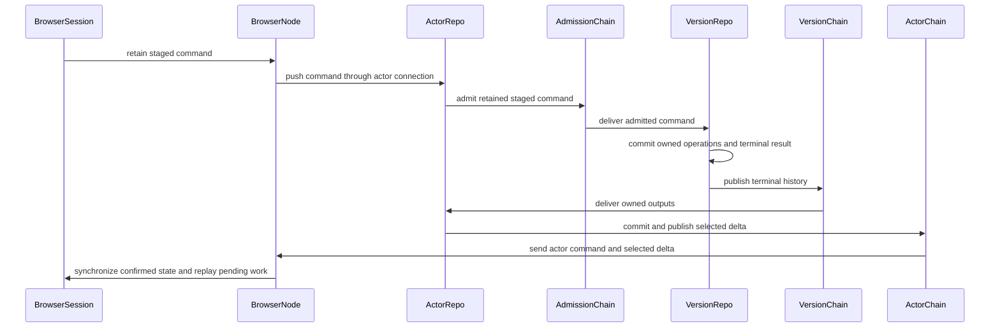

# Command history and projections

Admitted commands feed version-owned execution. Terminal histories feed actor projections, and actor output histories feed browser nodes and sessions.

## Annotated workflow steps

1. Session staging saves its optimistic operations and original staging result.
   - [`executeCommandTx.ts:207-228`](../../packages/core/src/aggregateSession/stageCommand/executeCommandTx/executeCommandTx.ts#L207-L228) — retains staging result and ordered optimistic operations. (`packages/core/src/aggregateSession/stageCommand/executeCommandTx/executeCommandTx.ts:207-228`)
2. The node owns durable ordered push and server synchronization.
   - [`NodeSynchronization.ts:338-357`](../../packages/browser/src/Node/NodeSynchronization.ts#L338-L357) — sends the staged command over the bound socket. (`packages/browser/src/Node/NodeSynchronization.ts:338-357`)
3. Actor staging retains prepared operations and durable admission work.
   - [`stageActorCommands.ts:301-330`](../../packages/system-worker/src/AggregateActorVersionRepo/optimistic/stageActorCommands.ts#L301-L330) — retains prepared operations and admission outbox work. (`packages/system-worker/src/AggregateActorVersionRepo/optimistic/stageActorCommands.ts:301-330`)
4. Admission history fans out to version materializers.
   - [`AggregateChain.ts:70-87`](../../packages/system-worker/src/AggregateChain/AggregateChain.ts#L70-L87) — binds command paging and materializer destinations. (`packages/system-worker/src/AggregateChain/AggregateChain.ts:70-87`)
5. Resource application, terminal history and outbox work commit synchronously.
   - [`executeCommandsTx.ts:300-327`](../../packages/system-worker/src/AggregateVersionRepo/executeCommands/executeCommandsTx.ts#L300-L327) — retains terminal publication intent with the command. (`packages/system-worker/src/AggregateVersionRepo/executeCommands/executeCommandsTx.ts:300-327`)
6. Version history retains complete terminal commands and owned operations.
   - [`receiveExecutedCommands.ts:180-184`](../../packages/system-worker/src/AggregateVersionChain/receiveExecutedCommands/receiveExecutedCommands.ts#L180-L184) — inserts terminal history and owned operation rows. (`packages/system-worker/src/AggregateVersionChain/receiveExecutedCommands/receiveExecutedCommands.ts:180-184`)
7. Actor projection replays committed owned operations.
   - [`applyExecutedCommandsTx.ts:123-145`](../../packages/system-worker/src/AggregateActorVersionRepo/applyExecutedCommands/applyExecutedCommandsTx.ts#L123-L145) — binds exact model version and applies owned operations. (`packages/system-worker/src/AggregateActorVersionRepo/applyExecutedCommands/applyExecutedCommandsTx.ts:123-145`)
8. Selected delta and projection checkpoint commit together.
   - [`commitActorProjectionTx.ts:105-121`](../../packages/system-worker/src/AggregateActorVersionRepo/commitActorProjectionTx/commitActorProjectionTx.ts#L105-L121) — inserts browser output and advances actor checkpoint. (`packages/system-worker/src/AggregateActorVersionRepo/commitActorProjectionTx/commitActorProjectionTx.ts:105-121`)
9. Actor history preserves selected delivery and private command outcomes.
   - [`getActorOutputs.ts:56-83`](../../packages/system-worker/src/AggregateActorVersionChain/getActorOutputs/getActorOutputs.ts#L56-L83) — pages retained browser outputs and missing private completions. (`packages/system-worker/src/AggregateActorVersionChain/getActorOutputs/getActorOutputs.ts:56-83`)
10. Browser replay keeps the original staging result while rebuilding optimism.
    - [`replayPendingCommandsTx.ts:115-126`](../../packages/core/src/aggregateSession/replayPendingCommandsTx.ts#L115-L126) — reapplies prepared optimistic operations in the replay transaction. (`packages/core/src/aggregateSession/replayPendingCommandsTx.ts:115-126`)

Services use the same owned-execution → version-history → actor-projection → session boundary. Async-contract WIP remains independent. Changed fixed schemas require empty storage.
