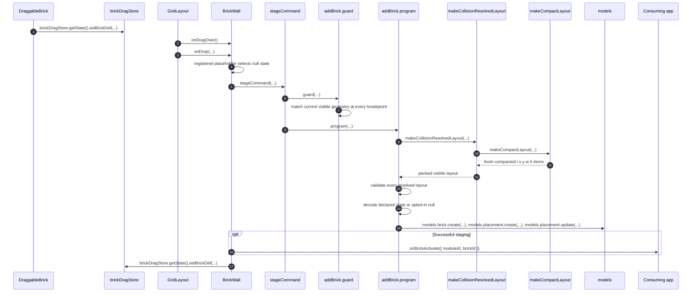

# Library brick drop

Catalog tiles place a brick onto `BrickWall` through Library's persisted standalone
session or App's live user session and the shared `addBrick` contract. HTML5 `dragover` cannot read
custom MIME, so the live payload is the module-level Zustand singleton
`brickDragStore` (`brickDef` / `setBrickDef` only). Placement column shape is
[LibraryGridItem](LibraryGridItem.md).

The shared `IDraggedBrick` payload retains a registered module ID from all four
drag sources. The view registry preserves the relationship between its keys,
module IDs, and definition IDs, so drop needs no separate module ID guard.
Module defaults and preview updates discard undeclared state fields. The command
guard validates declared fields, and the program decodes and saves the resulting
state, stripping extras from any caller. Invalid declared fields still fail.

A module opts into unconfigured bricks with backend `hasPlaceholder: true` and
view `default.placeholder`. `makeModuleView` rejects either declaration mismatch.
Image currently opts in with a full-size shadcn Skeleton. A new drop of an opted-in
module sends null instead of copying the preview state; the spec and sizes remain
unchanged. The JSON payload codec encodes null as JSON for the existing non-nullable
descriptors, then guards and programs accept it only for opted-in modules.
Descriptor shapes remain unchanged, preserving the standalone backup definition key. The existing
JSON state column stores the encoded JSON null without a storage migration.

## Trigger

1. Each app waits for its session and wall before rendering the shared grid.
   1. Library workbench: module-level `librarySession` + `useInitializeStandaloneSession`,
      then `LibrarySessionContext`; reset replaces the `qrk-library` backup with
      the empty seeded wall and clears its command history. App document keys
      and backend storage are outside this reset.
   2. App: authenticated `userSession` owns user/site/page and Library rows.
      `Grid` reads the current page with `useLiveQuery` and uses its `wallId`.
      The document key `JSON.stringify(["app", user.id, siteId, pageId])`
      keys the viewport provider; App does not construct a standalone session.
2. A catalog tile starts an HTML5 drag and writes `brickDragStore` before
   RGL sees `dragover`. Each source first resolves the declared or measured
   default `{ w, h }` for all four breakpoints using its current state and spec.
   Measured widths are limited to the wall's eight columns.
   Dragging remains disabled until every size is available.
   1. Library and App filmstrip: shared `ModuleFilmstrip` → `ModulePreview` → `DraggableBrick`.
   2. Library module breakpoint preview: `-BreakpointPreviewRow`.
   3. App module detail: `ModuleRoute`.

`addBrick` is a fresh `1.0.0` baseline with no historical payload adapter.
The payload contains `wallId`, `brickId`, `moduleId`, `state`, `spec`,
`dropPosition: { x, y }`, four `placementSizes`, and four `visibleLayouts`.
RGL uses `verticalCompactor` for drag/resize feedback. The grid preview may differ
from the committed result: every breakpoint is resolved by the contract using
stored placement snapshots, then vertically compacted. Catalog drags defer the
wall's automatic normalization of existing gaps until completion or cancellation.



## Annotated workflow steps

1. Drag start supplies all four measured or declared sizes.
   - [`DraggableBrick.tsx:30-38`](../../../apps/library/lib/DraggableBrick.tsx#L30-L38) — enables dragging only with a complete definition, then clones and publishes it. (`apps/library/lib/DraggableBrick.tsx:30-38`)
2. Hover reads the live definition and returns the active drag-preview size.
   - [`BrickWall.tsx:294-301`](../../../apps/library/lib/BrickWall.tsx#L294-L301) — missing drag data returns false. (`apps/library/lib/BrickWall.tsx:294-301`)
3. Drop uses the grid item position and reads the typed drag definition again.
   - [`BrickWall.tsx:303-309`](../../../apps/library/lib/BrickWall.tsx#L303-L309) — requires both an item and drag data. (`apps/library/lib/BrickWall.tsx:303-309`)
4. A registered placeholder selects null; otherwise the dragged state is cloned.
   - [`BrickWall.tsx:328-332`](../../../apps/library/lib/BrickWall.tsx#L328-L332) — preserves the dragged spec while selecting the new brick state. (`apps/library/lib/BrickWall.tsx:328-332`)
5. The caller snapshots visible layouts and stages addBrick with all placement sizes.
   - [`BrickWall.tsx:311-337`](../../../apps/library/lib/BrickWall.tsx#L311-L337) — supplies fresh brick identity, state, spec, position, sizes, and stored layout snapshots. (`apps/library/lib/BrickWall.tsx:311-337`)
6. The guard validates identity, module state or permitted null, strict spec, coordinates, and dimensions.
   - [`AddBrickContractV1.ts:98-187`](../../../apps/library/libraryModule/contracts/addBrick/AddBrickContractV1.ts#L98-L187) — rejects invalid input before any mutation. (`apps/library/libraryModule/contracts/addBrick/AddBrickContractV1.ts:98-187`)
7. Visible snapshots must match stored geometry exactly at every breakpoint.
   - [`AddBrickContractV1.ts:189-239`](../../../apps/library/libraryModule/contracts/addBrick/AddBrickContractV1.ts#L189-L239) — rejects duplicates, omissions, stale geometry, and extra items. (`apps/library/libraryModule/contracts/addBrick/AddBrickContractV1.ts:189-239`)
8. The named program receives the validated payload and model mutation interfaces.
   - [`AddBrickContractV1.ts:241-250`](../../../apps/library/libraryModule/contracts/addBrick/AddBrickContractV1.ts#L241-L250) — owns brick creation and placement updates. (`apps/library/libraryModule/contracts/addBrick/AddBrickContractV1.ts:241-250`)
9. The program constructs the incoming item separately for every breakpoint.
   - [`AddBrickContractV1.ts:251-260`](../../../apps/library/libraryModule/contracts/addBrick/AddBrickContractV1.ts#L251-L260) — combines brickId, dropPosition, and breakpoint size. (`apps/library/libraryModule/contracts/addBrick/AddBrickContractV1.ts:251-260`)
10. Collision resolution closes gaps after bounding and displacing neighbors.
    - [`resolveVisibleCollisions.ts:20-44`](../../../apps/library/libraryModule/resolveVisibleCollisions.ts#L20-L44) — clones inputs, corrects bounds, pushes overlapping neighbors, then calls `makeCompactLayout`. (`apps/library/libraryModule/resolveVisibleCollisions.ts:20-44`)
11. Vertical compaction returns fresh persisted geometry.
    - [`resolveVisibleCollisions.ts:74-76`](../../../apps/library/libraryModule/resolveVisibleCollisions.ts#L74-L76) — compacts a cloned layout and projects `i/x/y/w/h`. (`apps/library/libraryModule/resolveVisibleCollisions.ts:74-76`)
12. The resolver returns the packed breakpoint layout.
    - [`resolveVisibleCollisions.ts:44`](../../../apps/library/libraryModule/resolveVisibleCollisions.ts#L44) — returns the compacted collision result. (`apps/library/libraryModule/resolveVisibleCollisions.ts:44`)
13. All resolved layouts are checked before any mutation is constructed.
    - [`AddBrickContractV1.ts:261-273`](../../../apps/library/libraryModule/contracts/addBrick/AddBrickContractV1.ts#L261-L273) — fails before brick creation when a resolved layout is invalid. (`apps/library/libraryModule/contracts/addBrick/AddBrickContractV1.ts:261-273`)
14. The program decodes state again, admitting null only for hasPlaceholder modules.
    - [`AddBrickContractV1.ts:275-287`](../../../apps/library/libraryModule/contracts/addBrick/AddBrickContractV1.ts#L275-L287) — ignores undeclared non-null state fields and clones the decoded state and spec. (`apps/library/libraryModule/contracts/addBrick/AddBrickContractV1.ts:275-287`)
15. Create the brick and four placements, updating only changed visible neighbors.
    - [`AddBrickContractV1.ts:288-335`](../../../apps/library/libraryModule/contracts/addBrick/AddBrickContractV1.ts#L288-L335) — saves null or configured state and preserves hidden or unchanged placements. (`apps/library/libraryModule/contracts/addBrick/AddBrickContractV1.ts:288-335`)
16. Successful staging activates the new brick through the consuming app's existing detail callback; failures are presented without activation.
    - [`BrickWall.tsx:339-350`](../../../apps/library/lib/BrickWall.tsx#L339-L350) — reports command failures or calls `onBrickActivate` with the new module and brick IDs. (`apps/library/lib/BrickWall.tsx:339-350`)
17. The completed drag definition is cleared.
    - [`BrickWall.tsx:351-355`](../../../apps/library/lib/BrickWall.tsx#L351-L355) — clears the completed drag while preserving any replacement drag payload. (`apps/library/lib/BrickWall.tsx:351-355`)

## Placeholder rendering and state updates

The shared module renderer checks exact null before authored decoding or JSON-render
execution. Wall and detail consumers also accept a structurally valid empty spec
when a registered placeholder is being rendered. This does not relax command spec
validation. Non-null values, including empty objects and strings, follow normal
rendering and validation. Preview examples and existing configured bricks remain
unchanged.

```tsx
// Backend-safe declaration on Image's version.
hasPlaceholder: true,

// Matching view markup; one display-only placeholder for every breakpoint.
placeholder() {
  return <Skeleton className="size-full" />;
},
```

Library's existing JSON state editor calls `updateBrickState`: saving a valid Image
state replaces the skeleton, and saving null restores it without changing specs or
placement. Other modules reject null. App's brick detail consumes the same
renderer; this feature adds no editing UI there.
