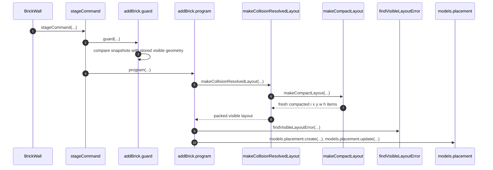
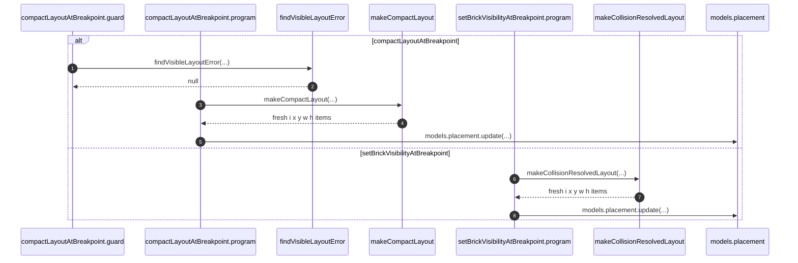
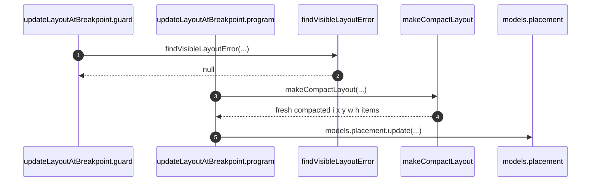
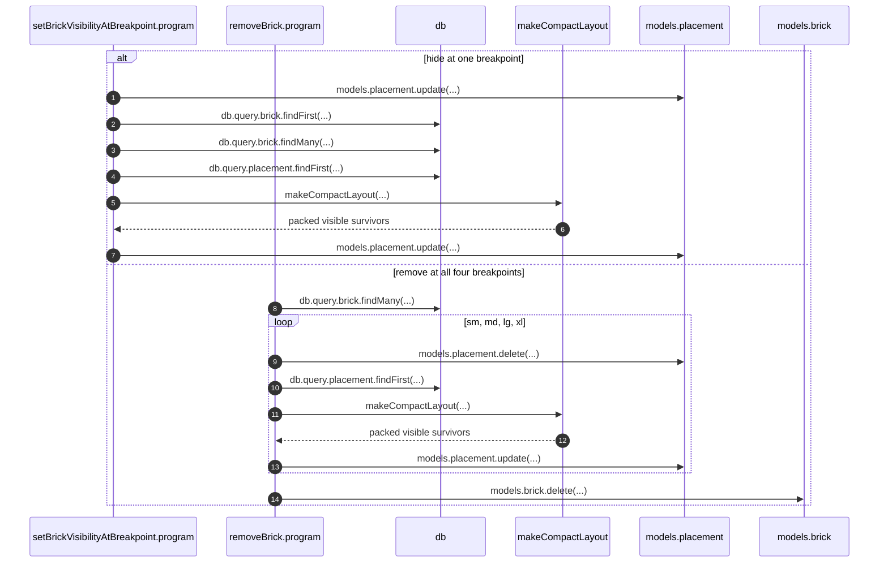

# Library placement gridItem

`placement.gridItem` is JSON `{ i, x, y, w, h }`. Session live queries decode
these values before rendering. RGL working objects may include additional fields;
`makeGridItem`, `makeCollisionResolvedLayout`, and `makeCompactLayout` return only
the five persisted geometry fields. See [LibraryBrickDrop](LibraryBrickDrop.md)
for the full drag lifecycle and fresh contract baseline.

## Trigger

1. `BrickWall.visibleLayoutAt` filters decoded session placements by wall,
   visibility, and breakpoint, then picks the five fields for rendering and
   `addBrick.visibleLayouts` snapshots.
2. `addBrick.program` resolves all four layouts from `dropPosition`,
   `placementSizes`, and validated snapshots before creating placements.
3. RGL's `verticalCompactor` packs drag/resize feedback; stop handlers retain
   their payload interface and stage `updateLayoutAtBreakpoint`.
4. Each mounted `BrickWall`, including inactive panes, checks stored visible
   geometry for gaps and stages `compactLayoutAtBreakpoint` only when packing
   changes it. Grid gestures and catalog drags defer this normalization.
5. Module contracts own saved compaction: add/show after collision resolution,
   update/compact before saving, hide at its breakpoint, and remove at all four
   breakpoints. Unchanged placements and hidden geometry remain untouched.

## Annotated workflow steps

1. The caller stages add with decoded visible placements from the session. It ignores the grid's proposed neighbor positions.
   - [`BrickWall.tsx:180-192`](../../../apps/library/lib/BrickWall.tsx#L180-L192) — filters and picks stored geometry. (`apps/library/lib/BrickWall.tsx:180-192`)
   - [`BrickWall.tsx:313-337`](../../../apps/library/lib/BrickWall.tsx#L313-L337) — stages `addBrick` with all four snapshots. (`apps/library/lib/BrickWall.tsx:313-337`)
2. Staging invokes the add guard before its program.
   - [`AddBrickContractV1.ts:98-187`](../../../apps/library/libraryModule/contracts/addBrick/AddBrickContractV1.ts#L98-L187) — validates identity, state, spec, coordinates, and dimensions. (`apps/library/libraryModule/contracts/addBrick/AddBrickContractV1.ts:98-187`)
3. The guard requires exact membership and geometry, independent of array order; stale snapshots fail with conflict 409.
   - [`AddBrickContractV1.ts:205-225`](../../../apps/library/libraryModule/contracts/addBrick/AddBrickContractV1.ts#L205-L225) — compares every stored item against the snapshot. (`apps/library/libraryModule/contracts/addBrick/AddBrickContractV1.ts:205-225`)
4. The validated payload enters the named add program.
   - [`AddBrickContractV1.ts:241-250`](../../../apps/library/libraryModule/contracts/addBrick/AddBrickContractV1.ts#L241-L250) — receives payload and model mutation interfaces. (`apps/library/libraryModule/contracts/addBrick/AddBrickContractV1.ts:241-250`)
5. The program uses the same drop coordinates with each breakpoint's own measured or declared size.
   - [`AddBrickContractV1.ts:251-260`](../../../apps/library/libraryModule/contracts/addBrick/AddBrickContractV1.ts#L251-L260) — constructs four incoming items. (`apps/library/libraryModule/contracts/addBrick/AddBrickContractV1.ts:251-260`)
6. The resolver corrects eight-column bounds, settles downward cascades, then compacts the resulting layout.
   - [`resolveVisibleCollisions.ts:20-44`](../../../apps/library/libraryModule/resolveVisibleCollisions.ts#L20-L44) — clones inputs, resolves collisions, and delegates to `makeCompactLayout`. (`apps/library/libraryModule/resolveVisibleCollisions.ts:20-44`)
7. Vertical compaction returns fresh five-field objects without mutating input geometry.
   - [`resolveVisibleCollisions.ts:74-76`](../../../apps/library/libraryModule/resolveVisibleCollisions.ts#L74-L76) — compacts a clone and projects `i/x/y/w/h`. (`apps/library/libraryModule/resolveVisibleCollisions.ts:74-76`)
8. The resolver returns the packed visible layout to the program.
   - [`resolveVisibleCollisions.ts:44`](../../../apps/library/libraryModule/resolveVisibleCollisions.ts#L44) — returns `makeCompactLayout(working)`. (`apps/library/libraryModule/resolveVisibleCollisions.ts:44`)
9. The program validates each resolved layout before constructing mutations.
   - [`AddBrickContractV1.ts:261-273`](../../../apps/library/libraryModule/contracts/addBrick/AddBrickContractV1.ts#L261-L273) — checks all four outputs. (`apps/library/libraryModule/contracts/addBrick/AddBrickContractV1.ts:261-273`)
10. New placements receive the resolved items directly. Only changed visible neighbors are updated; hidden placements stay untouched.
    - [`AddBrickContractV1.ts:297-335`](../../../apps/library/libraryModule/contracts/addBrick/AddBrickContractV1.ts#L297-L335) — creates placements and skips unchanged neighbors. (`apps/library/libraryModule/contracts/addBrick/AddBrickContractV1.ts:297-335`)

## Existing layout normalization

Every mounted wall checks its current database baseline, independent of `isActive`.
The effect waits for grid gestures and catalog drags to finish, compares compacted
geometry by brick ID, and stages the existing compact contract only when changed.
Library and Studio pass their shared viewport `gridGesture` as `gridGestureActive`,
so a gesture in the active wall also defers normalization in the inactive panes.
It records the sorted snapshot before staging, so a failed attempt reports through
`onCommandError` (or the existing alert fallback) without repeated retries on the
same input. Observing a packed layout clears that attempt, allowing a later reset
or restored layout to normalize again.

- [`BrickWall.tsx:92-117`](../../../apps/library/lib/BrickWall.tsx#L92-L117) — defers active gestures/drags, then selects current wall-visible placements from stored rows. (`apps/library/lib/BrickWall.tsx:92-117`)
- [`BrickWall.tsx:118-154`](../../../apps/library/lib/BrickWall.tsx#L118-L154) — compares geometry, suppresses repeated snapshots, stages compaction, and reports failures. (`apps/library/lib/BrickWall.tsx:118-154`)
- [`LibraryLayout.tsx:373`](../../../apps/library/app/LibraryLayout.tsx#L373) — passes the viewport's shared grid gesture to every wall. (`apps/library/app/LibraryLayout.tsx:373`)
- [`Grid.tsx:92`](../../../apps/studio/app/[username]/site/[siteId]/page/[pageId]/Grid.tsx#L92) — passes Studio's shared grid gesture to every wall. (`apps/studio/app/[username]/site/[siteId]/page/[pageId]/Grid.tsx:92`)

## Annotated workflow steps

1. Compact validate rejects an overlapping or out-of-bounds visible layout.
   - [`CompactLayoutAtBreakpointContractV1.ts:136-145`](../../../apps/library/libraryModule/contracts/compactLayoutAtBreakpoint/CompactLayoutAtBreakpointContractV1.ts#L136-L145) — `findVisibleLayoutError` on `payload.visibleLayout`. (`apps/library/libraryModule/contracts/compactLayoutAtBreakpoint/CompactLayoutAtBreakpointContractV1.ts:136-145`)
2. Validate returns `null` when the visible layout is clear.
   - [`resolveVisibleCollisions.ts:48-67`](../../../apps/library/libraryModule/resolveVisibleCollisions.ts#L48-L67) — returns `null` when bounded visible items have no duplicate identities or collisions. (`apps/library/libraryModule/resolveVisibleCollisions.ts:48-67`)
3. Compact runs RGL's vertical compactor on a cloned layout.
   - [`CompactLayoutAtBreakpointContractV1.ts:151`](../../../apps/library/libraryModule/contracts/compactLayoutAtBreakpoint/CompactLayoutAtBreakpointContractV1.ts#L151) — `makeCompactLayout(payload.visibleLayout)`. (`apps/library/libraryModule/contracts/compactLayoutAtBreakpoint/CompactLayoutAtBreakpointContractV1.ts:151`)
   - [`resolveVisibleCollisions.ts:75`](../../../apps/library/libraryModule/resolveVisibleCollisions.ts#L75) — `verticalCompactor.compact(cloneLayout(layout), GRID_COLS)`. (`apps/library/libraryModule/resolveVisibleCollisions.ts:75`)
4. The constructor returns fresh five-field objects in compacted order.
   - [`resolveVisibleCollisions.ts:76`](../../../apps/library/libraryModule/resolveVisibleCollisions.ts#L76) — projects each compacted item; an empty result maps to a fresh empty array. (`apps/library/libraryModule/resolveVisibleCollisions.ts:76`)
5. Compact writes only geometry that differs from stored placement rows.
   - [`CompactLayoutAtBreakpointContractV1.ts:152-176`](../../../apps/library/libraryModule/contracts/compactLayoutAtBreakpoint/CompactLayoutAtBreakpointContractV1.ts#L152-L176) — compares by identity and all geometry fields before updating. (`apps/library/libraryModule/contracts/compactLayoutAtBreakpoint/CompactLayoutAtBreakpointContractV1.ts:152-176`)
6. Showing a hidden brick resolves collisions and compacts the affected breakpoint.
   - [`SetBrickVisibilityAtBreakpointContractV1.ts:286-289`](../../../apps/library/libraryModule/contracts/setBrickVisibilityAtBreakpoint/SetBrickVisibilityAtBreakpointContractV1.ts#L286-L289) — inserts the cloned saved geometry alongside other visible placements. (`apps/library/libraryModule/contracts/setBrickVisibilityAtBreakpoint/SetBrickVisibilityAtBreakpointContractV1.ts:286-289`)
   - [`SetBrickVisibilityAtBreakpointContractV1.ts:196-209`](../../../apps/library/libraryModule/contracts/setBrickVisibilityAtBreakpoint/SetBrickVisibilityAtBreakpointContractV1.ts#L196-L209) — guard also constructs and validates the packed output. (`apps/library/libraryModule/contracts/setBrickVisibilityAtBreakpoint/SetBrickVisibilityAtBreakpointContractV1.ts:196-209`)
7. The constructor returns packed five-field geometry for the shown brick and its
   visible neighbors.
   - [`resolveVisibleCollisions.ts:44`](../../../apps/library/libraryModule/resolveVisibleCollisions.ts#L44) — returns the compacted resolved layout. (`apps/library/libraryModule/resolveVisibleCollisions.ts:44`)
8. The shown brick becomes visible with packed geometry; neighbors update only when their stored geometry changes.
   - [`SetBrickVisibilityAtBreakpointContractV1.ts:291-329`](../../../apps/library/libraryModule/contracts/setBrickVisibilityAtBreakpoint/SetBrickVisibilityAtBreakpointContractV1.ts#L291-L329) — show writes `isVisible` and `gridItem`, then skips unchanged neighbors. (`apps/library/libraryModule/contracts/setBrickVisibilityAtBreakpoint/SetBrickVisibilityAtBreakpointContractV1.ts:291-329`)

## Annotated workflow steps

1. Update validate rejects an overlapping or out-of-bounds drag/resize layout.
   - [`UpdateLayoutAtBreakpointContractV1.ts:136-145`](../../../apps/library/libraryModule/contracts/updateLayoutAtBreakpoint/UpdateLayoutAtBreakpointContractV1.ts#L136-L145) — `findVisibleLayoutError` on `payload.layout`. (`apps/library/libraryModule/contracts/updateLayoutAtBreakpoint/UpdateLayoutAtBreakpointContractV1.ts:136-145`)
2. Validate returns `null` when the payload layout is clear.
   - [`resolveVisibleCollisions.ts:48-67`](../../../apps/library/libraryModule/resolveVisibleCollisions.ts#L48-L67) — returns `null` when bounded visible items have no duplicate identities or collisions. (`apps/library/libraryModule/resolveVisibleCollisions.ts:48-67`)
3. The program compacts the validated drag/resize payload.
   - [`UpdateLayoutAtBreakpointContractV1.ts:151`](../../../apps/library/libraryModule/contracts/updateLayoutAtBreakpoint/UpdateLayoutAtBreakpointContractV1.ts#L151) — calls `makeCompactLayout(payload.layout)`. (`apps/library/libraryModule/contracts/updateLayoutAtBreakpoint/UpdateLayoutAtBreakpointContractV1.ts:151`)
4. The constructor returns only persisted geometry fields.
   - [`resolveVisibleCollisions.ts:74-76`](../../../apps/library/libraryModule/resolveVisibleCollisions.ts#L74-L76) — clones, vertically compacts, then projects `i/x/y/w/h`. (`apps/library/libraryModule/resolveVisibleCollisions.ts:74-76`)
5. The program clones and writes only compacted items whose geometry differs from storage.
   - [`UpdateLayoutAtBreakpointContractV1.ts:152-176`](../../../apps/library/libraryModule/contracts/updateLayoutAtBreakpoint/UpdateLayoutAtBreakpointContractV1.ts#L152-L176) — compares stored geometry and skips unchanged placements. (`apps/library/libraryModule/contracts/updateLayoutAtBreakpoint/UpdateLayoutAtBreakpointContractV1.ts:152-176`)

## Hide and remove

Contract operations accumulate before application. Survivor queries therefore
exclude the target explicitly rather than assuming an emitted update/delete has
already changed the database. Hidden survivors retain their geometry and Specs.

## Annotated workflow steps

1. Hide emits only the target's visibility change, retaining its saved grid item and Spec.
   - [`SetBrickVisibilityAtBreakpointContractV1.ts:220-229`](../../../apps/library/libraryModule/contracts/setBrickVisibilityAtBreakpoint/SetBrickVisibilityAtBreakpointContractV1.ts#L220-L229) — updates `isVisible: false`. (`apps/library/libraryModule/contracts/setBrickVisibilityAtBreakpoint/SetBrickVisibilityAtBreakpointContractV1.ts:220-229`)
2. The program reads the target's stored brick row to identify its wall.
   - [`SetBrickVisibilityAtBreakpointContractV1.ts:231-235`](../../../apps/library/libraryModule/contracts/setBrickVisibilityAtBreakpoint/SetBrickVisibilityAtBreakpointContractV1.ts#L231-L235) — queries by `payload.brickId`. (`apps/library/libraryModule/contracts/setBrickVisibilityAtBreakpoint/SetBrickVisibilityAtBreakpointContractV1.ts:231-235`)
3. The program reads only bricks on the target's wall.
   - [`SetBrickVisibilityAtBreakpointContractV1.ts:237-239`](../../../apps/library/libraryModule/contracts/setBrickVisibilityAtBreakpoint/SetBrickVisibilityAtBreakpointContractV1.ts#L237-L239) — filters bricks by stored `wallId`. (`apps/library/libraryModule/contracts/setBrickVisibilityAtBreakpoint/SetBrickVisibilityAtBreakpointContractV1.ts:237-239`)
4. It collects stored visible placements at the affected breakpoint, excluding the target explicitly.
   - [`SetBrickVisibilityAtBreakpointContractV1.ts:240-254`](../../../apps/library/libraryModule/contracts/setBrickVisibilityAtBreakpoint/SetBrickVisibilityAtBreakpointContractV1.ts#L240-L254) — skips `payload.brickId` before querying survivor placements. (`apps/library/libraryModule/contracts/setBrickVisibilityAtBreakpoint/SetBrickVisibilityAtBreakpointContractV1.ts:240-254`)
5. The hide program compacts the visible survivors.
   - [`SetBrickVisibilityAtBreakpointContractV1.ts:256-258`](../../../apps/library/libraryModule/contracts/setBrickVisibilityAtBreakpoint/SetBrickVisibilityAtBreakpointContractV1.ts#L256-L258) — compacts survivor grid items from stored rows. (`apps/library/libraryModule/contracts/setBrickVisibilityAtBreakpoint/SetBrickVisibilityAtBreakpointContractV1.ts:256-258`)
6. Compaction returns fresh five-field geometry for those survivors.
   - [`resolveVisibleCollisions.ts:74-76`](../../../apps/library/libraryModule/resolveVisibleCollisions.ts#L74-L76) — returns projected compacted items. (`apps/library/libraryModule/resolveVisibleCollisions.ts:74-76`)
7. Hide updates only survivors whose stored geometry changed.
   - [`SetBrickVisibilityAtBreakpointContractV1.ts:259-281`](../../../apps/library/libraryModule/contracts/setBrickVisibilityAtBreakpoint/SetBrickVisibilityAtBreakpointContractV1.ts#L259-L281) — compares all geometry fields and skips unchanged rows. (`apps/library/libraryModule/contracts/setBrickVisibilityAtBreakpoint/SetBrickVisibilityAtBreakpointContractV1.ts:259-281`)
8. Remove reads stored wall bricks and excludes the target before any emitted deletion.
   - [`RemoveBrickContractV1.ts:83-87`](../../../apps/library/libraryModule/contracts/removeBrick/RemoveBrickContractV1.ts#L83-L87) — builds the survivor list from stored rows. (`apps/library/libraryModule/contracts/removeBrick/RemoveBrickContractV1.ts:83-87`)
9. Remove emits deletion of the target placement at each breakpoint.
   - [`RemoveBrickContractV1.ts:89-95`](../../../apps/library/libraryModule/contracts/removeBrick/RemoveBrickContractV1.ts#L89-L95) — loops over all four placement IDs. (`apps/library/libraryModule/contracts/removeBrick/RemoveBrickContractV1.ts:89-95`)
10. It collects stored visible survivor placements independently at each breakpoint.
    - [`RemoveBrickContractV1.ts:97-105`](../../../apps/library/libraryModule/contracts/removeBrick/RemoveBrickContractV1.ts#L97-L105) — keeps only visible placements for the prefiltered wall bricks. (`apps/library/libraryModule/contracts/removeBrick/RemoveBrickContractV1.ts:97-105`)
11. The remove program compacts that breakpoint's visible survivors.
    - [`RemoveBrickContractV1.ts:107-109`](../../../apps/library/libraryModule/contracts/removeBrick/RemoveBrickContractV1.ts#L107-L109) — passes stored survivor geometry to `makeCompactLayout`. (`apps/library/libraryModule/contracts/removeBrick/RemoveBrickContractV1.ts:107-109`)
12. Compaction returns fresh five-field survivor geometry.
    - [`resolveVisibleCollisions.ts:74-76`](../../../apps/library/libraryModule/resolveVisibleCollisions.ts#L74-L76) — clones the input before vertical compaction. (`apps/library/libraryModule/resolveVisibleCollisions.ts:74-76`)
13. Remove updates only survivors whose geometry changed.
    - [`RemoveBrickContractV1.ts:110-129`](../../../apps/library/libraryModule/contracts/removeBrick/RemoveBrickContractV1.ts#L110-L129) — compares stored geometry before emitting placement updates. (`apps/library/libraryModule/contracts/removeBrick/RemoveBrickContractV1.ts:110-129`)
14. After all breakpoint operations, remove emits deletion of the brick row.
    - [`RemoveBrickContractV1.ts:133-135`](../../../apps/library/libraryModule/contracts/removeBrick/RemoveBrickContractV1.ts#L133-L135) — deletes `payload.brickId`. (`apps/library/libraryModule/contracts/removeBrick/RemoveBrickContractV1.ts:133-135`)

## Callers

| Direction                                | Symbol                        | Owner                                                                                                                                                    |
| ---------------------------------------- | ----------------------------- | -------------------------------------------------------------------------------------------------------------------------------------------------------- |
| RGL item → five fields (UI payload)      | `makeGridItem`                | local in [`BrickWall.tsx`](../../../apps/library/lib/BrickWall.tsx)                                                                                      |
| collision resolution → five-field layout | `makeCollisionResolvedLayout` | [`resolveVisibleCollisions.ts`](../../../apps/library/libraryModule/resolveVisibleCollisions.ts)                                                         |
| compaction → five-field layout           | `makeCompactLayout`           | [`resolveVisibleCollisions.ts`](../../../apps/library/libraryModule/resolveVisibleCollisions.ts)                                                         |
| visible layout → error or null           | `findVisibleLayoutError`      | [`resolveVisibleCollisions.ts`](../../../apps/library/libraryModule/resolveVisibleCollisions.ts)                                                         |

`updateLayoutAtBreakpoint` payload items are already `makeGridItem`'d by
BrickWall. Add, show, compact, hide, and remove persist layout-constructor outputs
directly. `updateLayoutAtBreakpoint` compacts its payload before cloning and saving
the output. All geometry writes skip unchanged placements.
